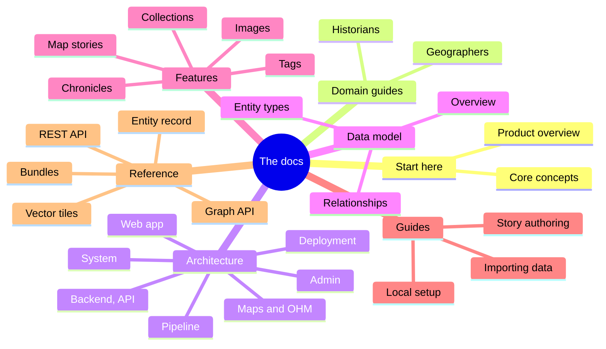

# History Mapped documentation

History Mapped is an open atlas of world history. States, people, battles, places and ideas are
**entities** with dates, a location and typed links to one another. They are drawn on a map whose
borders change with the year you pick. These docs explain what the product is, how the history is
modelled, and how the system is built and run.

> Last reviewed against the code: 2026-11-14. If a page and the code disagree, the code is right.
> Please report the mismatch, or fix it with **Edit on GitHub** at the bottom of each page.

## Start with your role

| You are… | Read first | Then |
|---|---|---|
| **New to the project** (any role) | [What is History Mapped?](overview/product-overview.md) | [Core concepts](overview/concepts.md) |
| **Business, product, partners** | [What is History Mapped?](overview/product-overview.md) | [Map stories](architecture/map-stories.md) · [Data pipeline](architecture/data-pipeline.md) (how the content is produced) |
| **Historian, editor, researcher** | [For historians](entity-model/for-historians.md) | [Core concepts](overview/concepts.md) · [Relationship types](entity-model/relationships.md) · [Entity types](entity-model/entity-specification.md) |
| **Geographer, GIS, cartographer** | [For geographers](entity-model/for-geodata-contributors.md) | [Maps, tiles and OHM](architecture/ohm-integration.md) · [Atlas vector tiles](schemas/atlas-tiles.md) |
| **Developer** | [System overview](architecture/system-overview.md) | [Local setup](implementation-docs/setup.md) · [Backend and API](architecture/backend.md) · [Public web app](architecture/frontend-app.md) · [MCP connector](architecture/mcp-connector.md) · [Talk with people](architecture/talk-with-people.md) |
| **Data contributor / operator** | [Data pipeline](architecture/data-pipeline.md) | [Importing data](implementation-docs/data-contributor-guide.md) · [Deployment and operations](architecture/deployment.md) · [Scalability benchmark](architecture/scalability.md) |

## What is in these docs



The sidebar lists the same sections. They are ordered from the broad picture to the detail, so
reading top to bottom works:

1. **Start here.** What the product does, for whom, and the ten terms used everywhere else.
2. **Domain guides.** How the model fits historical and geographical knowledge. No code needed.
3. **Architecture.** The running system, one page per part, with diagrams.
4. **Data model.** The tables behind every entity, relationship, chronicle and border.
5. **Features.** Chronicles, map stories, tags, collections and images, each from data to screen.
6. **Guides.** Step-by-step tasks: run the stack, import data, author a map story.
7. **Reference.** Contracts: the REST API, the vector tiles and the pipeline file formats.

## For maintainers: the `docs/` folder

Only the pages in the sidebar are published on the site, and they are listed in
[`web/src/content/docs/manifest.ts`](../web/src/content/docs/manifest.ts). Everything else in
`docs/` is internal: runbooks, plans, design specs and the archive. On GitHub it reads like any
other folder.

| Folder | What it holds | Published |
|---|---|---|
| [`overview/`](overview/) | Product overview and core concepts | yes |
| [`architecture/`](architecture/) | How each part is built | yes |
| [`entity-model/`](entity-model/) | The canonical data model; [`entity-specification.md`](entity-model/entity-specification.md) is the source of truth for types | mostly |
| [`schemas/`](schemas/) | Contracts: API payloads, tiles, pipeline artifacts | some |
| [`implementation-docs/`](implementation-docs/) | Operator runbooks and how-to guides | guides only |
| [`plans/`](plans/) | Live roadmap; [`STATUS.md`](plans/STATUS.md) is the verified status of every plan | no |
| [`superpowers/`](superpowers/) | Design specs and implementation plans for the current cycle | no |
| [`reference/`](reference/) | Forward-looking design references, **not** the live app | no |
| [`archive/`](archive/) | Shipped or superseded documents, kept as history | no |
| [`TODO.md`](TODO.md) | Engineering backlog not owned by a plan | no |

**Adding a published page:** write it under `docs/`, then add an entry to the manifest **and** to the
`import.meta.glob` list in `web/src/lib/docs/load.ts`. A test keeps the two in sync. Runbooks, plans,
specs, `reference/` and the archive are never published.

**Writing conventions:**

- Open with two or three sentences on what the page covers and who it is for. Then put a diagram
  first, and prose after it.
- Prefer tables and Mermaid diagrams (flowchart, sequence, class, ER, state) to long paragraphs.
  The site renders ```` ```mermaid ```` fences. It does not render raw HTML, so use no `<br>` or
  `<details>`.
- Name the real files, classes and commands, so a reader can check the page against the code.
- File names are kebab-case. Design specs go in `superpowers/specs/YYYY-MM-DD-<topic>-design.md`
  and plans in `superpowers/plans/YYYY-MM-DD-<feature>.md`. When a plan ships, move it and its
  spec to `archive/` and update `plans/STATUS.md`.
