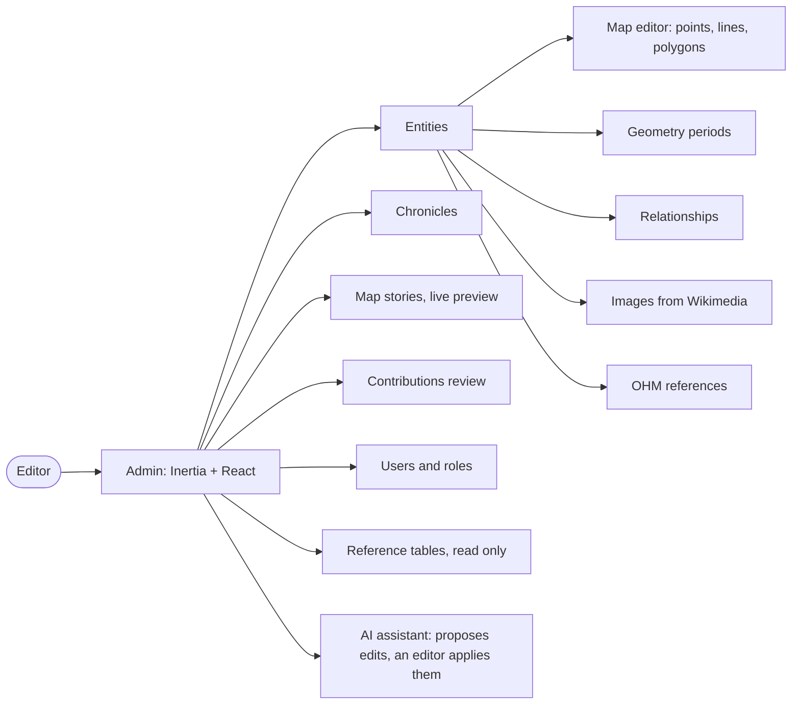
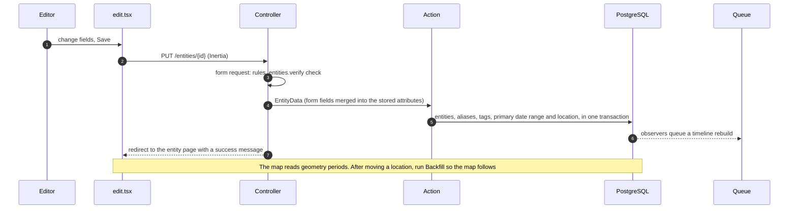
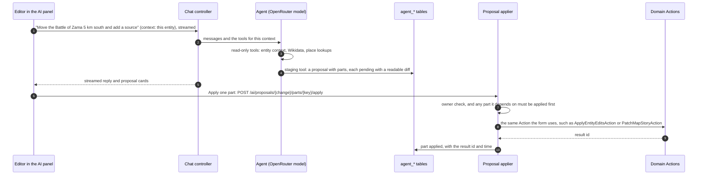
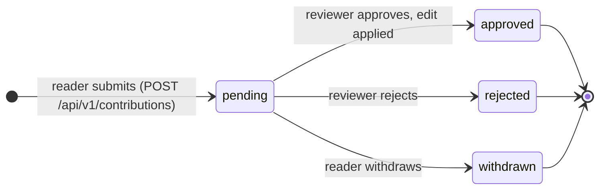
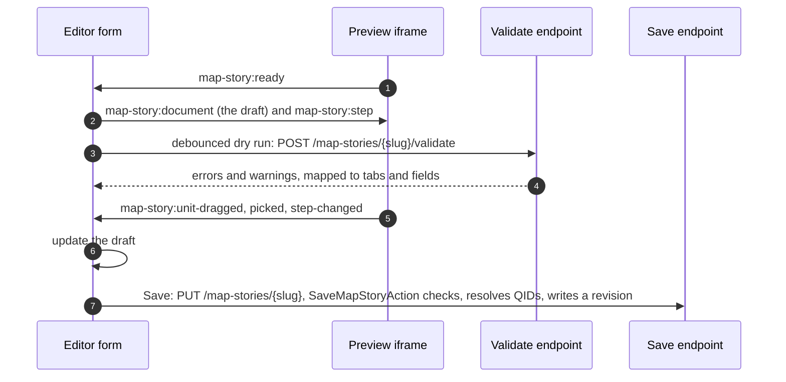

# Admin and editing

The admin is the editorial back office. Editors fix and enrich entities, draw geometry, link
relationships, write chronicles and map stories, and review readers' suggested edits. An AI assistant
in a side panel proposes changes, and an editor previews and confirms each one. This page explains
the admin's areas, its permission model and its main workflows.

> **Audience:** developers, editors, product · **Read time:** 10 minutes · **Last reviewed:** 2026-11-14 ·
> **Code:** `api/routes/web.php`, `api/app/Http/Controllers/Admin/*`, `api/resources/js/pages/*`,
> `api/app/Ai/*` · **Runbook:** [admin AI agent](../implementation-docs/admin-ai-agent.md)

## At a glance

- Pages are Inertia React pages rendered by Laravel controllers. Their JSON helpers live on the same
  web routes, and a few features (geography references, OHM resolution) call the public `/api/v1`
  endpoints with the editor's session.
- Every admin route requires `auth`, `verified` and `permission:admin.access`. Each area adds its own
  write permission.

## Areas and permissions

| Area | Pages | Write permission |
|---|---|---|
| Dashboard | A map of entities and overall stats | — |
| Entities | Index (filters include "has image"), create, show, edit | `entities.write` (`entities.verify` to change verification status) |
| Relationships | Panel on the entity page | `relationships.write` |
| Geometry periods | Panel on the entity page; "Backfill" from the primary location | `geometry.write` |
| Images | Panel on the entity page: candidates from Wikidata, Wikipedia, Commons or a URL | `entities.write` |
| Map stories | Index and editor, with revisions and restore | `entities.write` |
| Chronicles | Index (tag filter, sort), create, show, edit with a tag picker | `chronicles.write` |
| AI assistant | Side panel on every page, plus "Create with AI" | `entities.write` to apply |
| Contributions | Queue, detail, approve, reject | `contributions.review` |
| Users | Index, edit roles | `users.manage` (admins) |
| Reference tables | 10 read-only tables (periods, regions, calendars…) | — |

Role definitions are in [Backend and API](backend.md#auth-and-roles). A reader with only the `user`
role who signs in through the admin's login form is sent back to the public site.

## Editing an entity

The edit page (`pages/entities/edit.tsx`) is a form plus a set of panels. The form saves the core
record, and each panel saves its own data.

| Part of the page | Saves to |
|---|---|
| Metadata form: name, type, summary, significance, description, impact, QID, dates, confidence, verification, tags, aliases, type-specific attributes | `entities`, `entity_aliases`, `entity_tags`, `entity_temporal_ranges`, `entity_locations`, through `UpdateEntityAction` in one transaction |
| Geography references: search OHM, attach or detach a feature | `entity_geo_refs` (through `/api/v1`) |
| Map viewer and editor: a point or line (`geom`), a polygon (`territory_geom`) | `entity_locations` |
| Geometry periods: dated points or shapes, with provenance `manual`, `derived` or `ohm_import` | `geometry_periods` |
| Relationships: add, edit, remove; optionally create a "presence" period from the relationship (`derive_geometry_period`) | `relationships`, `geometry_periods` |
| Images: choose and order up to four, with licence data read from Commons on save | `entities.attributes.media_refs` |
| Map stories linked to the entity | links to the map-story editor |

Saving the form goes through `Admin\EntityController@update`, `Admin\UpdateEntityRequest` and
`UpdateEntityAction`:

The create page is metadata only. The map, geography, geometry, relationship and image tools appear
once the entity exists.

## The AI assistant

The assistant is a chat docked in the admin's sidebar (`components/ai/*`), built on `laravel/ai`.
It talks to models through OpenRouter; the model comes from `AI_DEFAULT_MODEL`. It **never writes
directly**. Every change it suggests is stored as a proposal, shown as a diff, and applied part by
part by the editor. The chat runs in `Admin\Ai\AiChatController`; `App\Ai\ProposalApplier` applies
a part.

| Agent | Used for | Tools |
|---|---|---|
| `EntityEditorAgent` | Chat on an entity page | 16 |
| `ChronicleEditorAgent` | Chat on a chronicle page | 17 |
| `GlobalAgent` | Chat that is not tied to one record | 19 |
| `EntityCreatorAgent`, `ChronicleCreatorAgent` | "Create with AI" | creation tools only |

- **Read-only tools:** entity context, Wikidata lookup, place finding (our entities, then OHM
  Nominatim), points by offset or between two places, nearest coast, and map-story reading and
  validation.
- **Staging tools:** create an entity, chronicle or entry; update fields; set the location or the
  QID; create a relationship; merge duplicates; create or patch a map story. Map-story edits are
  RFC 6902 JSON Patches, checked when proposed and checked again when applied.
- **Provenance:** records created this way have `created_by = agent:{user id}`. Map-story edits are
  saved as revisions with source `ai`.
- **Retention:** `ai:prune-proposals` runs daily. It removes pending and discarded parts after 7
  days, and conversations after 90 days.

## Reviewing readers' contributions

Signed-in readers can suggest edits from the public site. Suggestions are allowed on an entity's name,
summary, significance, description or aliases, a relationship's description, a chronicle's title
or description, and a chronicle entry's narrative. Reviewers handle them in the admin.

`ApproveContributionAction` checks that the record has not changed since the suggestion (an editor
can force it). A replaced name is kept as an alias.

## The map-story editor

`/map-stories/{slug}/edit` is a form on the left (Overview, Sides and units, Features, Steps, JSON)
and **the real public player in an iframe** on the right, so the preview is exactly what visitors
will see.

- The iframe loads `${FRONTEND_URL}/app?story=<slug>&sstep=0&preview=1`. Both sides check message
  origins: the public app trusts only `VITE_ADMIN_ORIGINS`, and the admin trusts only the iframe.
- Renaming a side, unit or feature id rewrites every reference to it.
- The last 50 revisions are kept, and any of them can be restored.
- [Map stories](map-stories.md) covers the document format and how stories reach the database.

## Known limits

- Geometry-period CRUD, the image save and relationship edits write models directly, not through
  Actions.
- The create page has no map or relationship tools until the entity is saved.
- Reference tables are read-only in the admin.

## Where next

- [Backend and API](backend.md): routes, roles and commands behind these pages
- [Map stories](map-stories.md): the documents the story editor edits
- [Admin AI agent runbook](../implementation-docs/admin-ai-agent.md): configuration, the full tool
  list, retention
