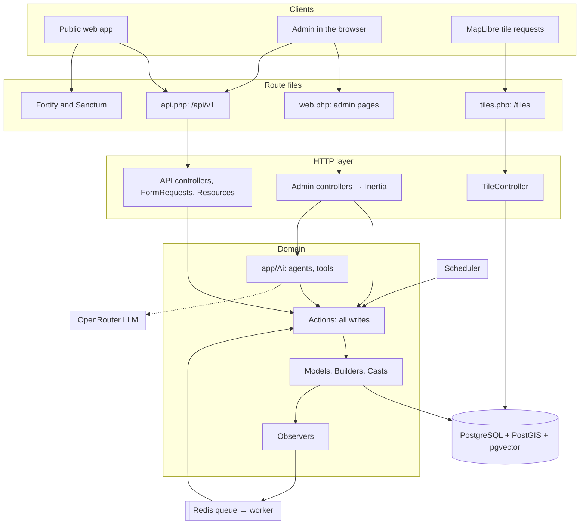
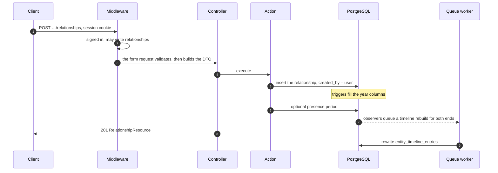
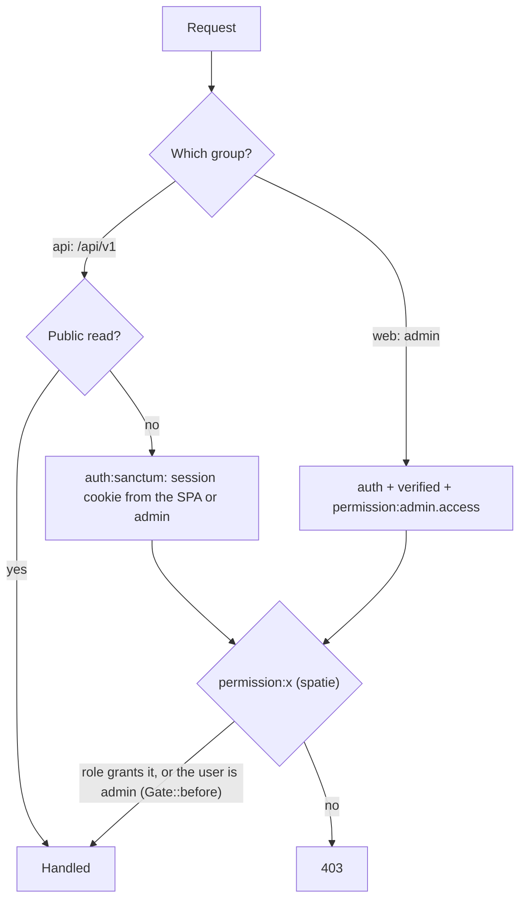

# Backend and API

The Laravel application in `api/` is one codebase with four jobs. It serves the public JSON API under
`/api/v1`, the editorial admin, vector tiles when the app is the tile driver, and the background work
(queue and scheduler). This page maps its routes, layers, auth model and commands.

> **Audience:** developers · **Read time:** 10 minutes · **Last reviewed:** 2026-11-14 ·
> **Stack:** Laravel 13, PHP 8.4, Fortify, Sanctum, spatie/laravel-permission, Inertia 2, laravel/ai,
> Scramble, Octane

## At a glance

**Rules of the codebase:**

- Controllers stay thin. Business writes live in Action classes under `app/Actions/*`. A few admin
  JSON endpoints still write directly: geometry-period CRUD, the image save, and relationship
  update and delete.
- Request validation lives in FormRequests. API output goes through API Resources.
- Side effects run through Eloquent **observers**, not events. A change to a location, temporal
  range, relationship or geometry period queues a rebuild of the entity's timeline.

## Runtime

| Concern | Local (Docker Compose) | Hosted site |
|---|---|---|
| HTTP | nginx :8000 → PHP-FPM (`app`) | Caddy (TLS) → FrankenPHP with Octane on `app:8080` |
| Queue | `queue:work --tries=1 --timeout=90` | `queue:work --tries=3 --max-time=3600` |
| Scheduler | `schedule:run` every 60 s | `schedule:work` |
| Tiles | Martin on :3000, or the app at `/tiles` | Martin (profile `martin`) or the app, chosen by `TILES_DRIVER` |
| Cache, sessions, queue | Redis | Redis |
| Deploy-time jobs | run by hand | one-shot `migrate` job: `db:repair-sequences`, `migrate --force`, `collections:sync`, `config:cache` |

Route files are registered in `api/bootstrap/app.php`. That file adds `/up` as a health check,
mounts `routes/tiles.php` at `/tiles` and `routes/site.php` at `/site-pages` outside the `web` and `api` groups, turns on Sanctum's
`statefulApi()`, and adds the spatie `role` and `permission` middleware aliases.

## Routes

| File | Prefix | Serves | Guarded by |
|---|---|---|---|
| `routes/api.php` | `/api/v1` | The JSON API: public reads, account features, permissioned writes | public; `auth:sanctum` and `permission:*` on writes |
| `routes/web.php` | `/` | The admin (Inertia React pages) and its JSON helpers | `auth`, `verified`, `permission:admin.access`, plus a permission per write area |
| `routes/settings.php` | `/settings` | Profile, password, appearance | `auth` (`verified` for security changes) |
| `routes/tiles.php` | `/tiles` | TileJSON and MVT tiles (Martin-compatible) | public, CORS `*` |
| `routes/site.php` | `/site-pages` | The public site's entity and chronicle pages with their text in the HTML, and its sitemap. Caddy sends those paths of the web domain here ([What crawlers see](frontend-app.md#what-crawlers-see)) | public, no session; `SITE_RATE_LIMIT` per address |
| *(Fortify)* | `/login`, `/register`, … | Sign-in, registration, password reset, e-mail verification, 2FA | rate limited (5 per minute) |
| *(Scramble)* | `/docs/api` | Generated OpenAPI docs for `/api/v1` | admins, or everyone when `SCRAMBLE_DOCS_PUBLIC=true` |

The [REST API reference](../schemas/rest-api.md) lists every endpoint. In summary:

| Area | Reads (public) | Writes |
|---|---|---|
| Entities, map | list, show, `entities/map`, `entities/map/year`, OHM feature resolution | `entities.write` |
| Relationships, graph, timeline | relationships, 1–2 hop graph, timeline entries | `relationships.write` |
| Geography references | list, OHM search | `geometry.write` |
| Chronicles | list, show, graph, an entity's chronicles | admin only (web routes) |
| Map stories, collections, tags, reference tables, sources | list and show; `map-stories/ambient` | admin or files (see below) |
| Account (`/me`) | profile, saved items (stars and folders), own contributions | any signed-in user |
| Contributions | — | `contributions.create`, throttled to 10 per minute |

## Layers

| Directory | What it holds |
|---|---|
| `app/Http/Api/V1` | 18 API controllers, 19 FormRequests, 19 Resources. The public chronicle controller sits apart, in `app/Http/Controllers/Api/V1` |
| `app/Http/Controllers` | `Admin/*` (entities, geometry periods, images, map stories and revisions, relationships, contributions, users, AI, 10 reference-table pages), `Web/ChronicleController`, `Settings/*` |
| `app/Actions` | 15 groups: Chronicle, Collection, ContentBundle, Contribution, Entity (20 classes), EntityGeoRef, Fortify, Graph, MapStory, Relationship, Saved, Source, Tag, Timeline, User |
| `app/Builders` | `EntityBuilder`: type and group filters, bbox and near, time window, name search, tags, sort presets, map and graph projections |
| `app/Services` | Identity guard (`EntityReferenceResolver`), geo helpers, OHM lookup, the tile server, Wikidata, Wikimedia images, graph support |
| `app/DTOs`, `app/Casts` | `EntityData`, `RelationshipData`, `ChronicleData`…; the PostGIS ↔ GeoJSON cast and Postgres array casts |
| `app/Observers` | Geometry period, temporal range, location and relationship observers → `TimelineRebuild::queue()` |
| `app/Jobs` | Import, border import, relationship resolution, embeddings, timeline rebuild |
| `app/Ai` | 5 agents, 19 tools, `ProposalApplier`, `ToolRegistry` |
| `app/Enums` | 57 enums: `EntityType` (30), `EntityGroup` (5), `RelationshipType` (74), `VerificationStatus` (10)… |
| `app/Support` | Content bundles, map-story document checks and JSON Patch, `OhmDate`, timeline rebuild, GeoJSON normalisation |

### A write, end to end

Creating a relationship through the API (`POST /api/v1/entities/{id}/relationships`). The
middleware is `auth:sanctum` and `permission:relationships.write`; `StoreRelationshipRequest`
validates and builds `RelationshipData`; `CreateRelationshipAction` does the write.

### A read, end to end

`GET /api/v1/entities/{id}?include_relationships=1` runs `EntityController@show` →
`GetEntityAction`. That loads the entity with its primary temporal range and location, tags,
aliases, map-story summaries and both directions of relationships (with their end entities, in one
eager load), then renders `EntityResource`. Images ride along as `media_refs`. There is no
separate image or search endpoint: search is `?search=` on names (trigram, ILIKE and English
full-text).

## Auth and roles

- **Fortify** handles sign-in on the `web` guard, with e-mail as the username. A non-staff user
  who signs in through the HTML form is redirected to the public site.
- **Sanctum is cookie-only.** The SPA calls `GET /sanctum/csrf-cookie`, then sends credentials with
  every request; CORS allows the frontend origin. No API tokens are issued.
- **Roles** come from spatie/laravel-permission (`database/seeders/RoleSeeder.php`,
  `PermissionSeeder.php`). Assign one with `php artisan user:role {email} {role}`.

| Role | Permissions |
|---|---|
| `admin` | everything |
| `moderator` | `entities.write`, `entities.verify`, `relationships.write`, `chronicles.write`, `sources.write`, `admin.access`, `contributions.create`, `contributions.review` |
| `history_moderator` | as `moderator`, without `entities.verify` |
| `geo_moderator` | `geometry.write`, `admin.access`, `contributions.create` |
| `user` (every new account) | `contributions.create` |

`reference.manage` and `users.manage` belong to no role, so only admins hold them. Setting an
entity's `verification_status` also needs `entities.verify`, wherever it happens: the admin form,
the AI assistant or `/api/v1` (`GuardsVerificationStatus`). On create, only the default
`pipeline_draft` is allowed without it.

## Background work

| Job | Queued by | Does |
|---|---|---|
| `ImportEntityJob` | `pipeline:import`, `pipeline:import-border-relations` | Creates or updates one entity with its companions (3 tries) |
| `ImportBorderEntityJob` | `pipeline:import-borders` | Imports one OHM border entity |
| `ResolveRelationshipsJob` | after imports; `pipeline:resolve-relationships` | Turns staged relationship hints into relationships |
| `GenerateEntityEmbeddingJob` | `pipeline:embeddings` | Writes `entities.embedding` with OpenAI `text-embedding-3-small` |
| `RebuildEntityTimelineJob` | observers | Rebuilds `entity_timeline_entries` for one entity |

| Schedule (`routes/console.php`) | When |
|---|---|
| `ai:prune-proposals` | daily |
| `entity:fetch-images --limit=2000` | daily at 03:30, without overlapping |

Everything else is run on demand: tag sync, map-story sync and embeddings.

## Commands

| Purpose | Commands |
|---|---|
| Import pipeline output | `pipeline:import`, `pipeline:import-relations`, `pipeline:import-borders`, `pipeline:import-border-relations`, `pipeline:import-ohm-links`, `pipeline:resolve-relationships`, `pipeline:report-relationship-hints`, `chronicles:import` |
| Derived data | `pipeline:embeddings`, `timeline:rebuild`, `entity:backfill`, `geometry:derive-located-at` |
| Content from files | `tags:sync`, `collections:sync`, `entities:sync-descriptions`, `map-stories:sync`, `map-stories:export`, `map-stories:relink` |
| Images | `entity:fetch-images` |
| Content bundles | `content:export`, `content:validate` (import is designed but not built) |
| Operations | `db:repair-sequences`, `ai:prune-proposals`, `user:role`, `pipeline:export-ohm-ref-ids` |

## Feature backends

| Feature | Storage | Written by | Read by | Page |
|---|---|---|---|---|
| Map stories | `map_stories` (live copy) and `map_story_revisions` (last 50); JSON files are seeds | `SaveMapStoryAction` (admin, AI patch, `map-stories:sync`) | `/map-stories`, `/map-stories/ambient`, entity payloads, the `has_map_story` tile flag | [Map stories](map-stories.md) |
| Chronicles | `chronicles`, `chronicle_entries`, `chronicle_entry_entities` | `chronicles:import`, admin, AI tools | `/chronicles`, graph endpoint | [Chronicles](chronicles.md) |
| Collections | `collections` (items are refs resolved when served) | `collections:sync` from `resources/collections/*.json` | `/collections` | [Collections](../schemas/collections.md) |
| Tags | `tags`, `entity_tags`, `chronicle_tags` | `tags:sync`, admin, pipeline | `/tags`, `tags[]` filters | [Tags](tags.md) |
| Images | `entities.attributes.media_refs` (links and credits) | `entity:fetch-images`, import, admin picker | entity payloads | [Entity images](entity-images.md) |
| Long descriptions | `entities.description` | `entities:sync-descriptions` from `resources/entity-descriptions/*.md` | entity payloads | [Authoring map stories](../implementation-docs/map-story-authoring.md) |
| AI assistant | `agent_conversations`, `agent_proposed_changes`, `…_parts` | the admin chat | the admin | [Admin and editing](admin-map-editor.md) |
| Vector tiles | SQL function `tiles.atlas_entities(z,x,y)` | migrations | Martin or `TileController` | [Atlas vector tiles](../schemas/atlas-tiles.md) |

## Testing

- `php artisan test` runs the PHPUnit suite inside the `app` container. It needs a database with the
  PostGIS, pgvector, hstore and pg_trgm extensions.
- `composer test` adds a Pint style check. `composer ci:check` mirrors CI (lint, Prettier, types,
  tests).

## Where next

- [REST API](../schemas/rest-api.md): every endpoint and its parameters
- [Admin and editing](admin-map-editor.md): the back office built on this backend
- [Data model overview](../entity-model/README.md): the tables these Actions write
