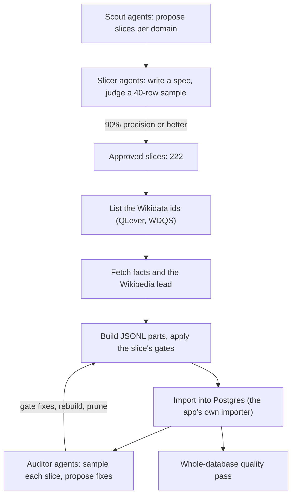

# From 36,000 to 641,000 entities

On 15 November 2026 the atlas grew from about 36,000 entities to about 641,000 in one day. This page
tells how: which sources and tools were used, what the AI agents did and did not do, what went
wrong, and what the result looks like. The design of the tool is in
[Data pipeline § Bulk Wikidata slices](data-pipeline.md#5-bulk-wikidata-slices).

## Why a new approach was needed

Until then the atlas was filled by two slow, careful tracks:

| Track | How it works | Rate |
|---|---|---|
| [Extraction agent](data-pipeline.md#3-the-extraction-agent-langgraph) | A LangGraph workflow reads a Wikipedia article and extracts entities, dates and relationships | One topic at a time |
| [History-data campaign](data-pipeline.md#4-the-history-data-campaign) | Agents write a transcript of dated facts for one era and region, extract it, review it and ingest it | About 100 entities for about a million tokens |

Both give well-connected, reviewed rows, and neither can reach hundreds of thousands. Wikidata
already holds structured records for most of what the atlas wants: people, cities, monuments,
battles, treaties, works. So the bulk track imports those records directly and spends the agents'
effort on a different question: *which* records are worth taking, and *are the ones we took right*.

## The idea: slices

Nothing is imported as "all of Wikidata". The unit of work is a **slice**: one entity type, one
SPARQL pattern, a notability bar and a set of gates.

| Part of a slice | Example |
|---|---|
| Entity type | `event_battle` |
| Pattern | instance of battle (or a subclass) with a start date |
| Notability bar | at least N Wikipedia language editions, or an English article |
| Year bounds | 1500 to 1799 |
| Gates | must have a date; drop descriptions that match sport words; drop leads that begin "competed in the … Summer Olympics" |

A slice is a small JSON file in `pipeline/bulk/slices/`. Every imported row carries its slice id, so
a slice can be audited, repaired or rolled back on its own. A Wikidata id belongs to the first slice
that lists it, so slices never import the same thing twice.

## Who did what

| Step | Done by | Tool |
|---|---|---|
| Propose slices for a domain, with a size and precision estimate | Scout agents (Claude Sonnet), read-only | SPARQL against Wikidata |
| Write the spec, list it, build one sample part, judge 40 rows | `bulk-slicer` agents (Sonnet) | `python -m pipeline.bulk qids / fetch` |
| Approve a slice | The orchestrating session, from the slicer's verdict | `output/bulk/approved.txt` |
| List, fetch and build every approved slice | Plain Python, no AI | `scripts/bulk_run.sh` |
| Import | The app's normal importer | `pipeline:import` run by `importer` daemons |
| Sample each imported slice, propose fixes as a CSV | `bulk-auditor` agents (Sonnet) | SQL on the local database |
| Apply fixes | Plain Python, from a curated CSV | `apply-audit`, `rebuild`, `prune`, `redate` |

The agents never write to the database. They write specs, verdicts and CSV files; deterministic
commands do the fetching, the importing and the repairs, and each repair saves the values it
replaced. That split is what made the scale affordable: the cost of an agent is per slice (a few
hundred of them), not per entity.

## Sources and services

| Source | Used for | Notes |
|---|---|---|
| Wikidata Query Service (WDQS) | Facts for each id: dates, coordinates, type, relations | The real speed limit: it answered 429 and 504 under load |
| QLever (a faster Wikidata SPARQL engine) | Listing ids for large slices | 30,000 people listed in 45 seconds, where WDQS took hours |
| Wikipedia REST API | The lead paragraph, used as the summary | Leads were cleaned and cut at a sentence |
| Wikimedia Commons | Images, linked with their credit, never copied | Fetched after the import; see [Entity images](entity-images.md) |
| OpenHistoricalMap | Not used by this track | Borders and placed points come from the [OHM track](ohm-integration.md) |

## The day in waves

Work went in waves: scouts and slicers designed a batch while the previous batch was fetching and
importing.

| Wave | What it added |
|---|---|
| Trial | Ancient battles, 313 rows, to prove the tool end to end |
| 1 | People of the first rank, cities, monuments, archaeology, conflicts |
| 2 | Polities, events, law, cultural works, economy, scholars, more places |
| 3 | Lower notability bars: more people, monuments, settlements, event tails |
| 4 and 5 | Postwar conflicts, works to 1950, heritage registers, institutions, military units, technology |
| "The rest" | Every non-sportsperson born before 1900 with an English Wikipedia article (eight catch-all slices) |
| 6 and 7 | Fortifications, early-modern monuments, periodicals, polity and settlement tails |

| Time (15 Nov) | Entities |
|---|---|
| Morning | about 36,000 |
| 16:40 | about 342,000 |
| 17:00 | 370,777 |
| 18:36 | about 550,000 |
| 19:40 | about 627,000 |
| 22:10 | 641,570 |

Measured rates: one fetch process handled about 5.6 rows a second; one importer about 10 to 35 rows
a second. Once listing moved to QLever, the single importer became the bottleneck, so it was
changed to several daemons that each lock one part.

## What came in

Counts from the database after the quality pass (641,473 entities in total, 605,207 of them from
bulk slices):

| Slice family | Entities | Slices |
|---|---|---|
| People | 464,566 | 81 |
| Monuments | 34,754 | 26 |
| Cultural works | 27,295 | 18 |
| Polities, dynasties, military units | 17,738 | 18 |
| Places and settlements | 14,933 | 20 |
| Culture, language, religion | 13,803 | 15 |
| Archaeology | 12,612 | 5 |
| Conflicts | 8,020 | 9 |
| Other events and law | 5,665 | 16 |
| Technology | 3,529 | 6 |
| Institutions | 1,573 | 3 |
| Economy | 406 | 4 |

The import also created about 570,000 of the atlas's 645,000 relationships, from Wikidata
statements such as place of birth, participant, capital and author.

People are three quarters of the atlas now. That was a choice: a person has a clear identity, dates
and usually a birthplace, so precision is high. Sportspeople were kept out on purpose.

## What went wrong, and the fixes

Bulk data fails in patterns, so each problem was fixed as a rule in the tool and then applied to the
rows already imported.

| Problem | Example | Fix |
|---|---|---|
| Century dates read as years | Wikidata's "10th century" arrives as the year 901 | People drop century-or-coarser dates; 2,100 rows removed, thousands re-dated |
| Julian dates silently converted | Pre-1582 births shifted by days, sometimes across a year | About 10,000 dates restored, 196 years changed |
| Reversed relations | A battle "participated in" a person | Four Wikidata properties are flipped on import; old rows repaired |
| Namesakes merged | The battle of Zela in 47 BCE merged into the one in 67 BCE | The importer no longer merges a record into a row that holds another Wikidata id |
| Wrong Wikidata id on older, hand-made rows | Jimmy Carter held an Indonesian politician's id | About 200 older rows corrected by comparing them with the new ones |
| Wrong article's lead | An English link that redirects to a parent article gave a person the family's summary | 1,352 summaries replaced by the Wikidata description |
| Anachronistic links | Modern France as a party to a medieval battle | `tidy` deletes links outside a state's or person's lifetime: 1,992 removed |
| Labels only in `mul` | 12,000 rows had no English label and were skipped | The fetch reads the `mul` label and falls back to the article title |
| Off-topic rows | Athletes, wineries among castles, US town incorporations | Description and class gates; pruned per slice |
| Vandalised labels | A battle named after a joke | 197 renames |

## The quality pass

After the last wave, sixteen agents sampled the whole database by domain and wrote candidates for
correction. Sampled error rates ran from 4% (people born after 1900) to 24% (polities and military
units, mostly older rows with a doubtful type), and most errors were dates or typing rather than
wrong identities.

| Applied from the pass | Count |
|---|---|
| Rows flagged `needs_review` | 2,108 |
| Dates fixed | 196, plus 4,061 people re-dated by rule |
| Rows deleted | 155 |
| Duplicates merged | 122 |
| Links dropped or moved | 245 |
| Stock images removed | 440 |
| Summaries re-cut | about 18,000 |

Rows that came from bulk slices are marked as pipeline drafts on the site, and about 10,300 rows
are flagged for review.

## What it cost the application

Seventeen times more rows changed how the app had to work, not only the data:

| Area | Change |
|---|---|
| Tags | `GET /tags` went from 9 s to 0.18 s after a rewrite |
| Search | A narrow `entity_names` table with trigram and full-text indexes; a common name search went from 1.5 s to 0.06 s on the production server |
| Database | Deletes during repairs went from a minute to under a second with three new indexes |

The measurements are in the [Scalability benchmark](scalability.md).

## Still open

| Item | Size |
|---|---|
| Lead and Wikidata dates that disagree with equal precision | about 2,700 rows, left alone |
| Archaeology rows with only a `mul` label and no English article | about 1,300, need a refetch |
| Rows with no summary (Wikidata has no description) | 562 |
| Embeddings for the new rows | not generated |
| People without a place of their own | most of them; a person's point is never borrowed from a related place |

## Related

[Data pipeline](data-pipeline.md) · [Scalability benchmark](scalability.md) ·
[Entity images](entity-images.md) · [Tags](tags.md)
