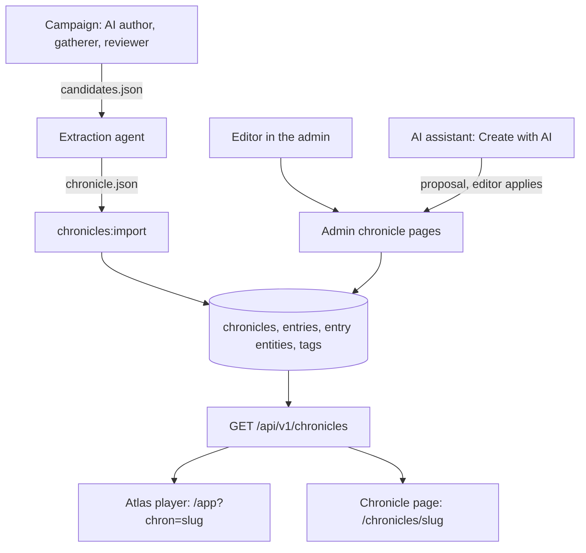
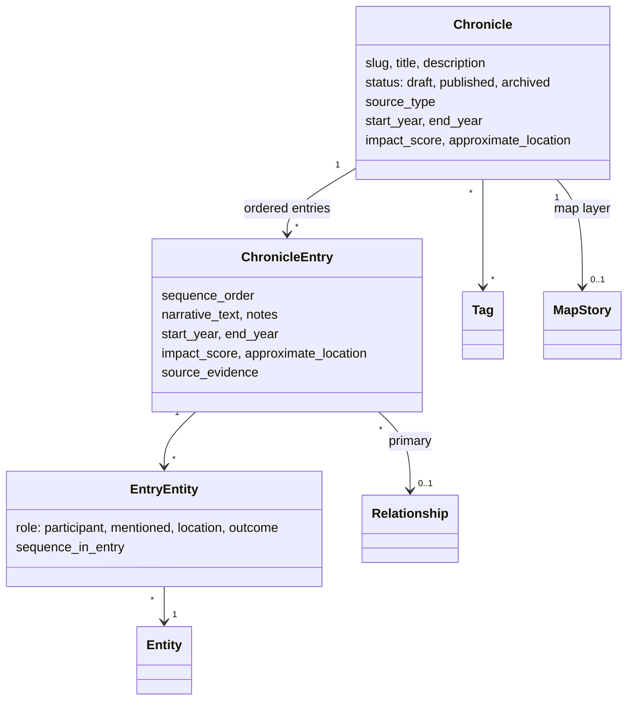
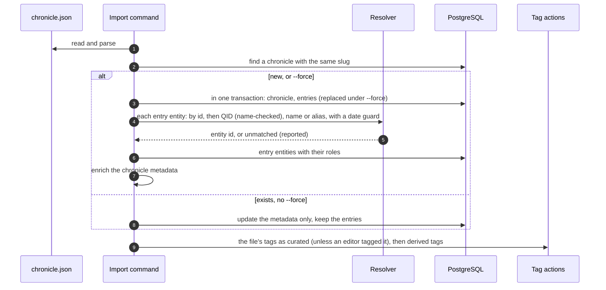
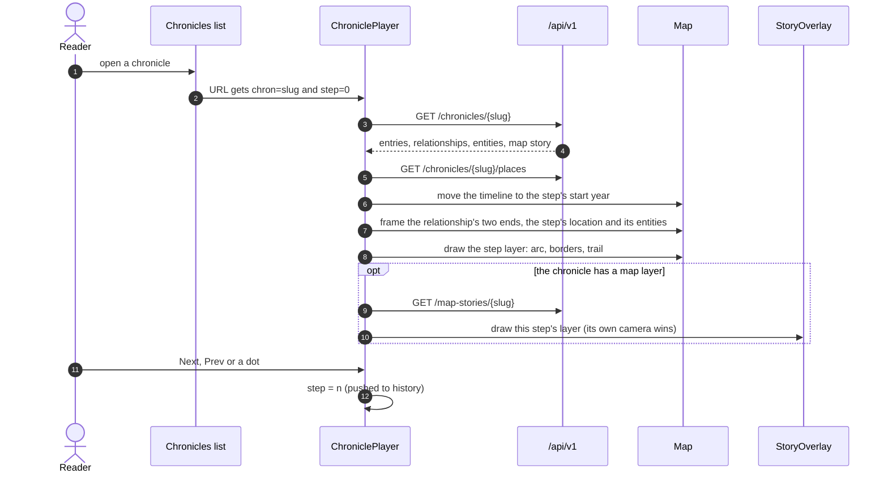

# Chronicles

A chronicle is a guided tour through a period or a theme: an ordered list of dated steps. Each step
tells one change in a few sentences, points at the relationship it narrates, and lists every entity
it touches. This page covers the model, how chronicles are made and imported, and how the public app
plays them.

> **Audience:** developers, editors, product · **Read time:** 10 minutes · **Last reviewed:** 2026-11-20 ·
> **Code:** `api/app/Models/Chronicle*.php`, `api/app/Actions/Chronicle/*`,
> `api/app/Console/Commands/ImportChroniclesCommand.php`, `web/src/components/atlas/Chronicle{Player,Page}.tsx`,
> `web/src/components/map/ChronicleLayer.tsx`, `web/src/lib/chronicle-map/*`

## At a glance

## The model

| Part | What it is |
|---|---|
| **Entry** | One step: a narrative of a few sentences and its years. Entries are played in `sequence_order` |
| **Primary relationship** | The edge the step narrates, such as *Carthage* `victorious_at` *Battle of Cannae*. At most one per entry; it can be empty |
| **Entry entities** | Every entity the step touches, each with a role: `participant`, `mentioned`, `location` or `outcome` |
| **Tags** | Era, region, theme and type facets. See [Tags](tags.md) |
| **Map layer** | Optionally, a [map story](map-stories.md) that draws extra detail for each step |
| **Status and source** | `status` is `draft`, `published` or `archived`. Imports start as `draft` (not yet reviewed by a person). The public site shows drafts and published chronicles and hides archived ones; the admin lists all three. `source_type` records where the text came from: `video_transcript`, `article`, `book_excerpt` or `manual` |

Events are ordinary entities. An event "belongs" to a chronicle when it is an end of an entry's
primary relationship or one of the entry's entities.

### Derived fields

`EnrichChronicleMetadataAction` fills these after an import or an edit, so authors do not type them:

| Field | Rule |
|---|---|
| Entry impact | The highest impact score among the entry's entities |
| Entry location | The point of the entry's highest-impact entity |
| Entry years | Taken from the primary relationship when the entry has none |
| Chronicle impact | 0.7 × the highest entry impact + 0.3 × the mean |

An entry's position in time is its primary relationship's start year, or else the earliest year
among its entities.

## How chronicles are made

| Route | Who | Path into the database | Default status |
|---|---|---|---|
| **Campaign** (most chronicles) | Claude agents write 60–120 dated facts per era, region or topic. Others extract and review them | The extraction agent writes `chronicle.json`, then runs `chronicles:import --sync` | `draft` |
| **Agent from a text** | An operator runs `python -m pipeline agent --input text.txt` | The same `chronicle.json` and import | `draft` |
| **Admin** | An editor with `chronicles.write` | Create and edit pages, including entries and their entities | set by the editor |
| **AI assistant** | `ChronicleCreatorAgent` ("Create with AI") or `ChronicleEditorAgent` on a chronicle page | A proposal that the editor applies part by part | `draft` |
| **Storyteller chapters** (*The Human Story*) | A `chapter-author` agent writes 16–24 narrative scenes per chapter; a `chapter-reviewer` fact-checks them | Files in `api/resources/chronicles/<slug>/chronicle.json`, checked by `pipeline.campaign chronicle-check`, then `chronicles:import resources/chronicles --all` | `draft` |

The campaign's editorial rules: every fact belongs to the chronicle's era, a fact from another era
goes to "spillover" and is never re-dated, and every fact is grounded in a cached Wikipedia lookup.
See [Data pipeline](data-pipeline.md#4-the-history-data-campaign).

### The Human Story

A twelve-chapter overview, from the first cities of Sumer to today, written to be read rather than
looked up. Each step is a scene with people, a place and stakes, and each chapter carries one big
idea. Yuval Noah Harari's *Sapiens* supplies the themes (shared myths, money, empires and universal
religions as unifiers, the scientific and industrial revolutions), used only as an attributed lens:
no quotations, and every fact comes from the cached Wikipedia articles. The chapters link the
atlas's existing entities and their battles, many of which open as battle maps, and the collection
`the-human-story` lists them in order.

| Step | Tool |
|---|---|
| Find the entities a step can link | `pipeline.campaign entity-find "<name>" Q123 …` |
| Check a chapter file (schema, 14–30 steps, plain prose, quotations, years, links) | `pipeline.campaign chronicle-check <file>` |
| Write and review | `.claude/agents/chapter-author.md`, `chapter-reviewer.md` |
| Load | `chronicles:import resources/chronicles --all` (add `--force` to replace edited entries) |

### Importing a chronicle file

`php artisan chronicles:import` reads the file, `EntityReferenceResolver` matches each entry's
entities, and `EnrichChronicleMetadataAction` fills in the derived fields.

| Option | Effect |
|---|---|
| `--all` | Import every `chronicle.json` under a directory |
| `--force` | Replace an existing chronicle's entries (matched by slug) |
| `--dry-run` | Report what would be imported |
| `--link-missing` | Repair: attach entities an earlier import could not match, without changing anything else |

The file format is the agent's `pipeline/agent/schemas/chronicle.py`. The top level holds title,
slug, source type and reference, status, years, impact, location, metadata and `entries`. Each entry
holds its order, narrative, years, an optional primary relationship id, evidence and its entities.

## Playing a chronicle

| Where | What the reader gets |
|---|---|
| **Atlas player** (`/app?chron=<slug>&step=<n>`) | The left rail on desktop, a sheet on mobile. Prev, Next and step dots, with no autoplay. A "Map layer" badge appears when the chronicle has a map story. Expand opens the full page. The map draws each step (see below) |
| **Chronicle page** (`/chronicles/<slug>`) | The whole chronicle as a page, with a relationship graph of its steps (`GET /chronicles/{slug}/graph`) and an "Open on the globe" link |
| **Lists** | The atlas "Chronicles" tab (search, tag filter), the landing page and `/browse` (by impact), and the chronicle chips on each entity |

### The step on the map

`ChronicleLayer` draws the playing step from `GET /chronicles/{slug}/places`: each entity's map
point (its primary location, else its first geometry period, the point the tiles draw) and its
dated OpenHistoricalMap borders. Nothing is drawn where the atlas has no place for an entity.

| Part | What it shows |
|---|---|
| **Arc** | The primary relationship, from source to target, when both ends are placed at least 3 km apart. It grows from its source as the camera flies in, then a glow runs along it. Its colour and line follow the kind of relationship (below). An arc from a polity fades in, since a polity's point is only somewhere inside its realm |
| **Borders** | The OHM boundaries of the step's entities standing in the step's year (OHM draws each change of border as its own relation), picked like a map story's: the primary links when one covers the year, else the rest. The relationship's ends are tinted in the arc's colour, the others outlined in grey |
| **Anchor** | Where the step happens: an entity in the `location` role, else an end that is an event or a place, else any event or place in the step, else the entry's approximate location. It ripples |
| **Entities** | Each placed entity of the step, ringed and labelled. The others reach the anchor by faint spokes. Clicking one opens it |
| **Trail** | The anchors of the steps so far, joined in order and numbered, older ones fainter. Hovering a stop shows its year and first sentence; clicking it goes back to that step |
| **The rest of the atlas** | Fades while a step shows. The step's own entities are drawn by the layer instead |

| Kind | Relationship types (most common) | Drawn as |
|---|---|---|
| Conflict | `victorious_at`, `defeated_at`, `fought_at`, `at_war_with`, `participated_in` a battle | Red arc with an arrowhead |
| Spread or exchange | `spread_to`, `adopted`, `influenced_by`, `trades_with` | Teal arc with an arrowhead |
| Succession | `succeeded_by`, `merged_into`, `split_from` | Dashed violet arc |
| Rule or territory | `located_at`, `part_of`, `rules`, `capital_of`, `controlled_by` | The territory's border; a dashed line only where there is none |
| A life or a founding | `founded`, `resided_in`, `died_in`, `born_in` | Amber arc |
| Alliance | `allied_with` | Blue arc |
| Not about places | `authored`, `signed_by`, `commissioned`, `child_of` | No line: the entities are only ringed |

A chronicle's own map layer, where it has a step for the entry, draws that step instead; only the
trail stays. Under reduced motion nothing animates. The kinds and rules are in
`web/src/lib/chronicle-map/scene.ts`, the layers in `layers.ts`.

## Editing

- **Admin:** `/chronicles` (index with tag filter and sort), create, show and edit. The edit form
  covers the metadata, the tags, and each entry's narrative, notes, evidence, primary relationship
  and entities with their roles. Saving needs `chronicles.write`.
- **AI assistant:** proposes entries and edits. Records it creates carry `created_by = agent:{user id}`.
- **Readers** can suggest edits to a chronicle's title or description and to an entry's narrative.
  Reviewers approve them in the admin (see [Admin and editing](admin-map-editor.md)).
- Deleting a chronicle also deletes any map story attached only to it (a database trigger).

## Known gaps

- A polity's map point is a single point inside its realm, so an arc from a large polity (the
  Russian Empire) starts far from the front. The arc fades in from there; a capital, where the
  atlas knows one, would be a better start.
- About a fifth of steps place both ends of their relationship, so most steps show borders, spokes
  and the trail rather than an arc. Placing more entities raises this.

## Where next

- [Map stories](map-stories.md): the map layer a chronicle can carry
- [Data pipeline](data-pipeline.md): the campaign and the agent that write most chronicles
- [For historians](../entity-model/for-historians.md#chronicles-telling-the-story): the editorial view
- [REST API](../schemas/rest-api.md#chronicles): the endpoints
