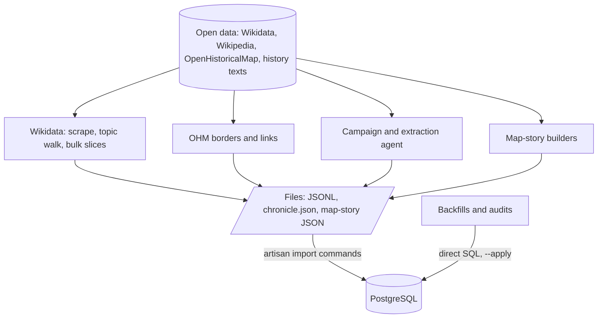
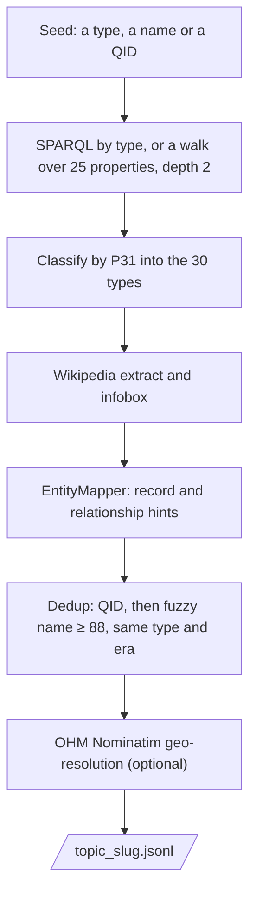
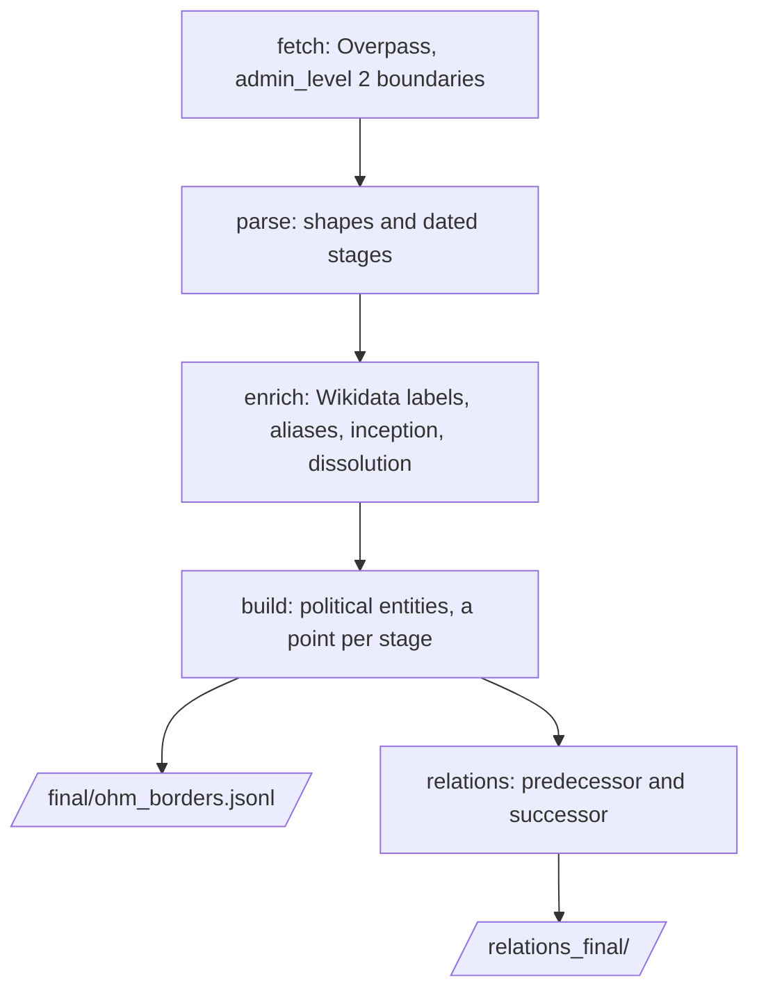
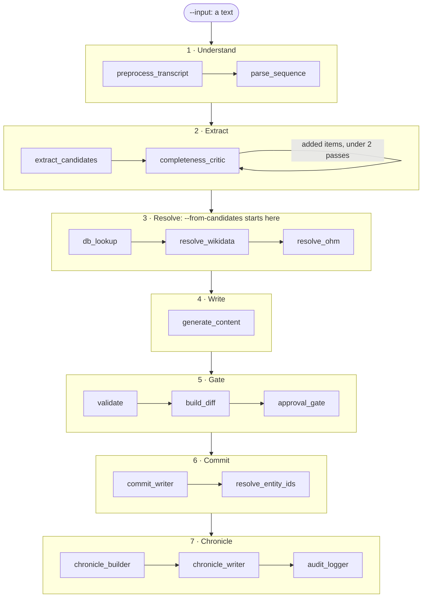
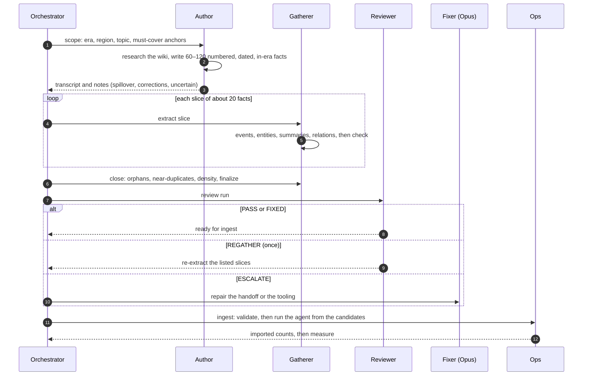
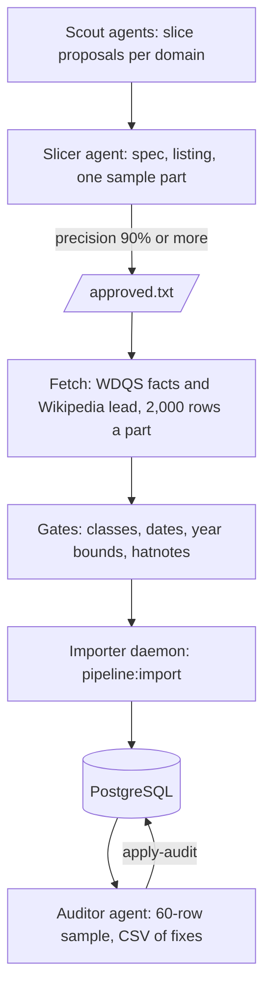

# Data pipeline

How History Mapped's content is produced. Python code in `pipeline/` fetches open data and extracts
entities, relationships and chronicles from text, with AI agents doing the writing and the review.
Everything it produces is a **file**, and Laravel commands import the files into PostgreSQL. This page
covers each track, the contract between the pipeline and the app, and the quality rules.

> **Audience:** developers, data operators, technical stakeholders · **Read time:** 16 minutes ·
> **Last reviewed:** 2026-11-15 · **How-to:** [Importing data](../implementation-docs/data-contributor-guide.md)

## At a glance

**Rules every track follows:**

- **Files, not live writes.** Tracks write artifacts and Laravel imports them, so a run can be
  inspected, re-imported or thrown away. The exceptions are the backfill and audit scripts. They
  write directly, preview by default, and change data only with `--apply`.
- **Run from the repository root** (`python -m pipeline …`). Settings come from `pipeline/.env`.
- **The app container sees only `api/`.** Files to import must be under `api/`; by convention
  `api/storage/app/pipeline/`. The agent writes its runs there itself.
- **Identity first.** Records are matched by Wikidata QID, then OHM id, then name, type and era,
  with guards against namesakes (`ImportEntityJob::findExisting`).

## Tracks

| Track | Command | Output | Imported by |
|---|---|---|---|
| Wikidata by type | `python -m pipeline scrape --type event_battle` | `output/<type>.jsonl` (appends) | `pipeline:import` |
| Wikidata topic walk | `python -m pipeline topic "Roman Empire"` | `output/topic_<slug>.jsonl` (+ `_ref`, `_untyped`, which are not imported) | `pipeline:import` |
| OHM borders | `python -m pipeline borders run --run-id R`, then `borders relations-run --run-id R` | `output/ohm_borders/R/final/ohm_borders.jsonl`, `relations_final/` | `pipeline:import-borders`, `pipeline:import-border-relations` |
| OHM links | `python -m pipeline ohm-links fetch` | `output/ohm_links/<run>/ohm_links.jsonl` | `pipeline:import-ohm-links` |
| Extraction agent | `python -m pipeline agent --input text.txt` or `--from-candidates candidates.json` | `api/storage/app/pipeline/agent_runs/<run>/` | runs the imports itself |
| Campaign | `.claude/agents/campaign-*` with `python -m pipeline.campaign` | `output/campaign/extractions/campaign_<slug>/candidates.json` | `run_campaign.sh` → the agent |
| Bulk Wikidata slices | `python -m pipeline.bulk qids/fetch <slice>` and the `importer` daemon | `output/bulk/<slice>/parts/part-NNNN.jsonl` | `pipeline:import --sync --skip-images` (run by the importer) |
| Map stories | `python -m pipeline.map_stories build <module>` | `api/resources/map-stories/<slug>.json` | `map-stories:sync` |
| Backfills and audits | `python -m pipeline.backfill_geo`, `pipeline.audit identity`… | reports in `output/audit/` | direct SQL with `--apply` |

## 1. Wikidata scrape and topic walk

Each line is one entity: name, type and group, QID, summary (at most 420 characters), significance,
aliases, dates, location hints, type attributes, tags, sources, plus private `_relationship_hints` and
`_geo_resolution` keys. The format is in [Pipeline entity record](../schemas/pipeline-entity-record.md).
`pipeline:import` creates the entities, stages the hints, then resolves them into relationships once
both ends exist.

## 2. OpenHistoricalMap: borders and links

- Each run lives in `output/ohm_borders/<run_id>/` with a manifest and `.done` markers, so every
  stage can `--resume`. A subset run builds a SQLite index of a global dump, then extracts a
  subgraph around a seed (`borders build-index`, `borders extract-subgraph`).
- Borders are imported as `ohm_draft` entities with OHM references and **point** geometry periods.
  The browser draws the actual borders from OHM's tiles.
- **OHM links** keep references current. `pipeline:export-ohm-ref-ids` lists our OHM ids;
  `ohm-links fetch` gets their tags and dates from Overpass; `pipeline:import-ohm-links` fills in
  years, and adds references where an OHM feature's `wikidata` tag matches an entity's QID.

## 3. The extraction agent (LangGraph)

The agent turns text into entities, relationships and a chronicle. The graph is
`pipeline/agent/graph/workflow.py:build_workflow`, and LangGraph Studio can open it from
`langgraph.json`.

| Stage | Nodes | What happens |
|---|---|---|
| Understand | `preprocess_transcript`, `parse_sequence` | An LLM cleans the text and splits it into dated events with the entities they mention |
| Extract | `extract_candidates`, `completeness_critic` | Candidate entities and relationships. A critic pass adds missing endpoints (up to 2 passes) |
| Resolve | `db_lookup`, `resolve_wikidata`, `resolve_ohm` | Reuse existing rows (with namesake and era guards), find QIDs and correct date signs, find map points |
| Write | `generate_content` | Summaries, significance, relationship descriptions and the chronicle title |
| Gate | `validate`, `build_diff`, `approval_gate` | Scores each item against per-type thresholds. Items below them become `needs_review` (campaign runs) or go to `review_items.jsonl` |
| Commit | `commit_writer`, `resolve_entity_ids` | Writes the entity and relationship files, then runs `pipeline:import --sync` and `pipeline:import-relations` in the app container and checks each return code. A file lock lets only one run import at a time. Then reads back the database ids of what was imported |
| Chronicle | `chronicle_builder`, `chronicle_writer`, `audit_logger` | Builds the chronicle from the parsed events and those ids (skipped with `--no-create-chronicle`), runs `chronicles:import --sync`, then writes `manifest.json` |

- **Models:** any OpenAI-compatible endpoint (`LLM_BASE_URL`, OpenRouter by default). The primary
  model is `openai/gpt-5-nano`, with two fallbacks per stage, and each model is tried twice.
- **Errors** are recorded per node, and the run continues. The CLI exits non-zero when any error was
  recorded. A clean manifest makes a re-run a no-op unless `--refresh` is given.
- **No pause for a person inside the graph.** Review happens before ingest (campaign) or after it
  (`needs_review` rows, `review_items.jsonl`).

## 4. The history-data campaign

Chronicles at scale come from a campaign of Claude agents (definitions in `.claude/agents/`), each
with one job: `campaign-author`, `campaign-gatherer`, `campaign-reviewer`, `campaign-fixer` and
`campaign-ops`. Tooling is in `pipeline/campaign`.

- **Editorial rules** are written into the agents. Facts must belong to the run's era; a fact from
  another era goes to "spillover" and is **never re-dated**. Each fact is grounded in a cached
  Wikipedia lookup. Every fact needs at least two relationships.
- **The handoff** (`candidates.json`) holds the parsed events, candidate entities and relationships,
  and precomputed summaries. `python -m pipeline.agent.validate_handoff` must pass before ingest.
- **Ingest** runs the agent's tail (from `db_lookup`) for each ready handoff:
  `bash run_campaign.sh`, or the loop in `scripts/campaign_ingest_loop.sh`. Only the loop checks
  verdicts: it picks runs marked PASS or FIXED. `run_campaign.sh` ingests whatever it is given.
- **Measure:** `python -m pipeline.campaign measure` checks the database against targets: QID
  coverage, orphan relationships, padded dates, geography coverage by group.
- Details: the internal [campaign orchestration runbook](../implementation-docs/campaign-orchestration.md).

## 5. Bulk Wikidata slices

The campaign writes about 100 well-researched rows per run. Bulk slices add tens of thousands of
plainer rows per slice, straight from Wikidata, to fill the map between the curated rows. A
**slice** (`pipeline/bulk/slices/<id>.json`) is one entity type, a SPARQL pattern, a notability bar
(minimum sitelinks) and a sharding rule (birth-year windows, or one value per class or country).

| Step | Command | What it does |
|---|---|---|
| List | `python -m pipeline.bulk qids <slice>` | Lists the QIDs shard by shard, halving a shard that times out. Drops QIDs already in the database or claimed by an earlier slice (`output/bulk/claims.tsv`) |
| Fetch | `fetch <slice>` | Labels, dates with precision, coordinates, classes, aliases and relation properties in batches of 100, plus the English Wikipedia lead. A batch that times out is retried, then halved |
| Build | runs inside `fetch`; `rebuild <slice>` re-runs it | Maps with the regular `EntityMapper`, then applies the slice's gates and writes parts of 2,000 records |
| Import | `importer --poll 20` | Imports built parts of slices listed in `output/bulk/approved.txt`, one part at a time |
| Audit | `bulk-auditor` agent, then `apply-audit <csv>` | Applies a curated CSV: flag for review, delete, merge into an older row, fix dates |
| Re-date | `redate <slice>…` | Rewrites the dates of imported rows to match their rebuilt parts, after a date rule changes. Rows with an applied `fix_dates` are skipped |
| Tidy | `tidy` | Deletes bulk relations that link a state to an event or person outside the state's lifetime, or a person to an event outside their life |
| Roll back | `prune <slice> [--all]` | Deletes the slice's rows that its rebuilt parts no longer keep, or all of them |

**Rules:**

- **Every row is tagged** `attributes._bulk = {slice, sitelinks}`, and its batch is
  `bulk-<slice>-NNNN`. That is how audits find a slice and how `prune` rolls one back.
- **Older rows win.** The importer never merges a record into a row that holds a different QID. A
  record that matches an older row is merged into it and leaves it untagged, so `prune` never deletes
  curated data.
- **Rank below curated rows.** Bulk rows get a short lead instead of the full article, and an impact
  score from the sitelink count.
- **Points are never borrowed**, as everywhere else. A row without its own coordinates has no point.
- **Hints that mislead are dropped:** modern country (P17), modern admin unit (P131) and position
  held (P39, which would read as "rules" its office).
- **People get year-precision dates only.** Wikidata returns "10th century" as the bare year 901,
  so a person's century-or-coarser dates are dropped, and a lifespan that is reversed or over 115
  years loses its dates too. The person stays, undated, unless the slice requires dates. Places and
  events keep coarse dates with low confidence.
- **Gates per slice:** excluded classes, a sitelink bar, year bounds, dates required (for every row
  or only for listed classes outside a region), and leads that are only a hatnote.
- **A listing is frozen** once any part is fetched, because parts index into it by position.

The slicer and auditor are Claude agents (`.claude/agents/bulk-slicer.md`, `bulk-auditor.md`). The
slicer approves a slice only at 90% precision or better on a judged sample of 40 rows. The runbook
is [Bulk Wikidata ingest](../implementation-docs/bulk-wikidata-ingest.md).

## 6. Map stories

A battle or other map story is written as a Python **builder module**. The author uses cached
research tools (`python -m pipeline.map_stories research`, `places`), and `build` validates the
result and checks the layout. A contact-sheet `preview` renders every step for a visual check.
Claude agents (`battle-author`, `battle-reviewer`) do this in bulk from a queue of battles that have
no story yet. The JSON lands in `api/resources/map-stories/` and reaches the database through
`map-stories:sync`. See [Map stories](map-stories.md).

## 7. Enrichment and quality

| Job | Tool | What it does |
|---|---|---|
| Map points | `python -m pipeline.backfill_geo` | Uses the entity's own OHM feature (only when its `wikidata` tag matches) or its own Wikidata P625 for point-like types. Points are never taken from related entities |
| Dates | `pipeline.backfill_dates`, `pipeline.backfill_person_dates` | Years from the entity's own Wikidata item, with confidence set from the date's precision |
| Summaries | `pipeline.backfill_summaries` | Regenerates missing summaries |
| Point and reference audits | `pipeline.audit_points`, `pipeline.audit_ohm_refs` | Remove borrowed, centroid and stale points, and name-only OHM references |
| Identity audit | `python -m pipeline.audit identity` | Checks every QID against name, class, dates and text; finds duplicates; applies safe fixes with a rollback script |
| Merges and re-resolution | `pipeline.merge_entities`, `pipeline.reresolve_entities` | Folds duplicates together; re-resolves a row's QID, type, place and dates in place |
| Images | `php artisan entity:fetch-images` (Laravel) | Links Commons images with their credits; also runs after imports and nightly |

These scripts preview by default and change data only with `--apply`. The audits and the person-date
backfill also take a database dump first. They connect through `pipeline/local_db.py`: `DATABASE_URL`
from the environment or `pipeline/.env`, else the dev stack's default address. A non-local host is
refused, so they only ever touch a dev database.

## The import contract

| Artifact | Format | Import command | Tables written |
|---|---|---|---|
| `<type>.jsonl`, `topic_<slug>.jsonl` | [Pipeline entity record](../schemas/pipeline-entity-record.md) | `pipeline:import <file or dir> [--sync --force --batch-id]` | `entities` (`created_by = pipeline:<batch>`), aliases, tags, dates, locations, geometry periods, geo references, relationship hints → `relationships`, images |
| `ohm_borders/<run>/final/ohm_borders.jsonl` | `ohm_borders/mapper.py` | `pipeline:import-borders` | `entities` (`ohm_draft`), geo references, geometry periods, dates |
| `relations_final/` | `relations_enricher.py` | `pipeline:import-border-relations <dir>` | `entities`, hints → `relationships` |
| `ohm_links/<run>/ohm_links.jsonl` | `ohm_links/records.py` | `pipeline:import-ohm-links` | `entity_geo_refs` |
| `agent_runs/<run>/entities_to_create.jsonl` | `commit_writer.py` | `pipeline:import --sync` (run by the agent) | as `pipeline:import` |
| `agent_runs/<run>/relations.jsonl` | `commit_writer.py` | `pipeline:import-relations` (run by the agent) | `relationships` |
| `agent_runs/<run>/chronicle.json` | `agent/schemas/chronicle.py` | `chronicles:import --sync` (run by the agent) | `chronicles`, `chronicle_entries`, `chronicle_entry_entities`, tags |
| `output/bulk/<slice>/parts/part-NNNN.jsonl` | as `<type>.jsonl` plus `attributes._bulk` | `pipeline:import --sync --skip-images`, copied under `api/storage/app/pipeline/bulk/` by the importer | as `pipeline:import`, without images (run `entity:fetch-images` after a wave) |
| `api/resources/map-stories/<slug>.json` | `pipeline/map_stories/schema.py` | `map-stories:sync` | `map_stories`, `map_story_revisions` |
| `api/resources/entity-descriptions/<slug>.md` | front matter `wikidata`, `name` | `entities:sync-descriptions` | `entities.description` |

After a large import, run `tags:sync` (derived tags) and, if you use them, `pipeline:embeddings
--pending`. Timeline rebuilds and image links happen on their own.

## External services

| Service | Used for | Settings |
|---|---|---|
| Wikidata (SPARQL, API) | Scrape, topic walk, QID resolution, audits, backfills | `WIKIDATA_USER_AGENT`, `WIKIDATA_REQUESTS_PER_MINUTE` |
| Wikipedia | Extracts, campaign research, map-story research | `WIKIPEDIA_LANGUAGE`, `WIKIPEDIA_REQUESTS_PER_MINUTE` |
| OpenHistoricalMap (Overpass, Nominatim) | Borders, links, map points | `OHM_ENABLED`, `OHM_NOMINATIM_BASE_URL`, `OHM_REQUESTS_PER_MINUTE` |
| OSM Nominatim, OpenTopoData | Map-story places and elevations (cached, one call per second) | none |
| LLM provider (OpenAI-compatible) | The extraction agent, summary backfill | `LLM_BASE_URL`, `OPENAI_API_KEY` |
| LangSmith | Tracing in LangGraph Studio (optional) | `LANGSMITH_API_KEY` |

## Tests

`python -m pytest pipeline/tests/ pipeline/agent/tests pipeline/campaign/tests pipeline/audit/tests pipeline/bulk/tests`
runs about 880 tests. The largest groups are the agent (235), OHM borders (142), backfills and audits
(109), the campaign (100), map stories (92), the identity audit (89) and bulk slices (29). The
Wikidata scrape and topic code has no tests. CI does not run the Python tests.

## Known gaps

- The agent's `resolve_ohm` step can still accept an OHM feature matched by name and era rather
  than by its `wikidata` tag. The point audits clean up a wrong one after the fact.
- `python -m pipeline.agent.eval` resets the database by default (`migrate:fresh`). Never point it
  at data you want to keep.

## Runbooks (internal)

[Agentic pipeline runbook](../implementation-docs/agentic-pipeline-runbook.md) ·
[Campaign orchestration](../implementation-docs/campaign-orchestration.md) ·
[Data quality runbook](../implementation-docs/data-quality-runbook.md) ·
[Identity audit](../implementation-docs/identity-audit.md) ·
[OHM border extraction](../implementation-docs/ohm-border-extraction.md) ·
[Battle-map bulk run](../implementation-docs/battle-map-bulk-run.md) ·
[Bulk Wikidata ingest](../implementation-docs/bulk-wikidata-ingest.md)
