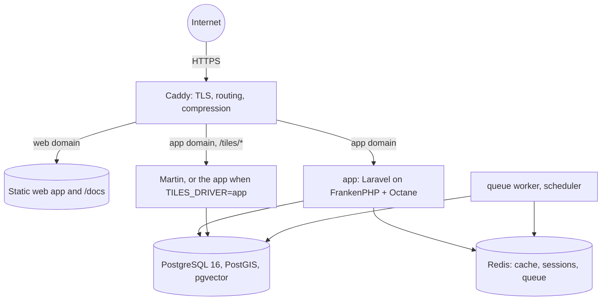
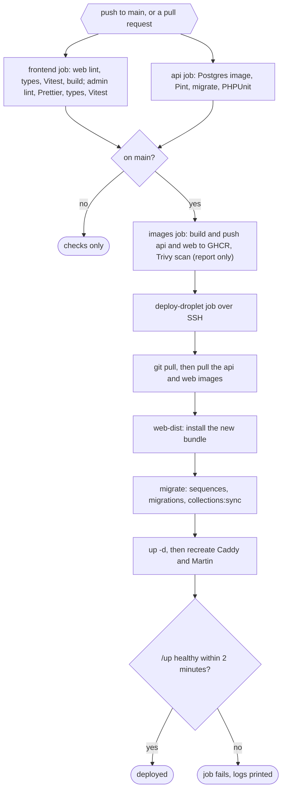
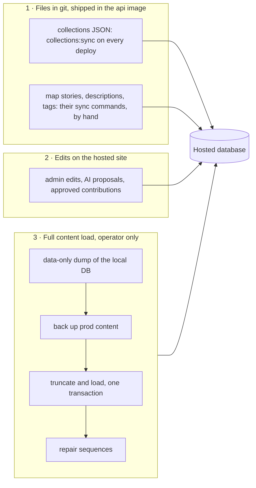

# Deployment and operations

How the hosted site runs, how a change reaches it, and how content moves between environments.
This is the architecture view. The step-by-step operator procedures are in the internal runbooks
linked at the end.

> **Audience:** developers, operators, technical stakeholders · **Read time:** 10 minutes ·
> **Last reviewed:** 2026-11-14

## At a glance

The hosted site is one DigitalOcean droplet running Docker Compose. Caddy terminates TLS for two
domains. The **web domain** (historymapped.org) serves the public app as static files. The
**app domain** (api.historymapped.org) serves the API, the admin and the vector tiles.

## Environments

| | Local development | Hosted site |
|---|---|---|
| Orchestration | `docker/docker-compose.yml` (project `history-mapped`) | `docker/docker-compose.prod.yml`, always through `bash docker/compose-prod.sh` |
| Entry point | nginx :8000 → PHP-FPM | Caddy :443 → FrankenPHP with Octane |
| Public web app | Vite dev server :5173 | Static bundle built in CI, served by Caddy |
| Admin frontend | Vite HMR :5174, page served on :8000 | Compiled into the api image |
| Tiles | Martin :3000, or the app at `:8000/tiles` | Martin or the app, chosen by `TILES_DRIVER` |
| Mail | Mailpit :8025 | `log` until an SMTP provider is configured |
| Extras | CloudBeaver :8978, RedisInsight :5540 | none |
| Configuration | `api/.env`, `web/.env`, `docker/.env` for ports | `docker/.env.prod` on the server (not in git); `VITE_*` from GitHub repository variables |

## Request routing

| Domain | Path | Goes to | Notes |
|---|---|---|---|
| web domain | everything | `/srv/web/current` | Single-page app: unknown paths fall back to `index.html`. `/docs` is part of this bundle |
| app domain | `/tiles/*` | Martin, or the app | `Cache-Control: public, max-age=300` |
| app domain | `/ai/chat` | app | Server-sent events: no compression, flushed immediately |
| app domain | everything else | app | `/api/v1/*`, sign-in, `/sanctum/csrf-cookie`, the admin, `/docs/api` (generated API docs, admins only by default), `/up` |

The SPA and the API sit on sibling subdomains. Sign-in works across them because the session cookie
is set on the parent domain (`SESSION_DOMAIN`), the SPA host is listed in
`SANCTUM_STATEFUL_DOMAINS`, and CORS allows the SPA origin with credentials.

## Containers on the hosted site

| Service | Image | Role |
|---|---|---|
| `caddy` | `caddy:2-alpine` | TLS (Let's Encrypt), routing, static files; the only service that publishes ports |
| `app` | `ghcr.io/…/history-mapped/api:<sha>` | API and admin on Octane; health check `/up` |
| `queue` | same image | `queue:work --tries=3 --max-time=3600` |
| `scheduler` | same image | `schedule:work`: daily proposal pruning and image fetching |
| `martin` | `ghcr.io/maplibre/martin:1.16.1` | Vector tiles, only with the `martin` profile |
| `db` | built from `docker/db/` | PostgreSQL 16, PostGIS 3.5, pgvector 0.8.2 |
| `redis` | `redis:7-alpine` | Cache, sessions and queue, with append-only persistence |
| `migrate` | api image, `setup` profile | One-off: `db:repair-sequences`, `migrate --force`, `collections:sync`, `config:cache` |
| `web-dist` | `ghcr.io/…/history-mapped/web:<sha>`, `setup` profile | One-off: copies the bundle to `releases/<sha>` and switches the `current` symlink |

Volumes: `postgres_data`, `redis_data`, `caddy_data` (certificates), `caddy_config` and `web_dist`
(the current and previous web releases).

## Shipping a change

Every push to `main` runs CI. When the checks pass, CI builds both images and deploys to the
droplet. A newer push cancels a run that is still in progress.

| Fact | Detail |
|---|---|
| Images | `api` (`docker/api/Dockerfile.prod`: PHP extensions, Composer without dev packages, the admin build, FrankenPHP runtime) and `web` (`docker/web/Dockerfile.prod`: the SPA plus the `docs/` markdown, built with the `VITE_*` repository variables) |
| Build gate | The web image is not built unless the `VITE_API_URL` repository variable is set |
| Docs | The `/docs` pages are compiled into the web image, so a docs change goes live with the next deploy |
| Tests not in CI | The web Vitest suite and the Python pipeline tests run locally only |
| Rollback | Re-run `web-dist` and `up -d` with the previous image tags. Migrations are not rolled back |

## What runs when

| Job | When | How |
|---|---|---|
| Database migrations, sequence repair, `collections:sync` | every deploy | the `migrate` one-off |
| Proposal pruning (`ai:prune-proposals`) | daily | scheduler |
| Image links (`entity:fetch-images --limit=2000`) | daily, 03:30 UTC | scheduler |
| `map-stories:sync`, `entities:sync-descriptions`, `tags:sync`, `map-stories:relink` | when their source files change | by hand: `bash docker/compose-prod.sh exec app php artisan <command>` |
| Embeddings (`pipeline:embeddings`) | after large imports | by hand; needs an OpenAI key |

## Moving content

Content is the database, not the code. There are three ways it changes on the hosted site:

- **File-backed content** syncs without losing edits: map-story and description syncs skip rows
  that were edited on the site, unless forced.
- **A full content load replaces** the content tables wholesale, so edits made on the hosted site
  must be exported first: map stories with `map-stories:export --edited`, and approved
  contributions brought back to the local database. User accounts, saved items, contributions and
  sessions are never part of the dump.
- **Content bundles** (`content:export`, `content:validate`; format in
  [Content bundles](../schemas/content-bundle.md)) are the planned replacement for the full load.
  The import side is designed but not built yet.

## Tiles in production

- `TILES_DRIVER=martin` (the default) runs Martin on its own connection pool and cache.
  `TILES_DRIVER=app` serves the same tiles from Laravel with no extra service. Switching needs only
  the env line and a Caddy restart; the SPA is unchanged.
- Martin reads the tile functions only at startup. Every deploy recreates it, and locally you must
  `docker compose -f docker/docker-compose.yml restart martin` after a tile migration.
- The tile function reprojects with PostGIS, so `spatial_ref_sys` must hold EPSG:4326 and 3857.
  Migration `2026_11_03_000001_ensure_tile_srids` restores them.
- Contract and caching: [Atlas vector tiles](../schemas/atlas-tiles.md).

## Configuration

Names only; values live in `docker/.env.prod` on the server, and in GitHub secrets and variables.

| Group | Variables |
|---|---|
| Compose | `APP_IMAGE`, `WEB_IMAGE`, `APP_DOMAIN`, `WEB_DOMAIN`, `TILES_DRIVER`, `POSTGRES_*` |
| Laravel core | `APP_*`, `FRONTEND_URL` (CORS, admin preview), `DB_*`, `REDIS_*`, `CACHE_STORE`, `SESSION_DRIVER`, `QUEUE_CONNECTION`, `LOG_*`, `OCTANE_*` |
| Sign-in | `SESSION_DOMAIN`, `SESSION_SECURE_COOKIE`, `SANCTUM_STATEFUL_DOMAINS` |
| AI and external services | `AI_DEFAULT_PROVIDER`, `AI_DEFAULT_MODEL`, `OPENROUTER_API_KEY`, `OPENAI_API_KEY` (embeddings), `WIKIDATA_USER_AGENT`, `OHM_*`, `OVERPASS_*` |
| Tiles and API docs | `TILES_CACHE_TTL`, `TILES_MAX_AGE`, `SCRAMBLE_DOCS_PUBLIC` |
| Web build (repository variables) | `VITE_API_URL` (required), `VITE_MAP_TILES_URL`, `VITE_ADMIN_ORIGINS` |
| CI secrets | `DROPLET_HOST`, `DROPLET_USER`, `DROPLET_SSH_KEY` (plus optional port and registry credentials) |

## Known operational gaps

| Gap | Effect | Mitigation today |
|---|---|---|
| No scheduled database backup | A host failure loses data since the last manual dump | The content loader dumps prod content before every full load |
| Health gate checks only the app container | A broken Caddy, TLS, tiles or SPA release passes the deploy | Check the site after a deploy |
| No maintenance mode | Migrations run while the old app still serves | Keep migrations backward compatible |
| One server | No redundancy | Images are in GHCR and the setup is reproducible from the repo |

## Runbooks (internal)

- [`deployment-runbook.md`](../implementation-docs/deployment-runbook.md): first-time droplet setup,
  secrets, rollback
- [`content-data-transfer.md`](../implementation-docs/content-data-transfer.md): the full content
  load, step by step
- [Local setup](../implementation-docs/setup.md): the development stack
