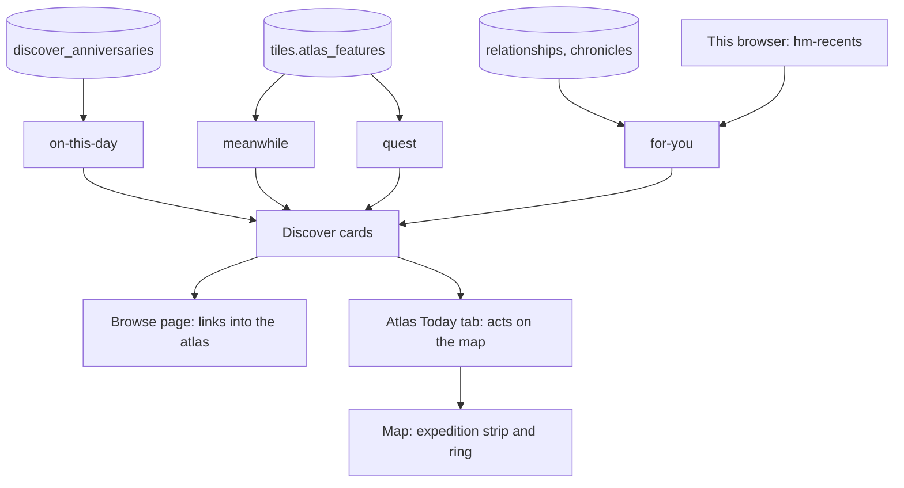

# Discover: "Today in the atlas"

Four cards that give a reader something to do with the map and the timeline: what happened on
this day, what the rest of the world was doing in a year, a daily expedition to find three
battles in time and place, and suggestions from what this browser opened. They show on the
browse page and in the atlas sidebar.

> **Audience:** developers, editors · **Read time:** 7 minutes · **Last reviewed:** 2026-11-20 ·
> **Code:** `api/app/Actions/Discover/`, `web/src/components/discover/`, `web/src/lib/discover/`

## The four cards

| Card | What the reader gets | Read from |
|---|---|---|
| On this day | Events, foundings, births and deaths on today's month and day. A row opens the entity on the map in its own year | `discover_anniversaries`, a derived table |
| Meanwhile | One year across eleven world regions: each region's most notable event and its most written-about state | `tiles.atlas_features`, so every row is on the map that year |
| Expedition | Three battles a day (easy, medium, hard) to reach on the timeline and the map, with two warm/cold meters | `tiles.atlas_features` and the chronicle mention index |
| For you | Entities, chronicles and battle maps related to what this browser opened lately | `relationships`, chronicle entries, map stories |

## Where they show

| Surface | Variant | How a row acts |
|---|---|---|
| `/browse`, section "Today in the atlas" | `page` | A link into the atlas with the entity and the year (`atlasHref`) |
| Atlas sidebar, tab **Today** (URL `tab=today`) | `panel` | In place: moves the timeline, opens the entity, flies the map (`useAtlasGo`) |
| Phone bottom sheet, tab **Today** | `panel` | The same |

| Rule | Detail |
|---|---|
| Card order in the atlas | Expedition, on this day, meanwhile, for you |
| Meanwhile's year in the atlas | The timeline's year, once it has rested for 400 ms |
| Meanwhile's year on the browse page | The year of the first event among today's "on this day" rows, and the card says so |
| A card with nothing to show | Leaves itself out. With none left the browse section hides its heading too |
| The tab from elsewhere | `useOpenBrowseTab('today')` opens it, expands a collapsed sidebar and lifts a peeking sheet |

## Endpoints

All four are public, under `/api/v1/discover`, and return `{ "data": … }`. Fields and selection
rules are in the [REST API reference](../schemas/rest-api.md).

| Endpoint | Parameter | Kept on the server | Local time, uncached |
|---|---|---|---|
| `GET /discover/on-this-day` | `date` (the reader's local day) | 12 hours per month and day | 22 to 33 ms |
| `GET /discover/meanwhile` | `year` (-4000 to this year) | 6 hours per year | 32 to 52 ms |
| `GET /discover/quest` | `date` (within 2 days of the server's) | 36 hours per date | 42 to 58 ms |
| `GET /discover/for-you` | `ids` (1 to 12 entity ids) | never: it belongs to one browser | 37 to 81 ms |

An answer with nothing in it is kept for 5 minutes only, so a request that arrives before the
tables are built does not pin an empty card. No request scans the `entities` table: each
endpoint picks its few entities from a small table or an index and reads those rows by primary
key (`App\Support\Discover\DiscoverEntities`).

## On this day

Only about 5,000 of the atlas's 594,000 date ranges carry a real day, and finding them means a
pattern match over every row. People's birth and death dates sit in `entities.attributes`, in
the 1 GB heap. Neither can be read per request, so a command builds a small table.

| Part | Detail |
|---|---|
| Table | `discover_anniversaries`: `entity_id`, `kind`, `month`, `day`, `year`, `date`, `impact`, `placed`. One row per entity and kind |
| Kinds | `happened`, `began`, `ended` (events); `born`, `died` (people); `founded`, `dissolved` (everything else) |
| Source 1 | Primary date ranges whose text has a real day (`1815-11-20`) |
| Source 2 | `attributes.birth_date` and `death_date` of people with impact 60 or more |
| Left out | 1 January (it stands for "that year"). The 1st of another month unless the summary states that day (it often stands for "that month"). The birthday of a person not known to have died |
| Order of a day | Entities on the map first, then by impact. At most 4 people, with room for 2 of the other kinds |
| A thin day | Borrows from the days around it, up to 3 days away, until it has 4 items. The answer's `widened` says how far |
| Size (local, 2026-11-20) | 70,915 rows, 365 of 366 days, median 195 rows a day |

## Meanwhile

| Part | Rule |
|---|---|
| Region | From the entity's map point, by a fixed table of boxes (`App\Support\Discover\WorldRegion`). Tags cover only a fifth of the map entities, so they are not used |
| Events | The `EVENT` group within 10 years of the year, the span the tiles keep an event on the map |
| States | The `POLITY` group, people excluded, standing in the year |
| The event of a region | The highest importance, then the nearest in time |
| The state of a region | The most mentioned in chronicles for the time it stood: mentions divided by one plus its centuries. Then importance, then the longest standing |
| Lead sentence | Two events far apart on the map, "while" when both were under way that year, "around" otherwise. It only joins names and years the API sent |

Importance cannot choose the state: it is 98 for every state with an end year and 96 for one
without. Raw mention counts favour whatever lasted longest. Mentions per century give the
Shang, Rome, the Tang, the Ming, the Ottomans and the United States in their own times.

## The daily expedition

| Part | Rule |
|---|---|
| Pool | Battles the tiles show from zoom 3, with a point in a region and a summary of 40 characters or more: 1,959 locally |
| Easy | A battle map, or at least 2 chronicle mentions (309) |
| Medium | Exactly 1 mention (1,271) |
| Hard | Never mentioned (379) |
| The day's three | One per tier, the first by `md5(id + date)`: the same for everyone on a date |
| Number | Days since `DISCOVER_QUEST_EPOCH` (2026-11-20), plus one |

Playing happens in the browser (`web/src/lib/discover/quest.ts`, pure and unit-tested).

| Part | Rule |
|---|---|
| "When" meter | Years between the timeline and the battle: here up to 10, hot up to 50, warm up to 200, cool up to 800, then cold |
| "Where" meter | Km from the middle of the visible map: hot up to 800, warm up to 2,500, cool up to 6,000, then cold |
| Here, in place | The battle is inside the visible map and the view is at most 3,000 km corner to corner |
| Arrival | Both meters read "here": a ring appears on the battle, and clicking it marks the find and opens the entity |
| Clue | The battle's summary with its years hidden until the "when" hint, a lift or the find |
| Hints | "When" shows the year. "Where" shows the region, a nearer place when the atlas has one, and the direction and distance |
| Stars | 3 with no hint, 2 with one, 1 with both, none after "Take me there" |
| Streak | Days in a row with all three found |
| Share | "Copy result" copies the stars per difficulty, never the names |

The strip over the map and the ring are `web/src/components/map/QuestLayer.tsx`. With no target
active the layer holds one store subscription and nothing else. It stands down while a chronicle
or a battle map plays.

## For you

| Part | Rule |
|---|---|
| What counts as opened | An entity that becomes the atlas selection, and a search word kept as the filter (`DiscoverRuntime`) |
| What is sent | The ids of up to 12 opened entities. The list itself never leaves the browser |
| Entities | The other end of each opened entity's relationships: the 3 of highest impact for each, 8 in all |
| Direction | `outgoing` says which way the relationship reads, so the row is worded truthfully: "victorious at Battle of Magdala", or "Siege of Jhain: commanded by" |
| Year a row opens at | The year the relationship starts when it has one (about one in nine do), else the first year both existed |
| Chronicles and battle maps | Up to 4 chronicles that name an opened entity and 3 battle maps of an opened or suggested one |
| Cost bound | At most 400 relationships are read per opened entity, so a hub such as World War I stays cheap |

## Kept in the browser

| Key | Holds | Cleared by |
|---|---|---|
| `hm-recents` | Up to 12 opened entity ids and 8 search words, newest first | "Clear" on the For you card |
| `hm-quest` | Today's expedition: the active target, hints taken, finds, and the streak | A new local day (the streak is kept) |

Storage that is missing or throws (a private window) costs only the memory: both features work
for the session.

## Operations

| Task | When | How |
|---|---|---|
| Create the tables | Every deploy | The `migrate` job: `discover_anniversaries` and an index on `chronicle_entries.primary_relationship_id` |
| Build the anniversaries | Hourly when the table is empty, and every Monday 04:10 | Scheduler: `discover:build-anniversaries --if-empty`, and the full rebuild |
| Build them now | After a deploy or a content load, to skip the wait | `php artisan discover:build-anniversaries` (about 3 s locally, tens of seconds on the droplet) |
| Change a threshold | Rarely | `api/config/discover.php` |

A content load truncates `entities`, which empties `discover_anniversaries` through its foreign
key. The hourly job rebuilds it.

## Known limits

| Limit | Why |
|---|---|
| "State" can be a people, a province, a party, or now and then a company or a ship | They share the `political_entity` type and nothing in the data tells them apart |
| A wrong map point puts an entity in the wrong region | For example a battle matched to a namesake town. The cards show what the map shows |
| Most expedition targets have no nearer place hint | 98% of the battles' location names repeat the battle's own name |
| One in nine relationships carries a year | The rest open at the first year both entities existed |
| No judgement between places ("A was better off than B") | That needs written, sourced content. Meanwhile only sets facts side by side |
| Streaks and recents stay in one browser | There is no account-side copy |

## Code map

| Path | Role |
|---|---|
| `api/app/Actions/Discover/` | One action per endpoint, and `BuildAnniversariesAction` |
| `api/app/Support/Discover/` | `WorldRegion` (the boxes, in PHP and as SQL) and `DiscoverEntities` (the shared entity shape) |
| `api/config/discover.php` | Every size, threshold and cache time |
| `web/src/lib/schemas/discover.ts` | The contract the cards parse |
| `web/src/components/discover/` | The cards, `DiscoverPanel` (atlas), `DiscoverSection` (browse), `DiscoverRuntime` (records what is opened) |
| `web/src/lib/discover/` | Pure rules: `quest.ts`, `quest-map.ts`, `wording.ts`, `pick.ts`, and the two stores |
| `web/src/components/map/QuestLayer.tsx` | The strip over the map and the found-it ring |
