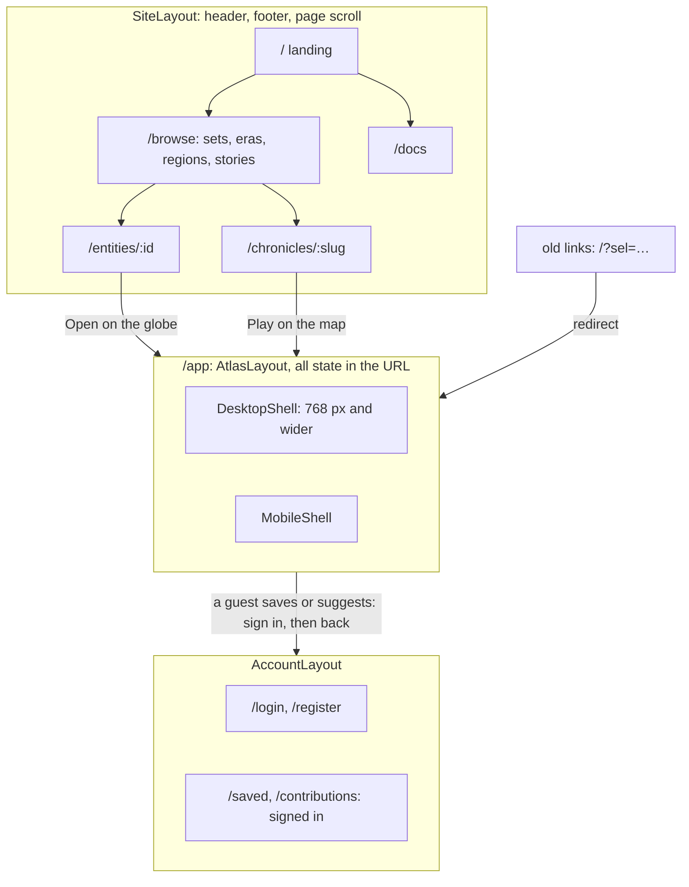
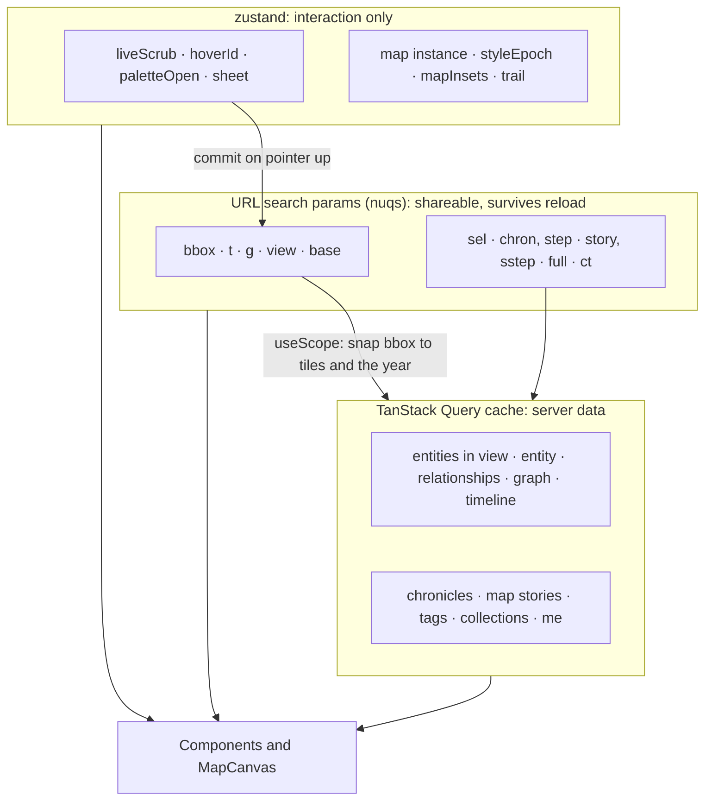
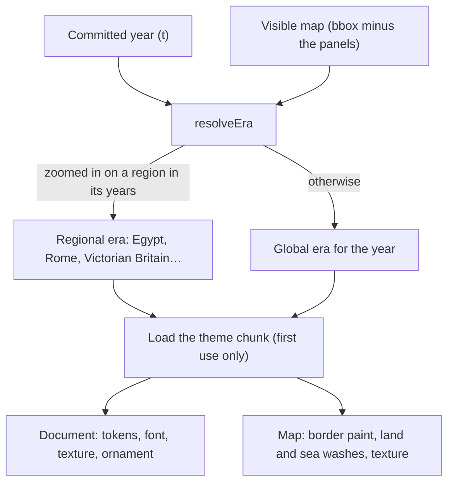
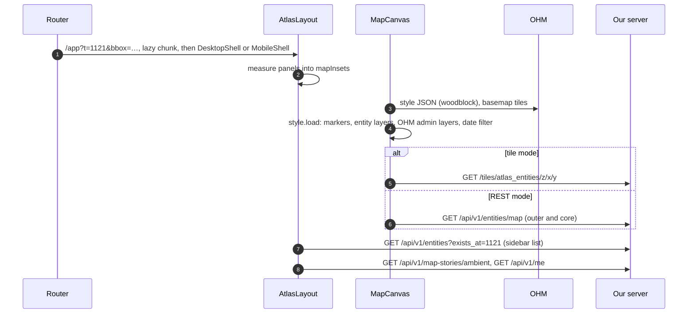
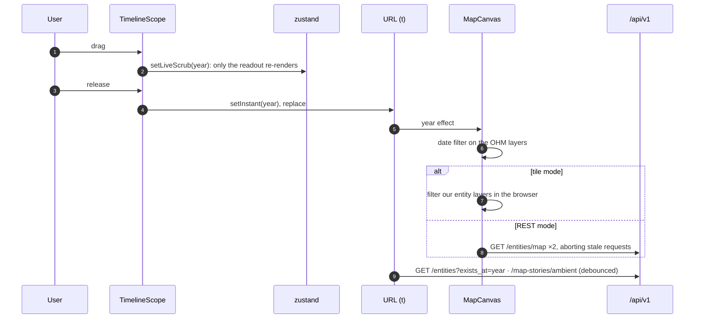
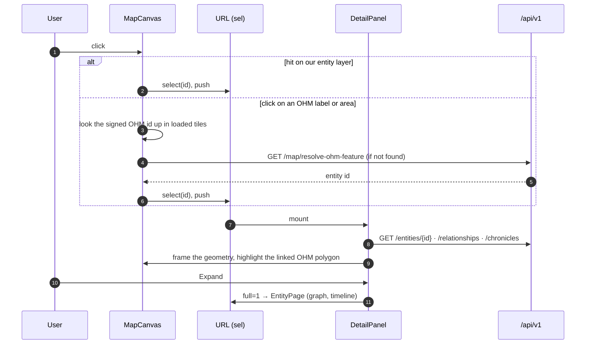

# Public web app

`web/` is the public single-page app at historymapped.org. It has two frames: the
**site** (landing, browse, entity and chronicle pages, docs, account) and the **atlas** at `/app`,
a full-screen map with a timeline. This page covers its routes, where state lives, how data is
fetched, and the main user flows.

> **Audience:** developers · **Read time:** 12 minutes · **Last reviewed:** 2026-11-14 ·
> **Stack:** React 19, Vite 7, react-router 7, nuqs 2, TanStack Query 5, zustand 5, zod 4, MapLibre GL 5,
> Tailwind 4 with shadcn/Base UI, vite-plugin-pwa

## At a glance



- Every page is a lazy chunk, the atlas included. Only `SiteLayout` and `AccountLayout` load
  eagerly. The atlas chunk carries MapLibre and both shells.
- The router is `app/router.tsx`. Providers, outside to inside: `QueryClientProvider`,
  `BrowserRouter`, `NuqsAdapter` (`app/providers.tsx`).
- `/` with a query string is an atlas link from before the atlas moved to `/app`, so it redirects
  there with the same query and hash (`lib/legacy-redirect.ts`).

## Routes

| Path | Page | Notes |
|---|---|---|
| `/` | `LandingPage` | Collections, top chronicles, three map stories, tags |
| `/browse` | `BrowseIndexPage` | Curated sets, era, region and theme grids, chronicles and battle-map strips |
| `/browse/stories` | `StoriesPage` | Every map story, filterable by kind, sorted by year or title |
| `/browse/collections/:slug` | `CollectionPage` | Cards for the set's entities, chronicles, stories and tags |
| `/browse/:facet/:tag` | `BrowseFacetPage` | Chronicles and entities with a tag; a wrong facet redirects to the right one |
| `/entities/:id` | `EntityRoute` → `EntityPage` | A non-UUID id, or an API 404, shows "not found" |
| `/chronicles/:slug` | `ChronicleRoute` → `ChroniclePage` | `?step=n` (0-based) is read once on mount |
| `/docs`, `/docs/:slug` | `DocsLayout` → `DocPage` | Markdown from the repo's `docs/` ([below](#the-docs-pages)) |
| `/login`, `/register` | account pages | `?next=` is checked by `safeNext` |
| `/saved`, `/contributions` | account pages | Wrapped in `RequireUser`, which redirects guests to `/login?next=` |
| `/app` | `AtlasLayout` | `DesktopShell` at 768 px and wider, `MobileShell` below |
| `*` | `NotFoundPage` | |

## The atlas (`/app`)

### Where state lives

Every piece of state has exactly one home. Shareable state goes in the URL, server data in the query
cache, and short-lived interaction state in zustand.



| URL key | Hook | History | Meaning |
|---|---|---|---|
| `bbox` | `useViewport` | replace | Camera bounds, written 250 ms after the map stops moving. Default `-25,30,65,70` |
| `t` | `useTimeState` | replace | The timeline year (default 1121). `a..b` is a range |
| `g` | `useFilters` | replace | Entity groups shown; empty means all |
| `view` / `base` | `useView` / `useBasemap` | replace | `map` or `globe` projection; basemap `woodblock` (default), `historical` or `railway` |
| `sel` | `useSelection` | push | Selected entity id: opens the detail panel |
| `chron`, `step` | `useChronicleNav` | push | Chronicle tour and step (0-based). Entering one clears `sel` and any story |
| `story`, `sstep` | `useStoryNav` | push | Map story and step. Entering one clears `sel`, `chron`, `step` and `full` |
| `full` | `useFullPage` | push | Expands the focus (`sel` wins over `chron`) into a full page |
| `ct` | `useChronicleTags` | replace | Tag filter on the Chronicles tab |
| `preview=1` | read once | — | The admin's map-story preview iframe (postMessage bridge) |

Panning, zooming and scrubbing use `replace`, so they do not flood the history. Opening something
uses `push`, so **Back** closes it again. nuqs writes the URL shallowly, so code that needs the live
atlas URL reads `window.location`.

**Derived scope.** `useScope()` crops the URL bbox by the share of the map hidden under panels
(`mapInsets`), then snaps it to a tile grid two zoom levels finer than the map. A small pan inside
the same tiles keeps the same query key, so it fetches nothing. Viewport queries wait until the
shells have measured `mapInsets`.

### Shells

| | Desktop (`DesktopShell`) | Phone (`MobileShell`) |
|---|---|---|
| Top bar | Brand, search (⌘K), map/globe, theme, basemap menu, account menu | Search, theme, a tools menu |
| Left | Story player, else chronicle player, else the sidebar (Browse and Chronicles tabs) | One bottom sheet (vaul) with snaps at 130 px, 55% and 97% |
| Right | Detail panel whenever `sel` is set, beside a running tour | none: a selection takes the sheet |
| Timeline | A strip under the map | A card floating over the map |
| Full pages | Slide up over the map in two layers: a chronicle page with an entity page above it | The sheet's top snap is the page |

Crossing 768 px swaps shells, which remounts the map; the camera is restored from `bbox`.

### The map

`components/map/MapCanvas.tsx` owns one MapLibre map per shell. It loads an OpenHistoricalMap style,
adds our layers on every style load, and filters everything by the timeline year. Layers from bottom
to top: OHM basemap, OHM admin polygons (shown only to highlight a linked entity), battle relief,
ambient stories, our entities, then the active map story. The full layer stack and the date rule
are in [Maps, tiles and OHM](ohm-integration.md).

Our entities come from one of two sources:

| Mode | When | Entities from | A year change |
|---|---|---|---|
| **Tile mode** | `VITE_MAP_TILES_URL` is set (the hosted site) | Vector tiles from Martin or the app | Re-filters the loaded tiles on the client; no tile request |
| **REST mode** | variable unset (local default) | Two merged `GET /entities/map` calls: the visible area, and a denser core at z+3 | Refetches, with the previous pins kept on screen |

In both modes a committed year also refetches the sidebar list (`GET /entities?exists_at=…`) and the
ambient stories.

### Timeline, panels, search

- **Timeline** (`TimelineScope.tsx`, built on `@timescope/react`). Axis from −10000 to 2050.
  Dragging updates only the readout (`liveScrub`); releasing commits `t`, and the map re-filters
  then. There is no play button or range control.
- **Detail panel** (`DetailPanel.tsx`): entity, relationships and chronicles. It shows the image,
  save controls, map-story buttons, chronicle chips and a relationship timeline. Expand opens
  `EntityPage` as a full page.
- **Chronicle player** (`ChroniclePlayer.tsx`): one entry per step. Moves the timeline to the step's
  year and frames the entities it involves. If the chronicle has a map story, that story draws as
  its map layer. See [Chronicles](chronicles.md).
- **Map-story player** (`StoryPlayer.tsx` with `map/StoryOverlay.tsx`): step-by-step playback with
  animated units, routes and regions. See [Map stories](map-stories.md).
- **Search** (`CommandPalette.tsx`, ⌘K or Ctrl-K): global name search through
  `GET /entities?search=…&sort=relevance`. The Chronicles tab has its own server-side search.

### Era themes

The atlas restyles itself for the time and place on the map: sand and lapis for Ancient Egypt,
off-white marble and a dentil cornice for Rome, grey and red for the Cold War. Colours, the heading
font, a texture, an ornamented border down the side panels and the map's borders, land and sea all
follow the era. Readers
can turn it off in the Layers menu (stored per browser).



| Part | What it does |
|---|---|
| **Manifest** (`lib/era/manifest.ts`) | The only part in the main bundle: each era's id, label, years, regions (lon/lat boxes) and priority. Nine global eras tile the whole timeline, from earthy Prehistory to the blue Global Age |
| **Resolve** (`lib/era/resolve.ts`) | Zoomed in (the visible map at most 60° wide), the highest-priority regional era whose years and box hold the view's centre wins; else the global era for the year |
| **Theme modules** (`lib/era/themes/*.ts`) | One lazily loaded chunk per theme (about 0.6 kB): paper, ink and accent colours, a heading font, a texture, an ornament and the map styling |
| **Tokens** (`lib/era/tokens.ts`) | Derives the full light and dark token set from those colours, pushing text until it meets WCAG contrast (tests check every theme in both modes) |
| **Document** (`lib/era/apply.ts`, `hooks/useEraTheme.ts`) | Adds the theme's stylesheet under `html[data-era-theme=…]`, loads its @fontsource font, draws its texture. Colour tokens are registered with `@property`, so they ease between eras |
| **Map** (`lib/era/map-style.ts`, `components/era/EraLayer.tsx`) | Recolours OHM's admin lines and adds a sea wash, a land wash and a land texture, after every basemap switch. Each call restores the basemap first, so eras never compound |
| **UI pieces** (`components/era/`) | `EraBorder` (the era's ornament as a 6px solid border down each side panel's inner edge, hidden beside an empty side), the `era-surface` texture on panels, a vignette, and an announcer that names a new era as the map enters it |
| **Textures and ornaments** (`lib/era/textures.ts`, `ornaments.ts`) | Drawn in code: canvas noise for textures, and pixel-art tiles for the ornaments (whole pixels, so the thin border stays crisp and solid). Nothing to download, and only the active era's texture is drawn |

To add an era: write `lib/era/themes/<id>.ts`, add a manifest row (with regions and a priority for a
regional era), and run `pnpm test`, which checks contrast, colours and coverage.

`prefers-reduced-motion` stops the easing and the announcer's slide; `prefers-contrast: more`
removes textures and the vignette.

## Key flows

### Opening the atlas



### Scrubbing the timeline



The two filters are `applyOhmLayerDateFilter` (`lib/ohm-layer-date-filter.ts`) and
`applyEntityLayerFilters` (`lib/map-tiles.ts`).

### Selecting an entity on the map



## Data fetching

Every call goes through typed functions in `lib/api/` over axios (base URL `VITE_API_URL`), and every
response is parsed with zod. Query keys come from one factory, `qk` in `lib/query/queryKeys.ts`.
Defaults: 5 minutes stale, 30 minutes in memory, one retry. Entities, chronicles, graphs and map
stories never go stale (`staleTime: Infinity`), because historical records change rarely.

| Hook | Endpoint | Used by |
|---|---|---|
| `useEntitiesInView` | `GET /entities/map` (twice) | Map pins, REST mode only |
| `useEntityList` | `GET /entities?exists_at=…&sort=impact` | The sidebar's "notable here" list |
| `useEntitySearch` | `GET /entities?search=…` | ⌘K search |
| `useEntity`, `usePrefetchEntity` | `GET /entities/{id}` | Detail panel, pages, chronicle framing |
| `useEntityConnections`, `useEntityChronicles`, `useEntityTimeline` | `GET /entities/{id}/relationships`, `…/chronicles`, `…/timeline` | Detail panel, entity page |
| `useEntityGraph`, `useFetchNeighbourhood` | `GET /entities/{id}/graph` | Relation graph, "expand node" |
| `useChronicleList`, `useChronicle`, `useChronicleGraph` | `GET /chronicles`, `/chronicles/{slug}`, `…/graph` | Chronicles tab, player, chronicle page |
| `useMapStory`, `useMapStoryList`, `useAmbientStories` | `GET /map-stories/{slug}`, `/map-stories`, `/map-stories/ambient` | Players, browse, ambient layer |
| `useTags`, `useCollections`, `useCollection` | `GET /tags`, `/collections[/{slug}]` | Browse, landing |
| `useMe`, account hooks | `GET /me`, `/me/stars`, `/me/folders`, `/me/contributions`; `POST /contributions` | Account menu, saved items, suggest-an-edit |

The [REST API reference](../schemas/rest-api.md) documents the parameters.

## Site pages and link mode

`EntityPage` and `ChroniclePage` render in three places: as the atlas's full page, in the phone
sheet, and as the standalone `/entities/:id` and `/chronicles/:slug` pages. What their links do
depends on the **link mode** (`components/atlas/link-mode.tsx`, policy in `lib/page-nav.ts`):

| Action in a page | In the atlas | On the site |
|---|---|---|
| Open another entity | select it (push `sel`) | go to `/entities/:id` |
| Open a chronicle step | enter the tour at that step | go to `/chronicles/:slug?step=n` |
| Open a map story | enter the story | go to `/app?story=…&sstep=n` (it needs the map) |
| Show on the map | set the year, collapse, frame it | go to `/app?sel=…&t=<year>` |
| A tag pill | filter the Chronicles tab | go to `/browse/:facet/:tag` |

Site pages set the document title and description through `useDocumentMeta`. Links into the atlas
are built in one place: `atlasHref()` in `lib/site-links.ts`.

## The docs pages

`/docs` renders a curated subset of the repo's `docs/` folder. The list of pages is
`content/docs/manifest.ts`; the sources are bundled at build time as lazy chunks under
`assets/docs/`, which the service worker does not precache. `DocMarkdown` renders GitHub-flavoured
Markdown and draws ```` ```mermaid ```` fences as themed SVG diagrams. Relative links to other
published pages stay on the site; any other relative link goes to the file on GitHub.

## Cross-cutting concerns

| Concern | How |
|---|---|
| **Offline and caching (PWA)** | `vite-plugin-pwa`, auto-update. Precaches the app shell (not the docs). Runtime caches: OHM tiles and styles (cache-first, 30 days), our vector tiles (stale-while-revalidate, 1 day), `GET /api/v1/*` except `/me` and `/user` (stale-while-revalidate, 7 days). Manifest `start_url` is `/app` |
| **Themes** | Light and dark (`.dark` on `<html>`, set before first paint; follows the OS until toggled). MapLibre, Mermaid and the timeline are re-themed in code. The OHM basemaps stay light; dark mode dims the canvas. On top, the [era theme](#era-themes) of the time and place on the map, in both modes |
| **Auth** | Sanctum cookie session on the API domain. axios sends credentials and fetches the CSRF cookie before each write. `GET /me` returning 401 means "guest". Two-factor sign-in is supported |
| **Environment** | `VITE_API_URL` (required for builds), `VITE_MAP_TILES_URL` (turns on tile mode), `VITE_ADMIN_ORIGINS` (who may drive the preview iframe) |
| **Analytics** | None: no analytics or telemetry script is loaded |

## Performance principles

- **Snap before keying.** Queries key on the snapped scope, not the raw camera, so most pans are
  cache hits.
- **Commit gestures once.** Scrubbing changes only the readout until release, and the camera is
  written to the URL 250 ms after it stops moving.
- **Keep the map imperative.** Highlights use MapLibre feature-state, filters and `setData`, never a
  React re-render of the map.
- **Keep old data on screen** (`placeholderData`) and abort superseded requests through the query
  `signal`.
- **Load heavy code late.** Cytoscape, Mermaid, the full pages and each era theme (with its font)
  are separate chunks.

## Code layout (`web/src/`)

```text
app/            router, providers, route components (site/, browse/, docs/, atlas and account layouts)
components/
  atlas/        shells, panels, players, EntityPage, ChroniclePage, page kit
  map/          MapCanvas, StoryOverlay, StoryAmbientLayer
  era/          EraLayer (map styling, vignette, announcer), EraBorder
  graph/        RelationGraph (cytoscape, lazy)
  ui/           shadcn primitives
hooks/          URL-state, server-cache and ephemeral hooks (the only way components reach state)
lib/            api/, query/, url/, scope/, schemas/ (zod), map-story/, graph/, docs/, era/, pure helpers
stores/         zustand stores
content/docs/   the docs manifest
```

## Build and test

- `pnpm build` runs `tsc -b && vite build`. Production builds happen in CI, in
  `docker/web/Dockerfile.prod`; see [Deployment and operations](deployment.md).
- Vitest with jsdom runs `src/**/*.test.ts`: 38 files, mostly pure logic in `lib/` (map-story
  geometry, graph model, scope snapping, docs, URL rules). The map, shells and players have no tests.
- CI runs the web lint, type check, Vitest suite and build (`pnpm test` in `web/` locally).

## Where next

- [Maps, tiles and OHM](ohm-integration.md): the map layers and the date rule
- [Map stories](map-stories.md) and [Chronicles](chronicles.md): the two players
- [REST API](../schemas/rest-api.md): the endpoints this app calls
