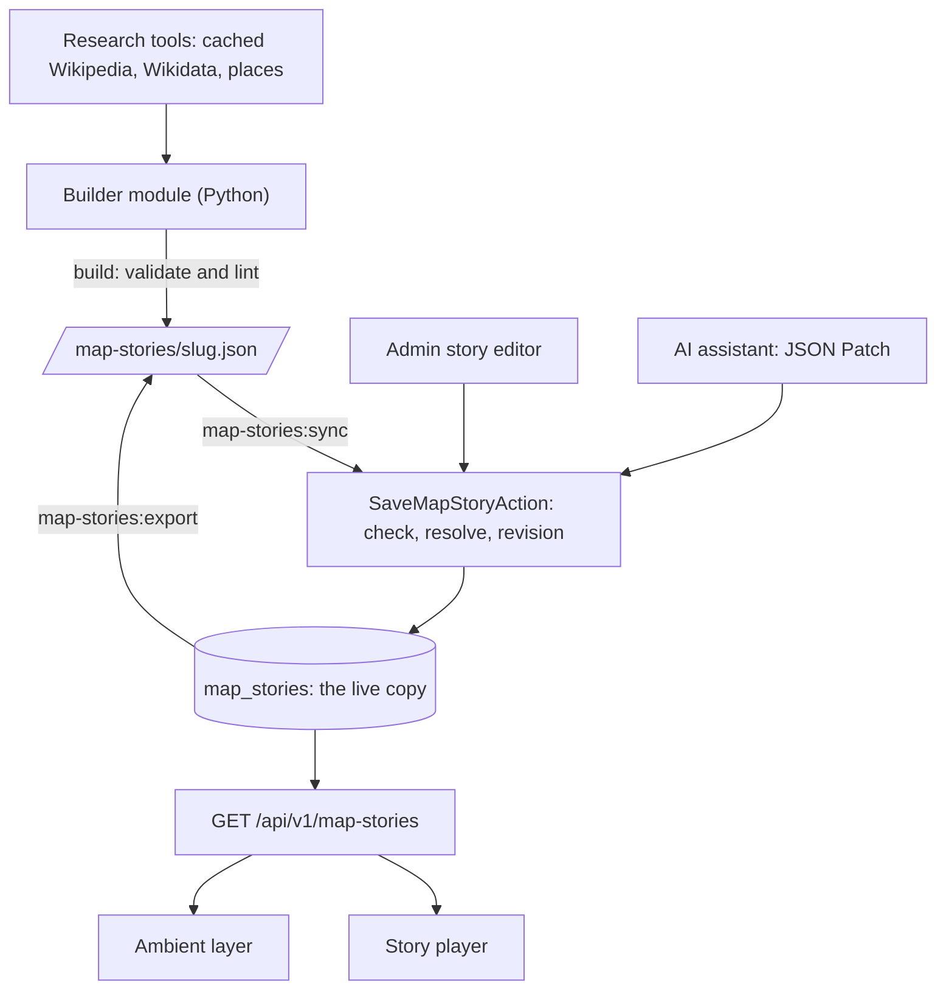
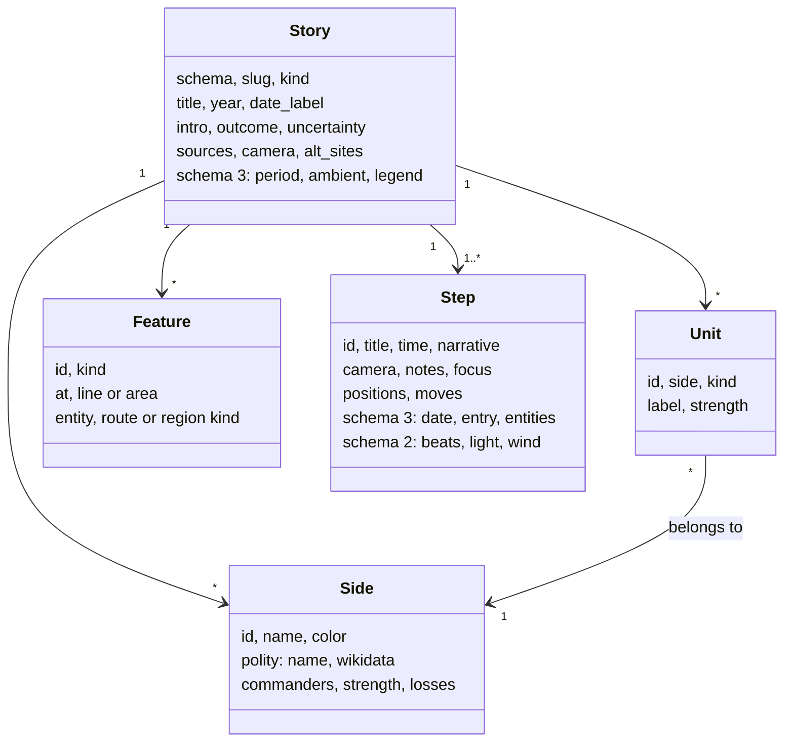
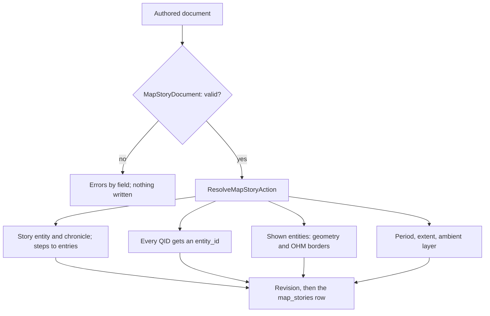
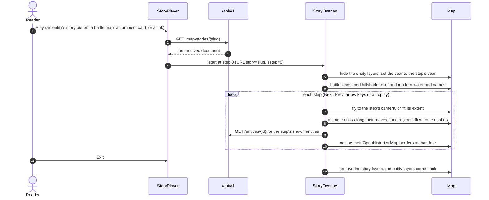
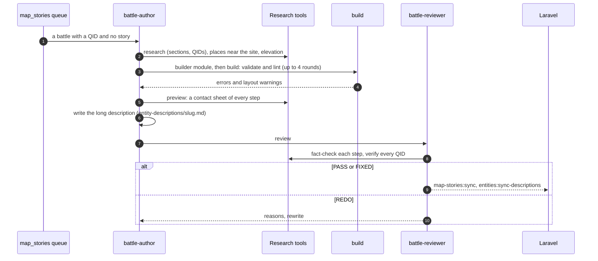

# Map stories

A map story replays one subject step by step on the map. A battle shows its units, positions and
manoeuvres. An epidemic shows its spread, and a trade network its routes and ports. Each step has a
date, a short narrative and a camera, and the story as a whole states its sources and its
uncertainty. This page covers the document format, the story's life from builder to database, and
how the public app plays it.

> **Audience:** developers, editors, historians, product · **Read time:** 9 minutes ·
> **Last reviewed:** 2026-11-14 · **Code:** `pipeline/map_stories/`, `api/app/Actions/MapStory/*`,
> `api/app/Support/MapStory/*`, `web/src/lib/map-story/*` · **How-to:** [Authoring map stories](../implementation-docs/map-story-authoring.md)

## At a glance

- **The database row is the live copy.** The JSON files are seeds and exports. `map-stories:sync`
  loads changed files and keeps rows that an editor changed, unless `--force`. `map-stories:export`
  writes edited rows back to the files.
- **There is one write path.** The editor, the AI, sync and restores all go through
  `SaveMapStoryAction`. It checks the document, resolves it against the atlas, and writes a
  revision and the row in one transaction. The newest 50 revisions are kept.

## What exists

There are 12 stories. 8 are battles, two of them naval: Blenheim, Cannae, Carrhae, Gaugamela,
Hastings, Navarino, Salamis and Waterloo. The other 4 are wide stories: the Black Death, the 1918
influenza pandemic, the Hanseatic League and the Indian Ocean dhow trade. The 4 wide stories are
also ambient, and the dhow-trade story is the map layer of a chronicle.

| Kind | Scale | Since schema |
|---|---|---|
| `battle`, `naval_battle`, `siege` | A battlefield: units, formations, arrows, terrain, light and wind | 1 |
| `campaign` | A theatre of operations | 1 |
| `war`, `expansion`, `migration`, `exploration`, `diffusion`, `event` | A region or continent: routes, regions, places | 3 |
| `trade_route` | Routes, ports and markets | 3 |
| `epidemic` | Outbreaks and spreading regions, with infected, peak and recovered states | 3 |

## The document

| Part | Purpose | Examples |
|---|---|---|
| **Sides** | The parties, with their polity's QID, commanders, strength and losses. Battles, naval battles and sieges need two | Carthage and Rome at Cannae |
| **Units** | What moves on the map | `heavy_infantry`, `cavalry`, `elephants`, `warship`, `caravan`, `fleet` |
| **Features** | The fixed map: points, lines and areas | a `river`, a `ridge`, `woods`, a `port`, a trade `route`, a spreading `region` |
| **Steps** | One moment each. Unit positions, moves (`advance`, `charge`, `rout`, `sail`, `spread`…), notes, and, in schema 3, the entities shown and the feature states | "Hannibal's centre gives way" |
| **Sources and uncertainty** | At least one source, typed `primary`, `secondary`, `web` or `video`, plus a statement of what is uncertain. Alternative sites can be listed where the location is disputed | Polybius, Livy; the site on the Aufidus is debated |

A story belongs to an entity (named with its QID), to a chronicle (by slug, schema 3), or to both.
In schema 3 a step can also name the chronicle entry it illustrates. There are 30 unit kinds, 31
feature kinds and 19 move types.

The vocabulary is defined three times and kept in step: `api/app/Support/MapStory/MapStoryVocabulary.php`,
`pipeline/map_stories/schema.py` and `web/src/lib/schemas/map-story.ts`. Schemas 1 to 3 are all
accepted.

## How a story is linked to the atlas

When a story is saved, `ResolveMapStoryAction` resolves every reference to an id, so the player can
link to the atlas pages:

A QID whose entity is clearly from another era resolves to nothing rather than to a namesake. After
new entities are imported, `map-stories:relink` resolves the stored stories again without losing
edits.

## Playing a story

- **Autoplay** waits 6 to 22 seconds per step, depending on the length of the narrative, plus 1.2
  seconds for each beat.
- **As a chronicle's map layer,** the story draws only its own layers under the chronicle player.
  Each chronicle step shows the matching story step.
- **Ambient stories** draw a faint layer of routes, regions, outbreaks and ports on the atlas for
  the current year whenever nothing is playing (`GET /map-stories/ambient?year=&bbox=`). The card
  on that layer has a "Play" button.
- **Where readers find stories:** the swords marker on the map (the tile property
  `has_map_story`), the entity panel and page, the landing page, `/browse` and `/browse/stories`.
- **Admin preview:** the admin story editor shows this same player in an iframe
  (`/app?story=<slug>&sstep=0&preview=1`) and sends it the draft as you type. See
  [Admin and editing](admin-map-editor.md#the-map-story-editor).

## Authoring

- Builder modules use layout helpers, so formations and arrows are computed rather than typed in.
  `build` refuses to overwrite a file that was exported from the admin until its edits are ported
  into the builder module (or `--force`).
- Research is cached under `output/map-stories/cache/`. Place and elevation lookups (OSM Nominatim,
  OpenTopoData) are limited to one call per second.
- The step-by-step guide, including the checks, the agents and the bulk run, is
  [Authoring map stories](../implementation-docs/map-story-authoring.md).

## Where next

- [Chronicles](chronicles.md): stories as a chronicle's map layer
- [Maps, tiles and OHM](ohm-integration.md): the basemap and borders the player draws on
- [REST API](../schemas/rest-api.md#map-stories-collections-tags-reference-data): the endpoints
