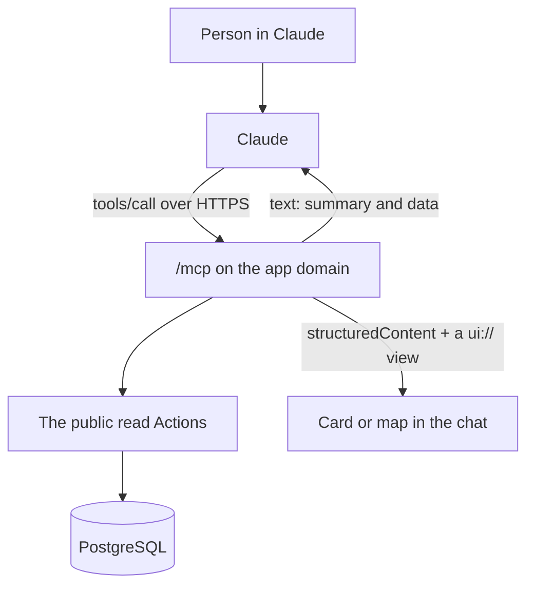

# MCP connector: the atlas in Claude

Claude, or any other MCP host, can connect to the atlas, answer history questions from its data, and
show the answers as cards and maps inside the chat. The server is read-only and needs no sign-in.

> **Audience:** developers, product · **Read time:** 5 minutes · **Last reviewed:** 2026-11-19 ·
> **Code:** `api/app/Mcp/`, `api/routes/ai.php`, `api/resources/views/mcp/` · **Design:** `docs/superpowers/specs/2026-11-19-mcp-connector-design.md`

## Connect it

| Where | How |
|---|---|
| Claude (web or desktop) | Customize → Connectors → Add custom connector, URL `https://api.historymapped.org/mcp`, no OAuth fields. Free plans allow one custom connector |
| Claude Code | `claude mcp add --transport http history-mapped https://api.historymapped.org/mcp` |
| Locally | `http://localhost:8000/mcp` on the dev stack. Claude itself needs a public URL, so test through a tunnel or use the test host below |

## Tools

All tools are read-only, with capped results ranked by similarity (search) or by impact. Years are
signed: -44 is 44 BC. Every record carries its `atlas_url`.

| Tool | Input | Returns | View |
|---|---|---|---|
| `search-atlas` | `query`, optional `types`, `year`, `limit` ≤ 20 | Entities and up to 5 chronicles | none |
| `get-entity` | `id`, `qid` or `name` | One entity: dates, places, description, image, top 12 relationships, chronicles | Entity card |
| `what-was-happening` | `year`, optional `bbox` or `region` (a region tag), `types`, `limit` ≤ 50 | Entities that existed then and have a point, by impact | Year map |
| `get-connections` | `id`, optional `types`, `limit` ≤ 40 | The entity, its neighbours and the edges | Connections graph |
| `find-chronicles` | `query` and/or `tags`, `limit` ≤ 20 | Curated chronicles | none |
| `get-chronicle` | `slug` | The chronicle and up to 60 steps | Timeline |

**What the model reads.** MCP Apps hosts keep `structuredContent` out of the model's context. Each
result's text therefore holds a one-line summary plus the same data as compact JSON
(`App\Mcp\Support\Reply`). `structuredContent` carries it in full for the views.

## Views

Views are `AppResource` classes (`api/app/Mcp/Resources/`) rendering one self-contained Blade file each.
The host shows them in a sandboxed frame and passes them the tool result. A view can call read tools
again, for example to step the year.

| View | Shows | Origins it declares |
|---|---|---|
| Entity card | Image with its Commons credit, dates, place, summary, relationships, Open in atlas | `upload.wikimedia.org`, `thumb.wikimedia.org` |
| Year map | MapLibre: OHM borders for the year, entities as pins by group, a year stepper. If the CDN, workers or WebGL are blocked it draws an SVG dot map instead | `cdnjs.cloudflare.com`, `tiles.openfreemap.org`, `vtiles.openhistoricalmap.org` |
| Connections | Radial graph, shape and colour per group, the full list below | none |
| Timeline | A chronicle's steps on a time axis, a list on narrow screens | none |

## Limits

| Limit | Value |
|---|---|
| Rate | `MCP_RATE_LIMIT`, 120 requests a minute per IP and MCP session (`throttle:mcp`) |
| Rows | Search 20, year map 50, connections 40, chronicle steps 60; counts stop at 1,000 |
| Data | Most records were imported automatically and are unreviewed; `verification_status` says so and the server tells the model to mention it |
| Speed | Tools take 6–130 ms on the local 641k dataset. A common-word `search-atlas` can take about a second on the droplet: see [Scalability](scalability.md#query-changes-made-after-the-benchmark) |

## Testing views locally

`scripts/mcp-harness/` is a small stand-in host. `python3 -I scripts/mcp-harness/server.py` serves it on
port 8765 and proxies `/mcp` to the dev API. It calls a tool, loads the tool's view under the CSP the
view declares, and answers the view's requests. URL parameters run it directly, for example
`?tool=get-entity&args={"qid":"Q517"}&theme=dark&width=380`; `&block=cdn` or `&block=worker` tests the
map's fallback. Tool tests are in `api/tests/Feature/Mcp/`.

## Next: contributions

A second server, `/mcp/contribute`, will sign people in with their atlas account (OAuth). Signed-in
people can suggest corrections and propose new entities and relationships. Everything goes to the
contributions queue and is reviewed in the admin before it exists. See the design spec.
