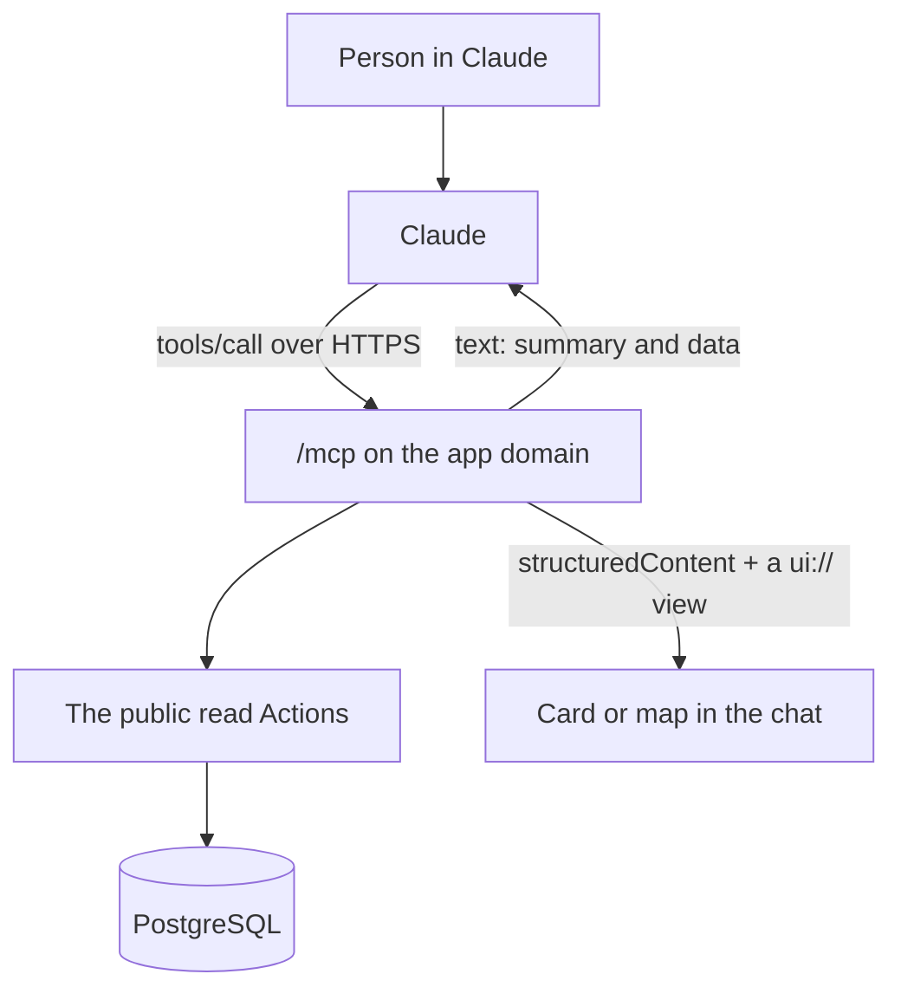

# MCP connector: the atlas in Claude

Claude, or any other MCP host, can connect to the atlas, answer history questions from its data, and
show the answers as cards and maps inside the chat. The server is read-only and needs no sign-in.

> **Audience:** developers, product · **Read time:** 5 minutes · **Last reviewed:** 2026-11-19 ·
> **Code:** `api/app/Mcp/`, `api/routes/ai.php`, `api/resources/views/mcp/` · **Design:** `docs/superpowers/specs/2026-11-19-mcp-connector-design.md`

## Connect it

| Where | How |
|---|---|
| Claude (web or desktop) | Customize → Connectors → Add custom connector, URL `https://api.historymapped.org/mcp`, no OAuth fields. Free plans allow one custom connector |
| Claude Code | `claude mcp add --transport http history-mapped https://api.historymapped.org/mcp` |
| Locally | `http://localhost:8000/mcp` on the dev stack. Claude itself needs a public URL, so test through a tunnel or use the test host below |

## Tools

All tools are read-only, with capped results ranked by importance of the match (search) or by impact. Years are
signed: -44 is 44 BC. Every record carries its `atlas_url`.

| Tool | Input | Returns | View |
|---|---|---|---|
| `search-atlas` | `query`, optional `types`, `year`, `limit` ≤ 20 | Entities and up to 5 chronicles | none |
| `get-entity` | `id`, `qid` or `name` | One entity: dates, places, description, image, top 12 relationships, chronicles | Entity card |
| `what-was-happening` | `year`, optional `bbox` or `region` (a region tag), `types`, `limit` ≤ 50 | Entities that existed then and have a point, by impact | Year map |
| `get-connections` | `id`, optional `types`, `limit` ≤ 40 | The entity, its neighbours and the edges | Connections graph |
| `find-chronicles` | `query` and/or `tags`, `limit` ≤ 20 | Curated chronicles | none |
| `get-chronicle` | `slug` | The chronicle and up to 60 steps | Timeline |

**What the model reads.** MCP Apps hosts keep `structuredContent` out of the model's context. Each
result's text therefore holds a one-line summary plus the same data as compact JSON
(`App\Mcp\Support\Reply`). `structuredContent` carries it in full for the views.

## Search ranking

`search-atlas` and the `name` lookup of `get-entity` re-rank inside the MCP layer (`Support/EntitySearch`,
`Support/SearchRanking`), so "hastings" leads with the Battle of Hastings, not a town. Candidates are the list
action's best 60 by trigram similarity, plus the 40 most important names with the query at a word start and the
20 most important exact names. Each is scored `100 x match quality + impact_score`:

| Match quality | Example for the query |
|---|---|
| 1.00 exact name | `Hastings` |
| 0.90 starts with it as whole words | `Napoleon III` |
| 0.80 whole words inside | `Battle of Hastings` |
| 0.45 / 0.40 / 0.20 start of a word / later word / inside a word | `Napoleonic Wars` / `Kingdom of Italy (Napoleonic)` / `Wyoming` |
| else trigram similarity x 1.5 (max 0.75), for typos | `napolean` finds `Napoleon` |

An exact name carried by several candidates is a namesake: minus 0.05 per extra one (max 0.2). A whole-word match
in a name of 4+ words at least four times the query's length reads as a sentence ("Caesar releases Aristobulus II"):
minus 0.3. `total_entities` still comes from the list action. Limit: `impact_score` is coarse and has no fame
signal, so a very common first name ("alexander") ranks by impact among the people called that.

## Chronicle step headings

Chronicle entries have no title. `get-chronicle` derives one without a model (`Support/ChronicleHeadings`): the
name of an event linked to the step (a battle, war or treaty, preferring one named in the text), else a
primary-relationship entity named in the text, only if it is linked to at most a quarter of the steps (never
"Rome" in a chronicle about Rome); otherwise the first clause of the text without its leading date ("In 260 BCE the
Romans built a fleet, copying..." gives "The Romans built a fleet"). Output keys are unchanged.

## Views

Views are `AppResource` classes (`api/app/Mcp/Resources/`) rendering one self-contained Blade file each.
The host shows them in a sandboxed frame and passes them the tool result. A view can call read tools
again, for example to step the year.

| View | Shows | Origins it declares |
|---|---|---|
| Entity card | Image with its Commons credit, dates, place, summary, relationships, Open in atlas | `upload.wikimedia.org`, `thumb.wikimedia.org` |
| Year map | MapLibre with OpenHistoricalMap's own woodblock style, as the public atlas draws it, filtered to the year (places, labels and borders as they were; English names), polity areas for the year, entities as pins by group, a year stepper that re-filters the map. Dark theme inverts the map canvas. If the CDN, workers, WebGL or OHM are blocked it draws an SVG dot map instead | `cdnjs.cloudflare.com` (script, resources); `www.openhistoricalmap.org` (style, sprites, fonts) and `vtiles.openhistoricalmap.org` (tiles) as connect |
| Connections | Radial graph, shape and colour per group, the full list below | none |
| Timeline | A chronicle's steps on a time axis, a list on narrow screens. Each step has a short heading (see below) and its text, which never starts with the heading again | none |

## Limits

| Limit | Value |
|---|---|
| Rate | `MCP_RATE_LIMIT`: 120 requests a minute per MCP session, and `MCP_RATE_LIMIT_PER_IP`: 1,200 per client IP across sessions (`throttle:mcp`). Claude's calls share a few IPs |
| Rows | Search 20, year map 50, connections 40, chronicle steps 60; counts stop at 1,000 |
| Data | Most records were imported automatically and are unreviewed; `verification_status` says so and the server tells the model to mention it |
| Speed | Tools take 6–130 ms on the local 641k dataset. A common-word `search-atlas` can take about a second on the droplet: see [Scalability](scalability.md#query-changes-made-after-the-benchmark) |

## Testing views locally

`scripts/mcp-harness/` is a small stand-in host. `python3 -I scripts/mcp-harness/server.py` serves it on
port 8765 and proxies `/mcp` to the dev API. It calls a tool, loads the tool's view under the CSP the
view declares, and answers the view's requests. URL parameters run it directly, for example
`?tool=get-entity&args={"qid":"Q517"}&theme=dark&width=380`; `&block=cdn` or `&block=worker` tests the
map's fallback. Tool tests are in `api/tests/Feature/Mcp/`.

## Contributing (`/mcp/contribute`)

A second server for signed-in people. It registers the six read tools and four views unchanged, plus four
tools that record **proposals**. Nothing Claude sends exists in the atlas until a moderator approves it in
the admin.

**Connect.** Add `https://api.historymapped.org/mcp/contribute` as a custom connector in Claude. Claude finds
the OAuth endpoints itself (`/.well-known/oauth-protected-resource/mcp/contribute`,
`/.well-known/oauth-authorization-server`), registers a client (`POST /oauth/register`, redirect URIs limited
by `config/mcp.php` to `https://claude.ai/`, `https://claude.com/` and localhost) and opens the atlas sign-in
in the browser. Sign in with the normal account (Fortify, 2FA included); you return to a consent page
("Authorize Claude"), approve, and Claude holds a token for 30 days (refresh 90) acting as you. Without
a token the server answers `401` with a `WWW-Authenticate` resource-metadata header.

| Tool | Does |
|---|---|
| `suggest-correction` | `SubmitContributionAction` on one prose field (same rules as the atlas: editable fields only, 50 pending per account) |
| `propose-entity` | A `create` contribution holding a validated entity payload (type, name, signed years, place or coordinates, summary, QID, sources, note) |
| `propose-relationship` | A `create` contribution; each end is an entity id or the `contribution_id` of the caller's own pending entity proposal; type from `RelationshipType`, read "source type target" |
| `my-contributions` | The caller's own rows with status, review note and, once approved, the created record's id |

They appear only to accounts with `contributions.create` (`shouldRegister`), are not read-only (so Claude asks
before each call) and record `source = mcp` and the OAuth client's name. There is no delete or direct-write tool.

**Guards on `propose-entity`.** A Wikidata QID the atlas already has, or one already proposed and pending, is
refused (the existing entity's id and `atlas_url` come back). Same-name, same-type entities within 50 years of
the proposed start (or undated) are returned as `possible_duplicates` and **nothing is recorded**; Claude shows
them to the user and, if told it is a different entity, calls again with `acknowledge_duplicates: true`. The
proposal then stores the duplicates it was shown so the moderator sees them.

**Review.** Admin > Contributions lists edits and proposals together (filter: kind, type, status), with an
MCP badge and client name. A proposal's page shows the payload as a form, the possible duplicates (links to
the admin and atlas) and any entity proposal a relationship waits on. Approve (`contributions.review`) runs
`CreateEntityAction` / `CreateRelationshipAction` in one transaction with `created_by` = the contributor, sets
a new entity to `human_verified`, stores the new id in `target_id` and closes the row as approved. Rules:

- A relationship whose end is a still-pending entity proposal cannot be approved ("approve the entity first");
  after that it resolves to the entity that was created.
- Rejecting or withdrawing an entity proposal also closes (same status, note saying why) the contributor's
  pending relationship proposals that point at it.
- Approval re-checks: QID not taken since, relationship not already present, ends still exist.
- The atlas's "My contributions" page lists proposals too (`kind: create`, one-line summary, no diff).

**Schema.** `contributions` gains `kind` (`edit`, `create`), `payload` jsonb, `source` (`atlas`, `mcp`) and
`client`; `field`, `base_text`, `proposed_text`, `diff` and `target_id` are nullable. For `create` rows
`target_type` says what is proposed.

**Environment.** `PASSPORT_PRIVATE_KEY` and `PASSPORT_PUBLIC_KEY` (RSA pair; generation steps in
`docker/.env.prod.example`). Locally `php artisan passport:keys` writes `storage/oauth-*.key` (gitignored;
must be readable by the web user, mode 600/660). Registration is limited to 10 a minute per IP;
`/mcp/contribute` uses `throttle:mcp` per user.

**Before first use on the droplet.**

1. Generate the key pair and put both values in `docker/.env.prod` (the app, queue and scheduler containers
   read it). Recreate the app containers.
2. `php artisan migrate --force` (Passport tables and the contributions change).
3. Confirm the sign-in accounts hold `contributions.create` (role `user` does) and that moderators hold
   `contributions.review`.
4. `curl -si -X POST https://api.historymapped.org/mcp/contribute -d '{}'` should return `401` with a
   `WWW-Authenticate` header (a `500` means the keys are missing or unreadable).
5. Add the connector in Claude and run through sign-in once.

Tests: `api/tests/Feature/Mcp/Contribute*Test.php`, `api/tests/Feature/Contribution/ProposalReviewTest.php`.
