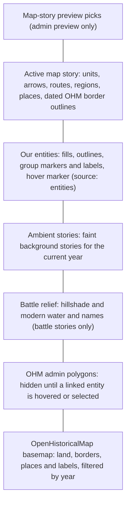
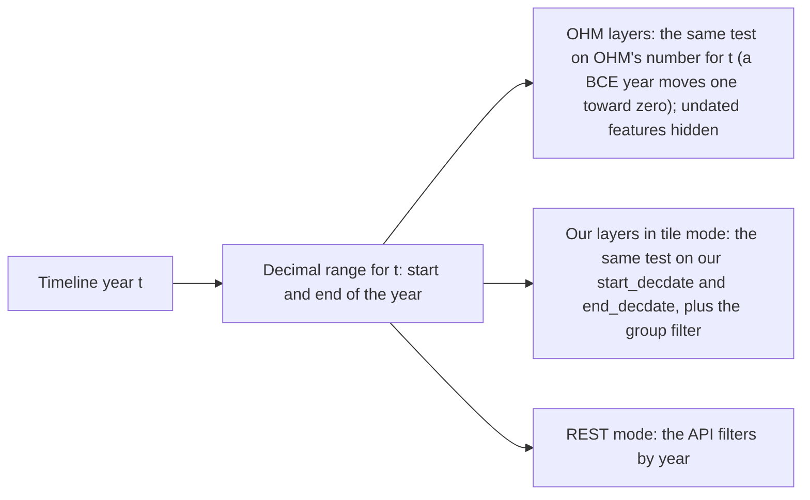
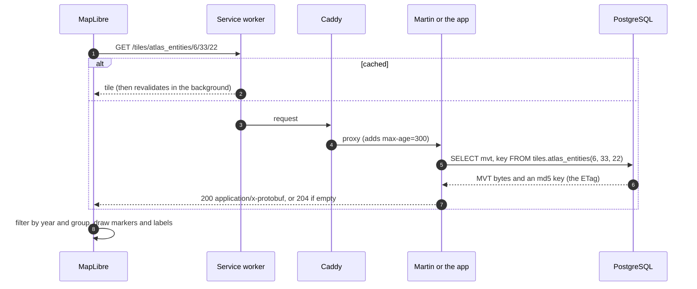
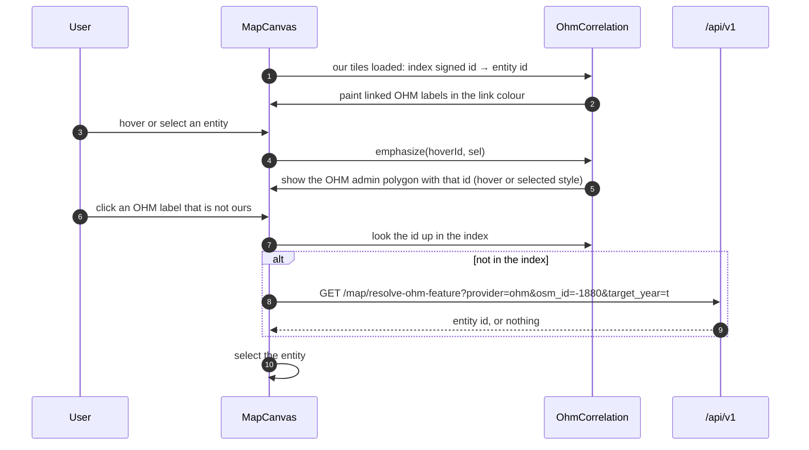

# Maps, tiles and OpenHistoricalMap

How the atlas map is put together: an OpenHistoricalMap (OHM) basemap whose borders change with the
year, our own entity layer from vector tiles, and the links between the two. It also covers how
everything is filtered by date, and which outside map services the browser talks to.

> **Audience:** developers, geographers · **Read time:** 10 minutes · **Last reviewed:** 2026-11-14 ·
> **Code:** `web/src/lib/map-config.ts`, `web/src/components/map/MapCanvas.tsx`,
> `web/src/lib/ohm-layer-date-filter.ts`, `web/src/lib/map-tiles.ts`, `web/src/lib/ohm-highlight.ts`

## The layer stack

From the top (drawn last) to the bottom:

`MapCanvas` builds this stack on every `style.load`: the first load, and each basemap switch. In
order, it registers the marker icons, adds the entity layers, adds the hidden OHM admin layers, sets
the projection (flat map or globe), applies the year filter, and bumps `styleEpoch` so the story and
ambient overlays re-add themselves.

## Why OpenHistoricalMap

- **Time-aware.** Every OHM feature carries a start and an end date, so one tileset can draw any
  year in history.
- **Open.** OHM data is CC0, and the tiles need no API key.
- **MapLibre-native.** OHM publishes MapLibre styles over its vector tiles, so we use the styles
  as they are and add our own layers on top.
- **Linkable.** OHM features carry their OSM-style ids and often a Wikidata id, so our entities can
  point at the exact feature that draws them.

## The basemap

| Basemap (URL `base`) | Style | Notes |
|---|---|---|
| `woodblock` (default) | `openhistoricalmap.org/map-styles/woodblock/woodblock.json` | Paper texture; our water recolouring applies here only |
| `historical` | `…/historical/historical.json` | OHM's default, with relief |
| `railway` | `…/railway/railway.json` | Rail lines picked out |
| fallback | `tiles.openfreemap.org/styles/liberty` | Used only if the OHM style cannot be fetched |

`loadHistoricalBasemapStyle()` fetches the style once per URL and normalises it before MapLibre
sees it:

- Labels are English-first: `coalesce(name_en, name:en, name_int, int_name, name)`.
- A few noisy layers and point-of-interest icons are removed.
- `promoteId` is set on OHM's label points, so they can carry feature-state highlights.
- An `ohm_admin` polygon source is added for highlighting.

Dark mode does not restyle the basemap. It dims the map canvas, and recolours our own layers.

## Filtering by year

OHM writes dates as **decimal years**. A year-only date starts at noon on 1 January and ends at noon
on 31 December. We store whole years, so we derive the same values everywhere with one rule:

| Year | Start (`year + 0.00137`) | End (`year + 0.99863`) |
|---|---|---|
| 1066 | 1066.00137 | 1066.99863 |
| 216 BCE (`-216`) | −215.99863 | −215.00137 |

The rule exists three times, with parity tests: SQL `tiles.year_to_decdate`, PHP
`App\Support\OhmDate`, TypeScript `web/src/lib/ohm-date.ts`.

Before the common era the two sides number years differently. We use historical years, with no
year 0. OHM uses ISO 8601 astronomical years, where year 0 is 1 BCE:

| Year | Ours | OHM's |
|---|---|---|
| 1 BCE | `-1` | `0000` |
| 44 BCE | `-44` | `-0043` |
| 216 BCE | `-216` | `-0215` |

So the filter on OHM layers (the basemap, and a map story's OHM outlines) first moves a BCE year
one toward zero (`toOhmDate`, in the atlas and the admin). Our own tiles and the rule above use our
numbering as is. Imports convert the other way: OHM's `-0043` is stored as `-44`
(`OhmDate::yearFromDate`, and `from_ohm_year` in `pipeline/ohm_borders/date_parser.py`).

OHM's own data is mixed. About half of its BCE dates follow the convention; the rest use the
historical number (the Roman Empire starts at `-0027`), so they show a year early, here as under
OHM's own rule. The fix belongs in OHM.

- Only layers on the `ohm` source are filtered. Natural Earth and land layers are timeless.
- **Events are "decade-sticky".** A battle or treaty stays visible for 10 years either side of its
  dates, so it does not vanish while you scrub past.
- In tile mode a year change re-filters tiles already loaded, so no tile is fetched. The sidebar
  list and the ambient stories still refetch for the new year.

## Our entity layer

- One feature per **geometry period**, for all of time. Each feature carries `start_decdate`,
  `end_decdate`, the entity group and type, impact, `has_map_story` and the signed `ohm_osm_id`.
- Each tile keeps at most N features per century (12 at zoom 0–1, up to 96 at zoom 12; no cap from
  zoom 13). They are ranked by curated priority and then impact, so every era is represented at a
  world view.
- Without `VITE_MAP_TILES_URL`, the app falls back to REST mode: `GET /api/v1/entities/map` per
  viewport and year.
- Full contract: [Atlas vector tiles](../schemas/atlas-tiles.md).

## Linking our entities to OHM

An entity that OHM draws stores a geography reference to that OHM feature. In tiles it travels as
a **signed id**: negative for an OHM relation (`relation/1880` → `-1880`), positive for a node or way.
OHM's own tiles use the same convention in `osm_id`.

- The `ohm_admin` polygon layers stay hidden, and so load no heavy tiles, until a linked entity is
  hovered or selected. They hide again 4 seconds after the map goes idle.
- Our links come from the geo-reference tables. The `ohm-links` pipeline step fills them by Wikidata
  id ([Data pipeline](data-pipeline.md)).
- Map stories use the same ids to outline a polity's border at each step's date.

## Outside map services

| Host | What | Cached by the service worker |
|---|---|---|
| `www.openhistoricalmap.org/map-styles/…` | Basemap styles, sprites, fonts | stale-while-revalidate, 30 days |
| `vtiles.openhistoricalmap.org/maps/ohm`, `…/ohm_admin` | OHM vector tiles | cache-first, 2,000 tiles, 30 days |
| OHM hillshade PNGs (referenced by the style) | Relief | cache-first |
| `tiles.openfreemap.org` | Fallback style; modern water and names under battle maps | yes |
| `elevation-tiles-prod.s3.amazonaws.com/terrarium` | Terrain for battle hillshade | no |
| Wikimedia hosts | Entity images (not map tiles) | no |

Attribution is shown in MapLibre's compact attribution control, from the styles' own attribution
fields.

## The admin's map

The admin uses its own MapLibre components (`api/resources/js/components/historical-map-viewer.tsx`,
`map-editor.tsx`). The viewer uses OHM's `main` style with the same date filter and REST data. The
editor adds Mapbox Draw for points, lines and polygons. Clicking an OHM feature in the viewer calls
`POST /api/v1/map/resolve-ohm-feature`. See [Admin and editing](admin-map-editor.md).

## Getting OHM data yourself

| Need | Tool |
|---|---|
| One feature's tags and members | `https://www.openhistoricalmap.org/api/0.6/relation/<id>` |
| A query by tag, area or date | Overpass, at `overpass-api.openhistoricalmap.org` |
| Place-name search | OHM Nominatim (the admin's geo-reference search uses it) |
| Bulk extraction | Planet files; the pipeline's `borders` commands ([Data pipeline](data-pipeline.md)) |

Extraction techniques (osmium, ogr2ogr, Overpass recipes) are collected in the internal
[OHM cookbook](../reference/ohm-cookbook.md).

## Troubleshooting

| Symptom | Cause and fix |
|---|---|
| Tiles return 500 "Cannot find SRID (3857)" | `spatial_ref_sys` lost its rows: run migrations (`2026_11_03_000001_ensure_tile_srids`) |
| A new tile property or function does not appear | Martin reads functions at startup: restart it |
| Borders do not change while scrubbing | The style lacks dated `ohm` layers (check the basemap URL), or the year filter threw on a style change (see the console) |
| An entity shows no OHM highlight | It has no resolvable signed id: no active OHM geo-reference of type relation, node or way |
| The map is empty locally | REST mode with an empty database: import data, or point `VITE_MAP_TILES_URL` at `http://localhost:8000/tiles` |
