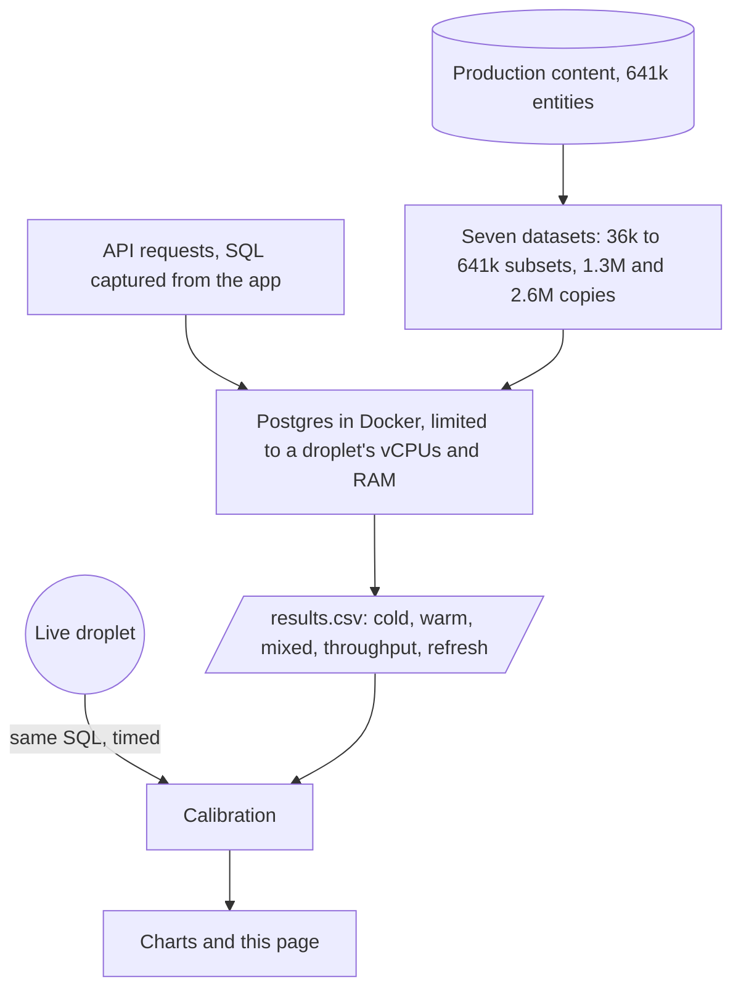
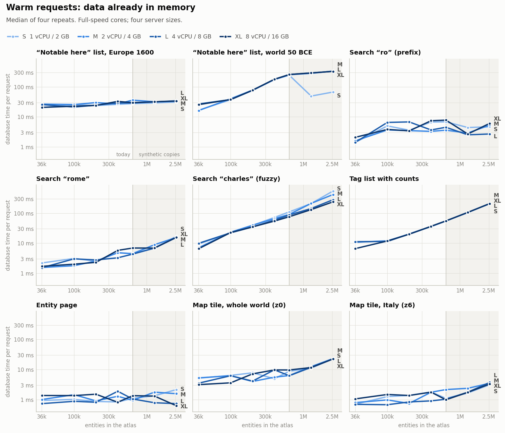
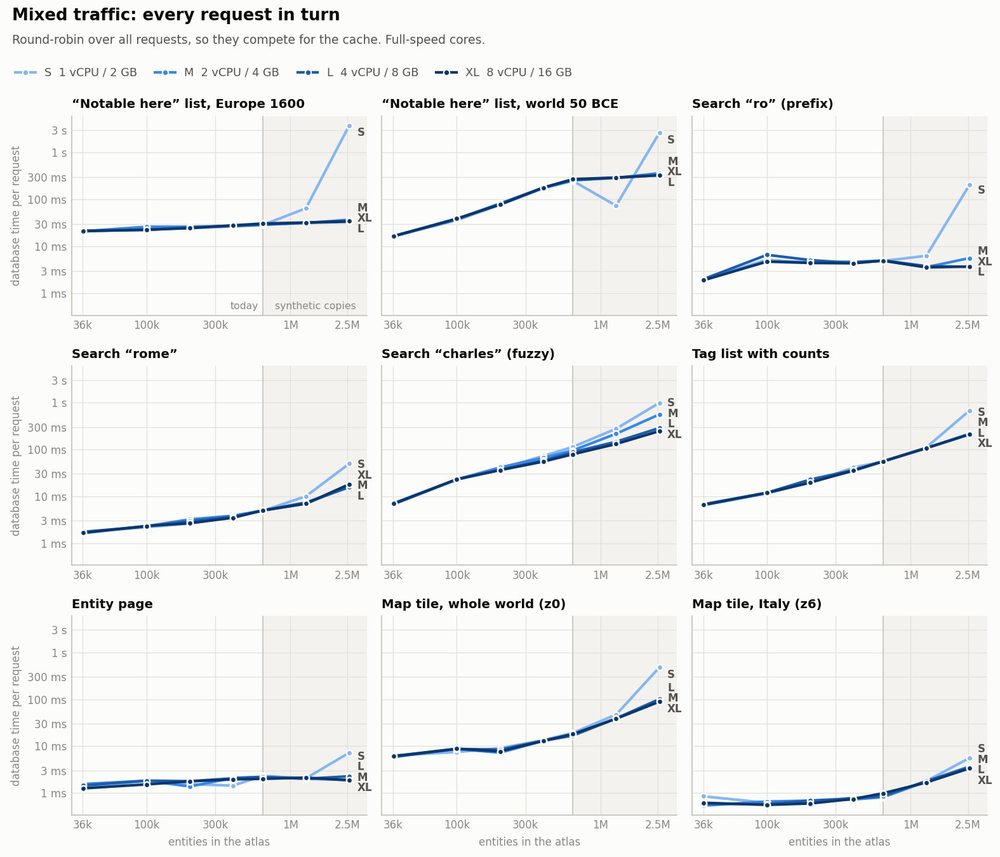
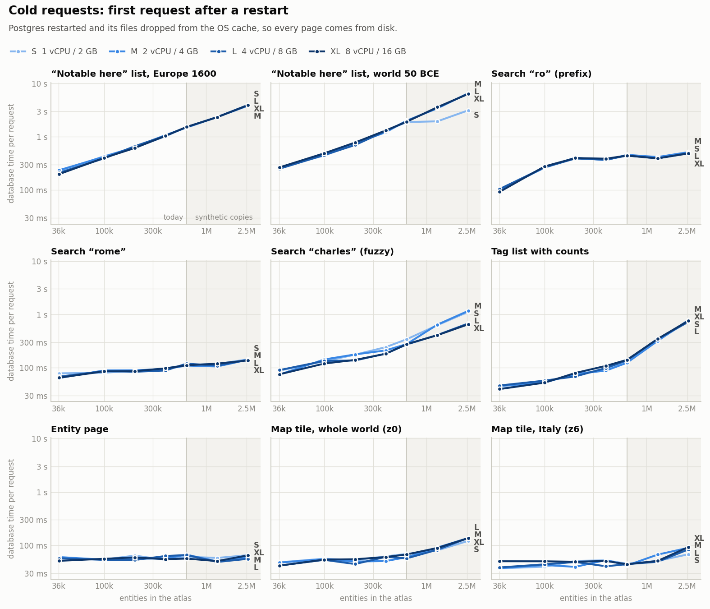
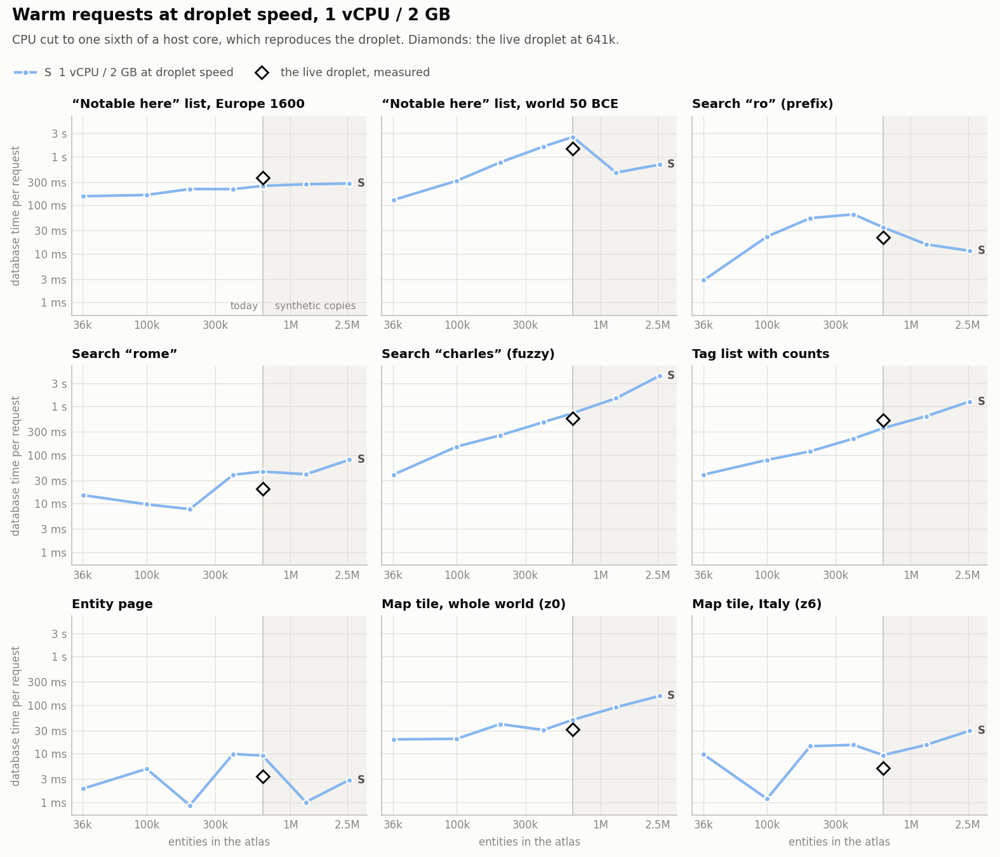
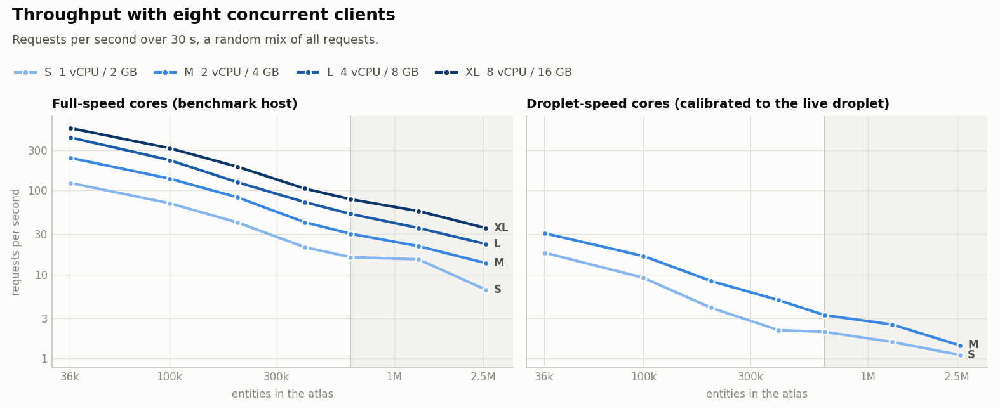
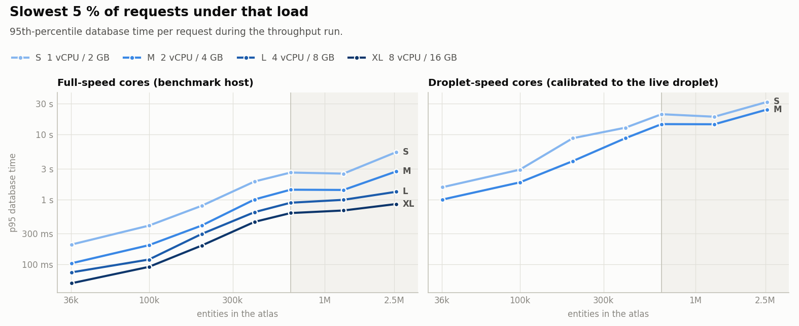
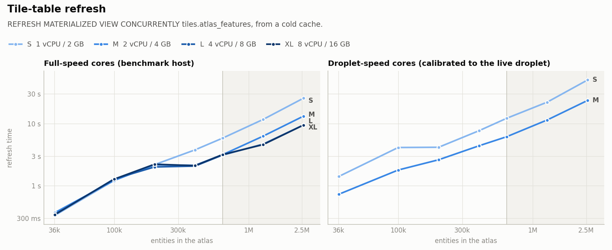
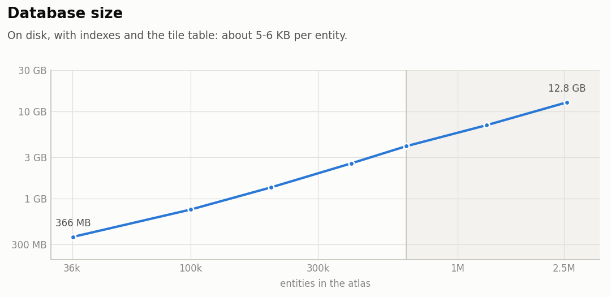

# Scalability benchmark

How request times change as the atlas grows, on servers of different sizes. The benchmark replays the
exact SQL the API runs against copies of the production database. The copies range from 36 thousand to
2.6 million entities. Each run uses a Postgres container limited to the CPU and memory of a
DigitalOcean droplet size. A calibration step ties the results to the live 1 vCPU / 2 GB droplet.

> **Audience:** developers, operators, technical stakeholders · **Read time:** 12 minutes ·
> **Last reviewed:** 2026-11-19 · **Code:** `scripts/scalability/`

## At a glance

All figures are database time. PHP and the network add a roughly constant amount on top, about 0.25 s
from Europe to the droplet. The **droplet-speed** figures are calibrated to the live server; the other
figures come from the benchmark host's much faster cores.

| Finding | Evidence |
|---|---|
| Most requests do not slow down as the atlas grows | From 36k to 2.6M entities, the entity page, regional tiles, prefix search and the regional "notable here" list stay within a few ms (warm, full speed: list 20 → 31 ms) |
| Four requests grow in step with the atlas | Tag list with counts 11 → 55 → 206 ms, fuzzy search 9 → 110 → 544 ms, the world-wide list 17 → 244 ms, the world tile 5 → 23 ms (36k → 641k → 2.6M, warm, full speed). They set the overall throughput |
| A bigger server barely speeds up a single request | Postgres runs each query on one core. Warm times are the same on 1, 2, 4 and 8 vCPUs, apart from fuzzy search at 2.6M (544 → 238 ms with parallel workers) |
| More vCPUs buy throughput | At 641k with eight clients: 16, 30, 52 and 78 requests/s on 1, 2, 4 and 8 vCPUs (full speed) |
| Memory decides where the cliff is | With mixed traffic, 2 GB holds 641k comfortably, starts to slip at 1.3M and collapses at 2.6M (the regional list 28 ms → 3.7 s). 4 GB holds 2.6M |
| After a restart everything comes from disk | Cold, the regional list takes 1.5 s at 641k and 3.9 s at 2.6M, on every server size |
| The live droplet's cores are about six times slower than the benchmark host's | A sixth of a host core reproduces the droplet's CPU timings, and it predicts the droplet's request times within ±50 % for requests over 100 ms (see [Calibration](#calibration)) |
| On the live droplet today (641k) | Tiles, entity pages and short searches take 3–50 ms and the regional list 370 ms. The world-wide list takes 1.5 s, fuzzy search 0.57 s and the tag list 0.53 s. The database serves about 2 requests/s of a mix where those requests are a third of the traffic |
| The cheapest wins are query changes, not hardware | Made on 2026-11-19, after these measurements. On the droplet: the world-wide list's count 1.47 → 0.18 s, the fuzzy-search page for a common word 0.4–1.9 s → 0.07–0.23 s, and the tag list's counts come from a cache (see [Query changes](#query-changes-made-after-the-benchmark)) |

## What was measured

### Requests

Each request is the full set of SQL statements one API call runs, captured from the running app by
`capture_queries.php`. Map tiles call the same `tiles.atlas_entities` function that Martin serves.

| Request | API call | What makes it costly |
|---|---|---|
| "Notable here" list, Europe 1600 | `GET /entities?bbox_…&exists_at=1600&sort=impact`, 50 per page | Spatial and date filter, capped total (1,000) |
| "Notable here" list, world 50 BCE | the same, with a world-wide box | Almost every row passes the box, so the date filter and the capped count do the work |
| Search "ro" | `GET /entities?search=ro&sort=relevance`, 30 per page | Name-prefix index |
| Search "rome" | `GET /entities?search=rome` | Substring match (3–5 letters) |
| Search "charles" | `GET /entities?search=charles` | Trigram similarity (6+ letters) |
| Tag list with counts | `GET /tags` | Counts entity tags per tag |
| Entity page | `GET /entities/{id}` for the Roman Empire (Q2277) | Primary-key lookups and relations |
| Map tiles | `tiles.atlas_entities(z, x, y)` at z0, z3, z6 and z9 around Rome | Precomputed tile table with per-zoom importance gates |

### Server sizes

The database gets a droplet's vCPUs and its RAM minus about 0.6 GB for the app, Redis, Martin and Caddy.
Postgres settings follow `docker-compose.prod.yml` and scale with RAM.

| Tier | Droplet | Database container | Buffers / cache size / work_mem | Parallel workers |
|---|---|---|---|---:|
| S | 1 vCPU / 2 GB (today) | 1 CPU, 1.4 GB | 384 MB / 1 GB / 16 MB | 0 |
| M | 2 vCPU / 4 GB | 2 CPUs, 3.4 GB | 1 GB / 2.5 GB / 32 MB | 1 |
| L | 4 vCPU / 8 GB | 4 CPUs, 7.4 GB | 2 GB / 5 GB / 32 MB | 2 |
| XL | 8 vCPU / 16 GB | 8 CPUs, 15.4 GB | 4 GB / 11 GB / 64 MB | 4 |

The columns are `shared_buffers`, `effective_cache_size` and `work_mem`. All tiers set `jit=off`,
`random_page_cost=1.1` and `effective_io_concurrency=200`, as production does. Two more tiers, **S and M
at droplet speed**, repeat S and M with the CPU quota cut to one sixth of a core per vCPU (see
[Calibration](#calibration)).

### Datasets

| Dataset | Entities | Database size | How it was made |
|---|---:|---:|---|
| 36k | 36,266 | 0.37 GB | The curated entities only (campaigns, chronicles, map stories) |
| 100k | 100,000 | 0.75 GB | Curated plus a fixed sample of the bulk Wikidata entities |
| 200k | 200,000 | 1.35 GB | The same, larger sample (each set contains the smaller ones) |
| 400k | 400,000 | 2.55 GB | The same |
| 641k | 641,473 | 4.01 GB | The production content of 2026-11-18 |
| 1.3M | 1,282,946 | 6.98 GB | 641k plus a copy of every entity with its names, places, dates, tags, relations, borders and timeline, points moved up to 0.5° |
| 2.6M | 2,565,892 | 12.78 GB | The 1.3M set copied again |

Subsets keep every row that belongs to a kept entity and drop the rest. Each set was compacted
(`VACUUM FULL`), its tile table rebuilt and analyzed, so no set carries dead rows.

### Modes

| Mode | What it means |
|---|---|
| Cold | The first run after a Postgres restart, with the database's files dropped from the OS page cache |
| Warm | The median of the next four runs of the same request |
| Mixed | The median of rounds 2–3 of a round-robin over all requests, so they compete for the cache as real traffic does |
| Throughput | Eight clients send a random mix of all requests for 30 s; requests per second and the 95th percentile |
| Tile refresh | `REFRESH MATERIALIZED VIEW CONCURRENTLY tiles.atlas_features` from a cold cache, which is what `tiles:refresh` runs after content changes |

## Results

### Warm requests

The lines for the four sizes lie on top of each other. With the data in memory, a request costs the same
on one vCPU as on eight.

| Grows with the atlas | Stays flat |
|---|---|
| Tag list with counts: it counts every entity tag on each call | Entity page: primary-key lookups |
| Fuzzy search: trigram similarity over all names | Prefix search: an index range, cut at one page |
| World-wide list: nearly every row passes the box, so the count walks the date index until it reaches the 1,000 cap | Regional list: the spatial index narrows it to the box first |
| World tile (z0): more rows pass the importance gate | Regional tiles: a tile covers a bounded area and the per-century caps hold |

Past 641k the world-wide list grows more slowly: the copies double the matching rows, so the capped
count reaches its 1,001 rows sooner. On the 1 vCPU tier at 1.3M the planner switches to the date-range
index, which is much faster (49 ms); see [What it means](#what-it-means).

### Mixed traffic

Mixed traffic shows where memory runs out. The 2 GB tier keeps up to 641k: its working set (the hot
indexes and the tile table) still fits. At 1.3M it starts to read from disk (the regional list 28 → 64 ms).
At 2.6M it collapses: the regional list takes 3.7 s, the world tile 479 ms and fuzzy search 1 s. The
4 GB tier serves 2.6M with times close to its warm ones.

### Cold requests

After a restart every page comes from disk, so server size makes no difference. The cost grows with the
pages a request has to touch: the lists read more of their indexes as the atlas grows (1.5 s at 641k,
3.9 s at 2.6M). Lookups and tiles stay near 50–150 ms. These figures come from the benchmark host's
NVMe disk. On the live droplet the first regional list after a restart took 3.8 s at 641k.

### At droplet speed

At droplet speed every request costs about six times its full-speed time, and the model sits close to
the live droplet (the diamonds). Doubling the atlas to 1.3M would take fuzzy search to about 1.5 s and the
tag list to about 0.64 s. The world-wide list is the exception, because at 1.3M its count switches to a
better plan (see [What it means](#what-it-means)).

The chart shows only the 1 vCPU tier. A CPU quota is shared by the whole container, so on the 2 vCPU
droplet-speed tier a single query borrows the second vCPU's share and runs about twice as fast as on a
real 2 vCPU droplet. The full-speed results show that one request costs the same on 1 vCPU as on 2, as
long as the data fits in memory. Throughput and the tile refresh use all cores at once, so the 2 vCPU
droplet-speed tier is valid for those.

### Throughput

Throughput falls as the atlas grows, because the four growing requests take a larger share of the
time. More vCPUs raise it almost in proportion.

Requests per second; "droplet" columns are at droplet speed.

| Entities | S | M | L | XL | S, droplet | M, droplet |
|---|---:|---:|---:|---:|---:|---:|
| 36k | 122/s | 243/s | 425/s | 548/s | 18/s | 31/s |
| 200k | 42/s | 83/s | 125/s | 191/s | 4.0/s | 8.3/s |
| 641k | 16/s | 30/s | 52/s | 78/s | 2.2/s | 3.3/s |
| 1.3M | 15/s | 22/s | 36/s | 57/s | 1.6/s | 2.5/s |
| 2.6M | 7/s | 14/s | 23/s | 36/s | 1.1/s | 1.4/s |

At droplet speed the eight clients mostly wait: the slowest 5 % of requests take 15–21 s at 641k, queued
behind the world-wide list, fuzzy search and tag list on one or two slow cores. The mix is deliberately
heavy (see [Caveats](#caveats)). Real traffic is mostly tiles, which take 5–50 ms on the droplet and are
cached for five minutes.

### Tile refresh

The tile table is rebuilt in full after any content change, so its cost is linear: at full speed, 5.8 s
at 641k and 26 s at 2.6M on one vCPU, and about half that with parallel workers. On the live droplet the
first refresh at 641k took 13.9 s, and the droplet-speed model gives 12.2 s. The scheduler runs it at
most every five minutes and only when content changed, so it is a background cost, not a visitor-facing
one.

### Database size

Size grows linearly at about 5–6 KB per entity, indexes and the tile table included (the curated set is
denser at 10 KB). A 2.6M atlas needs about 13 GB, plus room for the nightly dumps.

## Calibration

The benchmark host (Intel Core Ultra 7 258V, NVMe) is much faster per core than a DigitalOcean Basic
vCPU. Three steps tie the two together.

| Step | Benchmark host, 1 CPU | Live droplet | Ratio |
|---|---:|---:|---:|
| Sum of 3M integers in Postgres | 0.18 s | 1.2–1.7 s | 6.5–9× |
| md5 of 300k strings | 17 ms | 93–99 ms | 5.5× |
| The same two, host limited to one sixth of a core | 1.08–1.16 s, 108–111 ms | | about 1× |

The live droplet's warm request times (five runs each through `psql`, median of runs 2–5) compare with
the benchmark at 641k as follows:

| Request | Live droplet | Model: 1 vCPU at droplet speed | Live ÷ model | Full speed, 1 vCPU |
|---|---:|---:|---:|---:|
| "Notable here" list, Europe 1600 | 370 ms | 250 ms | 1.5× | 28 ms |
| "Notable here" list, world 50 BCE | 1.5 s | 2.5 s | 0.6× | 244 ms |
| Search "ro" | 21 ms | 35 ms | 0.6× | 6.9 ms |
| Search "rome" | 20 ms | 46 ms | 0.4× | 4.4 ms |
| Search "charles" | 573 ms | 734 ms | 0.8× | 110 ms |
| Tag list with counts | 528 ms | 359 ms | 1.5× | 55 ms |
| Entity page | 3.4 ms | 9.1 ms | 0.4× | 1.1 ms |
| Map tile z0 | 31 ms | 50 ms | 0.6× | 8.7 ms |
| Map tile z3 | 44 ms | 39 ms | 1.1× | 4.5 ms |
| Map tile z6 | 5.0 ms | 9.3 ms | 0.5× | 1.1 ms |
| Map tile z9 | 4.8 ms | 15 ms | 0.3× | 1.5 ms |

For the four requests over 100 ms the model is within ±50 %, and on average it is right (geometric mean
1.0×). It overstates requests under about 20 ms by 2–3×: the quota hands out CPU in 10 ms slices, so a
short query can wait for its next slice. Read the droplet-speed curves as accurate for the slow requests
and pessimistic for the fast ones.

## What it means

### Server size

| Atlas size | 1 vCPU / 2 GB (today) | What to change |
|---|---|---|
| Up to about 650k (now) | Browsing is fine: tiles, entity pages, searches and regional lists. Before the query changes below, the world-wide list, fuzzy search and the tag list took 0.5–1.5 s each and ran one at a time on the single core, so a few visitors using them at once queued behind each other | Query changes (below, made) before hardware |
| About 1.3M | Single requests still fit in memory, but mixed traffic starts to miss the cache, and the growing requests double | 2 vCPU / 4 GB |
| About 2.6M | Mixed traffic collapses on 2 GB: the regional list reaches 3.9 s at droplet speed | 4 GB at least; 4 vCPU / 8 GB for concurrent visitors |

Memory moves the cliff and vCPUs buy concurrent throughput. Neither makes one slow request faster; faster
cores (CPU-optimized or Premium droplets) or query changes do.

### Query changes made after the benchmark

The charts above show the queries as they were. Three of the growing requests were changed on
2026-11-19 (`ListEntitiesAction`, `Tag::entityCounts`). Before and after are timed on the droplet at
641k, warm.

| Request | Why it grew | Change | Before → after |
|---|---|---|---|
| World-wide "notable here" list | The capped count picked a merge join that walks the entity key in order, hoping to reach 1,001 matches early. For a year with few entities that is most of the table | The count runs with merge joins off (`SET LOCAL`), so it starts from the date-range GiST index for sparse years. Dense years keep a nested loop over the key, as fast as before (1900: 77 → 108 ms) | Count at 50 BC: 1.47 → 0.18 s |
| Fuzzy search (6+ letters) | The trigram index found every candidate (10.7k for "charles"), and all of them were scored to return 30 | Names at least 0.6 (then 0.45) similar rank above all others, so when they fill the page they are the page. Raising pg_trgm's threshold for that query lets the index skip weaker matches. Rare names fall through to the full query. Ranking is unchanged | "battle of" 1.9 → 0.19 s, "temple of" 1.9 → 0.07 s, "william" 0.48 → 0.23 s, "charles" 0.44 → 0.15 s |
| Tag list with counts | A `count(*)` over all 2.4M entity tags on every call (about 1 s however it is written) | Entity counts per tag are cached in Redis for 10 minutes; `tags:sync` drops them | 0.53 s → one cache read; the count reruns at most every 10 minutes |
| World tile (z0) | More rows pass the importance gate | None needed: Caddy caches tiles for five minutes | 31 ms |

A GiST trigram index ordered by distance (`name <-> term`) was tried for fuzzy search and dropped: a page
took 84 ms against 155 ms locally, and the planner then used it instead of the GIN index for the match
count, which is slower there.

## Caveats

| Caveat | Effect |
|---|---|
| The 1.3M and 2.6M sets are copies | Copies share names, so searches find twice the matches and tags count twice the rows. Real growth spreads over new names, so search may grow more slowly than measured here |
| Database time only | The PHP layer (Octane, 4 workers) and the network add a roughly constant amount per request |
| The benchmark host's disk is faster than the droplet's | Cold figures are a lower bound |
| The CPU quota emulates a slow core in 10 ms slices | Close for requests over 100 ms, as the calibration shows. A short query can wait for its next slice, so fast requests come out 2–3× slow. On the 2 vCPU tier one query can borrow the second vCPU's share, so its single-request times are not shown |
| The load generator shares the host | At 8 vCPUs the eight Python clients compete with Postgres for the same eight cores, so XL throughput is a lower bound |
| The throughput mix is heavy | Each request type is equally likely, so the four costly ones make up a third of it. Real traffic is mostly tiles, which are cheap and cached by Caddy for five minutes |

## Reproducing

The scripts live in `scripts/scalability/`. The datasets take about 30 GB of disk and an hour to build; the full run takes about an hour.

| Step | Command |
|---|---|
| Python environment | `uv venv .venv && uv pip install -r scripts/scalability/requirements.txt` |
| Capture the API's SQL | Copy `capture_queries.php` into the `app` container's `/tmp`, then `php artisan tinker --execute='require "/tmp/capture_queries.php";' > queries.json` |
| Start the benchmark Postgres | `docker run -d --name hm-bench-db -e POSTGRES_PASSWORD=bench -p 127.0.0.1:55432:5432 -v hm_bench_pgdata:/var/lib/postgresql/data history-mapped-db:16-pgvector-v0.8.2` |
| Load the content | `createdb b_full`, then `pg_restore` a content dump into it |
| Subsets | `createdb -T b_full b_100k`, then `psql -d b_100k -v n=100000 -f subset.sql`, then `VACUUM FULL`, refresh `tiles.atlas_features` and `VACUUM ANALYZE` |
| Synthetic copies | `createdb -T b_full b_1283k`, then `psql -d b_1283k -f scale_up.sql` (again on a copy of it for 2.6M) |
| Run | `.venv/bin/python scripts/scalability/bench.py --tiers S,M,L,XL,S-do,M-do` |
| Calibrate | `calibrate.py` writes `calibrate.sql`; run it on the droplet's database with `psql -f -`, then `calibrate.py --parse` |
| Charts and tables | `charts.py results.csv prod-calibration.csv docs/architecture/scalability` and `summarize.py` |

The raw results are in [`scalability/results.csv`](scalability/results.csv) and
[`scalability/prod-calibration.csv`](scalability/prod-calibration.csv).

## Related

| Page | Why |
|---|---|
| [Deployment and operations](deployment.md) | The production topology and the Postgres settings these tiers mirror |
| [Atlas vector tiles](../schemas/atlas-tiles.md) | The tile table, the importance gates and the refresh |
| [REST API](../schemas/rest-api.md) | The requests measured here, including the capped total |
