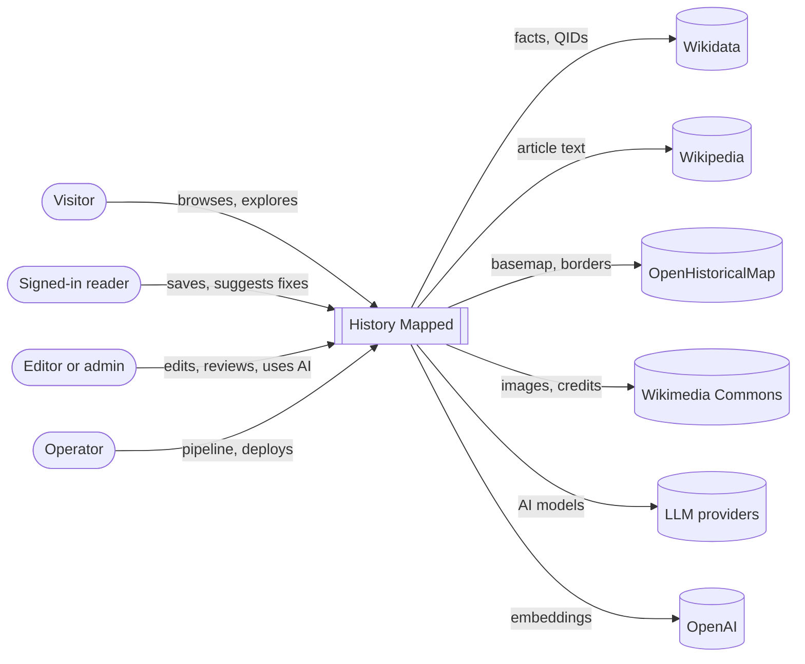
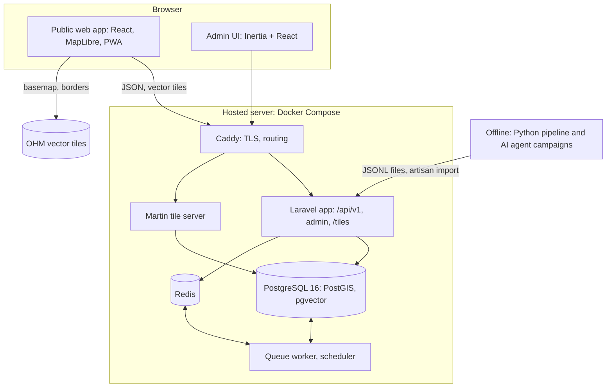
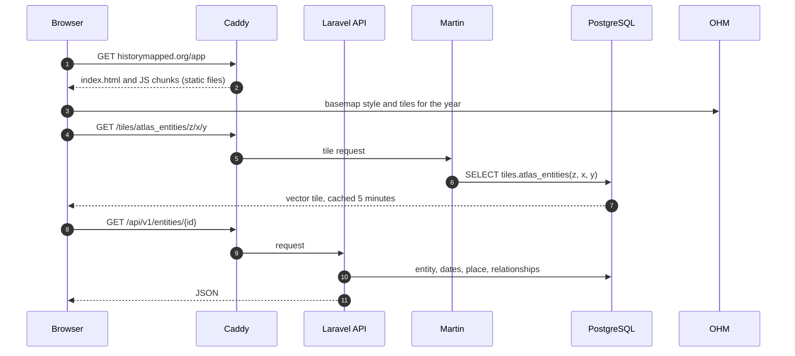
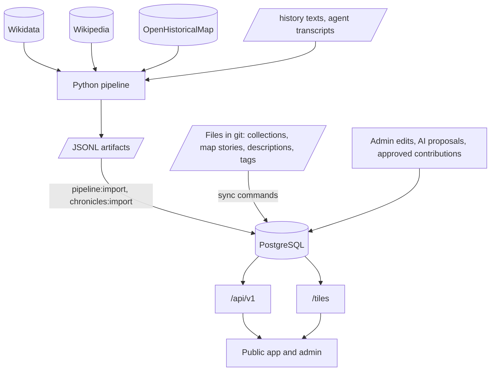

# System overview

History Mapped has four parts: a public web app, a Laravel application that serves both the API
and the admin, a PostgreSQL database with spatial and vector extensions, and an offline Python
pipeline that produces the content. This page shows how they fit together. Each part has its own
page in this section.

> **Audience:** developers, architects, technical stakeholders · **Read time:** 8 minutes ·
> **Last reviewed:** 2026-11-14

## Context

Who and what the system talks to (C4 level 1).



## Containers

The running pieces and how they connect (C4 level 2).



| Part | Technology | Responsibility | Read more |
|---|---|---|---|
| Public web app | React 19, Vite, MapLibre GL, TanStack Query, nuqs | Landing, browse, entity and chronicle pages, docs, the atlas at `/app` | [Public web app](frontend-app.md) |
| Laravel app | Laravel 13, PHP 8.4, Octane | Public JSON API, accounts, the admin, tiles (app driver), AI assistant | [Backend and API](backend.md) |
| Admin UI | Inertia 2, React 19, MapLibre, Mapbox Draw | Editing entities, geometry, relationships, chronicles and map stories; reviewing contributions | [Admin and editing](admin-map-editor.md) |
| Database | PostgreSQL 16, PostGIS 3.5, pgvector 0.8 | Entities, relationships, chronicles, time-aware geometry, tags, stories, accounts; the `tiles` SQL functions | [Data model overview](../entity-model/README.md) |
| Tile server | Martin 1.16 (or the app) | Serves `tiles.atlas_entities` as vector tiles | [Maps, tiles and OHM](ohm-integration.md) |
| Queue and scheduler | Laravel queue on Redis | Imports, relationship resolution, embeddings, timeline rebuilds, daily image fetch | [Backend and API](backend.md#background-work) |
| Pipeline | Python, LangGraph | Fetches open data, extracts entities and relationships from text, writes import files | [Data pipeline](data-pipeline.md) |
| Hosting | Docker Compose, Caddy, DigitalOcean, GHCR, GitHub Actions | One server; CI builds and deploys on every push to `main` | [Deployment and operations](deployment.md) |

## How a page gets its data



The public app is static. Everything dynamic comes from three sources: our API, our vector tiles,
and OpenHistoricalMap's basemap, which the browser loads directly.

## How content flows



The pipeline never writes to the database directly. It writes files, and Laravel commands import
them, so a run can be inspected, re-imported or thrown away. The [Data pipeline](data-pipeline.md)
page has the details.

## Key design decisions

| Decision | Why | Consequence |
|---|---|---|
| One Laravel app for the API and the admin | One set of models, Actions and permissions | The admin calls the same `/api/v1` endpoints for some features |
| A separate static app for the public | Cheap static hosting, installable PWA, its own release cycle | Cross-subdomain cookies and CORS for sign-in |
| The atlas state lives in the URL | Every view is a shareable link, and Back works | URL rules are carefully tested |
| Years stored as integers; the map uses decimal years | Simple storage and arithmetic for BCE | Decimal years are derived in SQL, PHP and TypeScript with the same rule |
| Borders come from OpenHistoricalMap, not our database | Reuse community-drawn, time-aware borders | We store links to OHM features (signed `osm_id`) and draw outlines from OHM tiles |
| Wikidata QIDs are the identity key | Merge sources, find duplicates, refer to entities in files | Writes are guarded against reusing one QID for two things |
| Vector tiles from a SQL function | One contract, served by Martin or by the app | Martin must restart after tile migrations |
| A file-based pipeline | Repeatable, reviewable, decoupled from the database | Imports are a separate step |
| Images are linked, not copied | Licence compliance and no storage cost | Display depends on Wikimedia's availability |
| AI proposes, people confirm | Keeps editors in charge of every change | Proposals are stored, previewed and applied part by part |

## Repository map

```text
history-mapped/
├── api/          Laravel app: API (app/Http/Api), admin (app/Http/Controllers, resources/js),
│                 Actions, models, jobs, migrations, the tiles SQL, map-story and collection files
├── web/          Public React app: atlas, site pages, docs renderer
├── pipeline/     Python: wikidata/, ohm_borders/, ohm_links/, agent/ (LangGraph), campaign/,
│                 map_stories/, audit/
├── docker/       Dockerfiles, docker-compose.yml (local), docker-compose.prod.yml, Caddyfile,
│                 Martin config
├── docs/         These docs, runbooks, plans and the archive
├── output/       Pipeline artifacts (git-ignored)
└── .github/      CI and deployment workflow
```

## Quality attributes

| Attribute | How it is addressed |
|---|---|
| Performance | Vector tiles cached at three layers (Martin, Caddy, service worker); snapped query keys; immutable data cached for the session |
| Security | Spatie roles and permissions on every write; cookie-only sessions with CSRF; contribution writes rate-limited |
| Data quality | QID identity guard, review status and confidence on every record, audits in `pipeline/audit` |
| Availability | One server; images in GHCR make it reproducible; no automated database backup yet ([gaps](deployment.md#known-operational-gaps)) |
| Observability | Container logs; no metrics or tracing stack |
| Cost | Open data sources, one droplet, linked images; AI usage is paid per call |

## Where next

- [Data pipeline](data-pipeline.md): how content is produced
- [Backend and API](backend.md) and [Public web app](frontend-app.md): the two codebases
- [Local setup](../implementation-docs/setup.md): run it yourself
