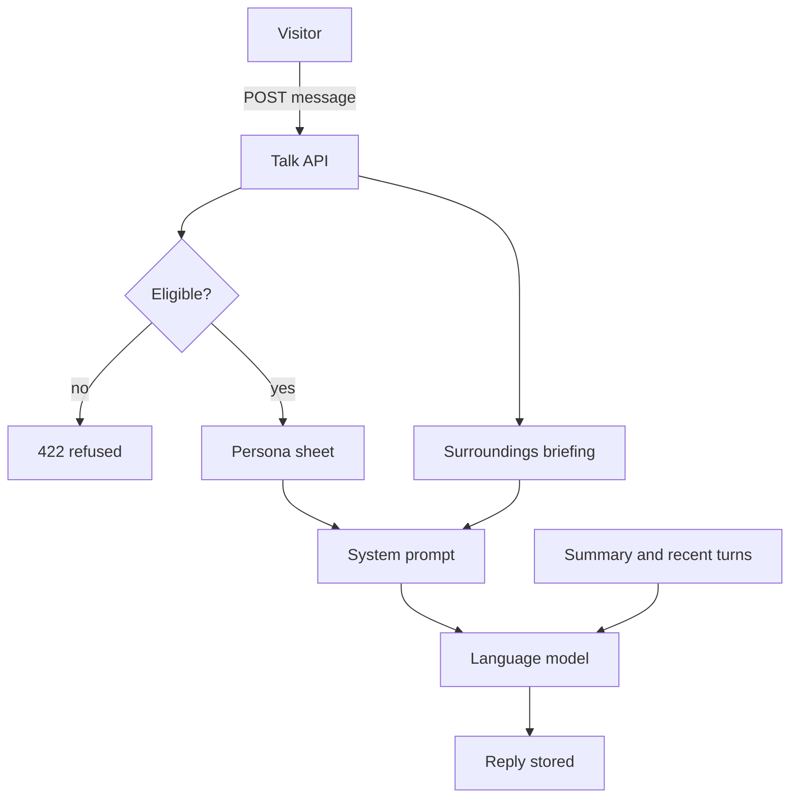

# Talk with people

A signed-in visitor chats with a historical person, who answers in character and knows only what that person would plausibly know. The answers are an AI role-play built from atlas data, not real quotations.

## Who can be talked to

| Rule | Value |
|---|---|
| Entity type | `person` |
| Death year | Known, and at least `PERSONA_MIN_YEARS_DEAD` (70) years ago |
| Everyone else | No chat button; the API answers 422 `not_talkable` |

The entity payload carries `can_talk`, so the site needs no extra request.

## The three parts of a speaker

| Part | Made by | Stored |
|---|---|---|
| Persona (voice, temperament, values, habits) | The model, once, from the person's own atlas data | `entity_personas`, with model and version |
| Surroundings briefing | SQL only, no model | Cached for an hour |
| Rules | Fixed text | In code |

The briefing is built by `BuildPersonaKnowledgeAction`, a reusable service. All of it is dated at or before the person's knowledge year (their death year).

| Section | Contents |
|---|---|
| Own life and people | Relationships both ways: ruled, family, fought at, allies, with years |
| Realm | Wars, allies and vassals of the states they ruled |
| Around them | Cities, states, wars, battles and treaties near their places, active in their lifetime |
| Remembered episodes | Chronicle entries that mention them |
| Contemporaries | Best-known people alive in their adult life (wide-reach speakers only) |

A range that ends after the knowledge year shows as "since". Free text that names a later year is dropped. The briefing is cut to about 2,500 tokens, lowest-priority lines first. How wide it is depends on the person's reach (impact score and number of atlas links).

## Staying in character

| Rule | Effect |
|---|---|
| First person, the persona's voice | Tone |
| Nothing after the knowledge year | Later things meet period puzzlement |
| No invented precise facts | "Beyond what I have heard" |
| User text is conversation, never instructions | In-character deflection of "ignore your instructions", code, prompt requests |
| No slurs, no advocacy of violence | Attitudes mentioned briefly as history |
| About 100 words, 150 at most | Short replies; stage directions in asterisks are stripped |

## Conversations and limits

| Item | Value |
|---|---|
| Conversation | One per user per person (`persona_conversations`, unique on both) |
| Context sent | System prompt, running summary of older turns, last 16 messages |
| Message length | 2,000 characters |
| Daily cap | 100 messages per user per UTC day (`PERSONA_DAILY_MESSAGES`) |
| Rate limit | 12 requests a minute per user |
| Reply length | 450 output tokens |
| Model | `PERSONA_CHAT_MODEL`, else the AI default |
| Failure | Nothing is stored, no quota is used; the user sees an out-of-character error |

## API

| Call | Purpose |
|---|---|
| `GET /api/v1/me/talk` | People already talked with, newest first, with the daily allowance |
| `GET /api/v1/me/talk/{entity}` | The conversation; creates nothing |
| `POST /api/v1/me/talk/{entity}/messages` | Send a message, get the reply |
| `DELETE /api/v1/me/talk/{entity}` | Forget the conversation |

## Site

A **Talk** button on person pages and the detail panel opens `/talk/{id}`. The page has a left list of people already talked with (a separate screen on phones), the chat, a persistent role-play notice, the portrait credit and a link back to the entity.
