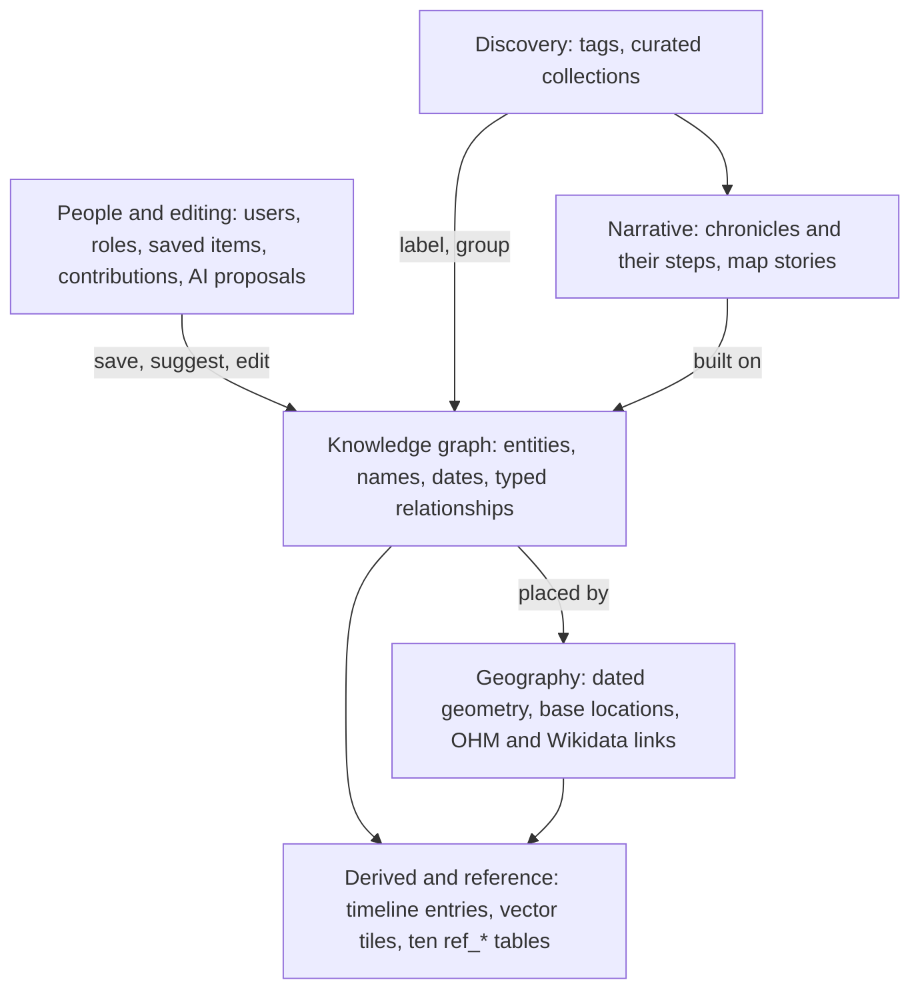
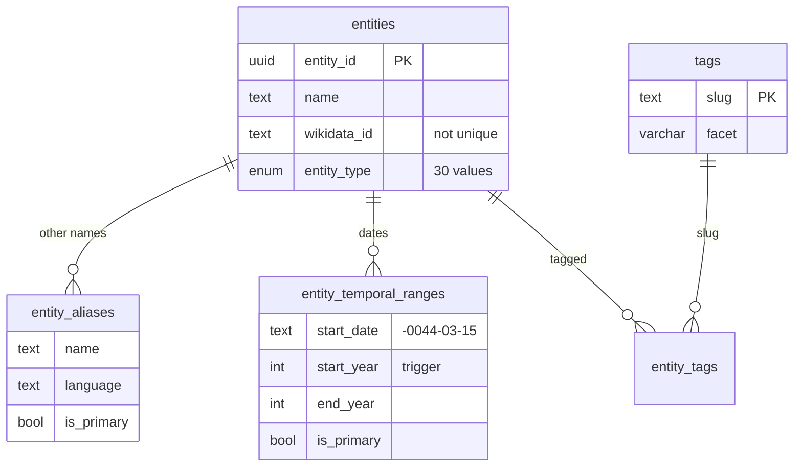
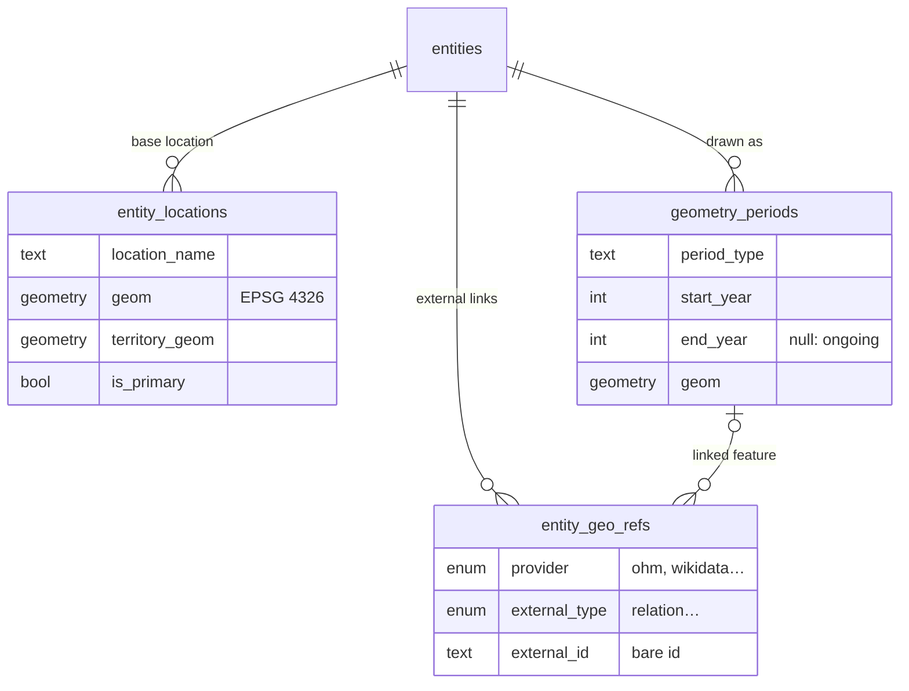
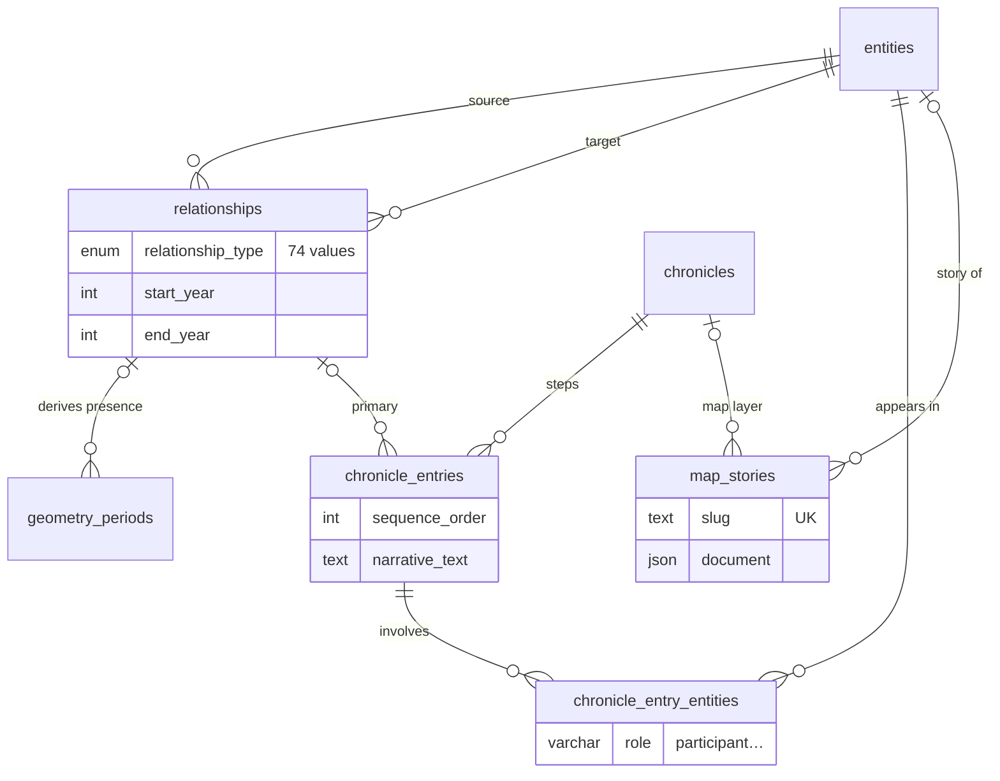
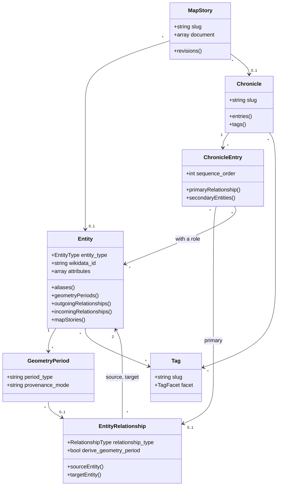
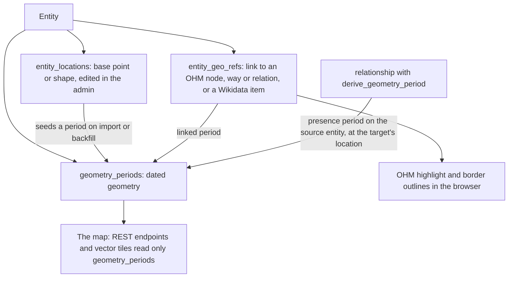

# Data model overview

The database behind the atlas: what is stored, how the tables connect, and how time and geography
are represented. Everything lives in PostgreSQL 16 with PostGIS (geometry) and pgvector
(embeddings). The canonical definitions are the migrations in `api/database/migrations` and the
enums in `api/app/Enums`.

> **Audience:** developers; historians and geographers who want the detail ·
> **Read time:** 12 minutes · **Last reviewed:** 2026-11-14

## The model in six areas

| Area | Tables | What it holds |
|---|---|---|
| Knowledge graph | `entities`, `entity_aliases`, `entity_temporal_ranges`, `entity_tags`, `relationships` | Every historical thing, its names and dates, and the typed links between things |
| Geography | `geometry_periods`, `entity_locations`, `entity_geo_refs` | Where each entity was over time, its base location, and links to OpenHistoricalMap or Wikidata |
| Narrative | `chronicles`, `chronicle_entries`, `chronicle_entry_entities`, `map_stories`, `map_story_revisions` | Guided tours and step-by-step map stories built on the graph |
| Discovery | `tags`, `chronicle_tags`, `collections` | The faceted tag vocabulary and curated sets |
| People and editing | `users`, roles and permissions, `stars`, `saved_folders`, `contributions`, `agent_*` | Accounts, saved items, readers' suggested edits, AI proposals |
| Derived and reference | `entity_timeline_entries`, schema `tiles`, ten `ref_*` tables | Read models rebuilt from the above; periods, regions, calendars and other lookups |

## Core tables (ER diagrams)

**An entity, its names, dates and tags.** An entity can have several names and date ranges; a
unique index allows at most one primary row of each.

**Where an entity is.** The base location is what an editor sets (one primary row, also enforced
by a unique index). Geometry periods are what the map draws. A geo reference links an OHM feature
or a Wikidata item, and can be tied to one geometry period.

**Links, narrative and stories.** Relationships connect two entities; chronicles and map stories are
built on top of them.

All satellite tables cascade on delete from `entities`. The exception is `chronicle_entry_entities`,
which blocks deleting an entity that a chronicle still uses. `chronicle_tags` (chronicles to tags)
and `collections` (no foreign keys: items are resolved by QID or slug when served) are left out of
the diagrams. Column details are in [Entity types](entity-specification.md#3-shared-fields).

## Main models (class diagram)

`Entity` uses a custom query builder (`App\Builders\EntityBuilder`) for type, place, time, tag and
search filters. Its relation methods return Eloquent `HasMany`, `HasOne`, `BelongsTo` and
`BelongsToMany`; `EntityType::group()` gives each type's group.

## The entity record

| Lives on `entities` | Lives in a satellite table | Lives in `attributes` (jsonb) |
|---|---|---|
| `name`, `entity_type`, `entity_group` (stored, derived from the type), `wikidata_id`, `summary` (one sentence), `significance`, `description` (paragraphs), `impact_score` (1–100), `display_priority`, `verification_status`, `confidence`, `date_confidence`, `location_confidence`, `date_method`, `duration_type`, `location_method`, `icon_class`, `source_citations`, `embedding` | names → `entity_aliases`; dates → `entity_temporal_ranges`; base location → `entity_locations`; tags → `entity_tags`; map geometry → `geometry_periods`; external links → `entity_geo_refs` | type-specific fields (125 keys across the 30 types, validated by `App\Support\EntityAttributeCatalog`); `date_raw`, `era_label`, `confidence_notes`, `entity_color`; images in `media_refs`; internal keys starting with `_` |

There are no per-type tables: a person's `birth_date` and a battle's `outcome` both live in
`attributes`. The API flattens the satellites back into convenience fields such as
`temporal_start`, `location_name`, `geom`, `alternative_names` and `tags`. The 30 types, their
groups and attributes are in [Entity types](entity-specification.md).

## Time model

| Rule | Detail |
|---|---|
| Years are signed integers | `-216` is 216 BCE. There is no year 0 |
| Dates arrive as text | `entity_temporal_ranges.start_date` and `relationships.temporal_start` hold ISO-like text (`-0044-03-15`). A database trigger takes the leading signed number into `start_year` |
| Year-only tables | Geometry periods, timeline entries, chronicles and their entries, tags and map stories store years only |
| Uncertainty | `date_confidence` (high, medium, low, unresolved), `duration_type` (point, period, ongoing, uncertain), `date_method` (how the date was found) |
| Open ranges | A null end year means "ongoing" |
| Events on the map | Events stay visible for 10 years either side of their dates |
| Decimal years | Derived on the fly for the map: start = year + 0.00137, end = year + 0.99863 |

**Worked example: the assassination of Julius Caesar** (an event on 15 March 44 BCE).

| Stored | Value |
|---|---|
| `start_date`, `end_date` | `-0044-03-15` |
| `start_year`, `end_year` | −44 |
| Visible on the map | 54 BCE to 34 BCE (the ±10-year event window) |
| Tile window | `start_decdate` −53.99863, `end_decdate` −33.00137 |

The pipeline maps Wikidata date precision to confidence: "circa" or approximate dates become
`medium`, decade precision becomes `low`, and century-only dates are not used as dates at all.

## Geometry model

- **Everything is stored in EPSG:4326** (longitude, latitude). Tiles reproject to EPSG:3857 when
  they are rendered.
- **Only `geometry_periods` reach the map.** An entity without a period is not drawn, whatever
  its `entity_locations` row holds.
- **Borders are not stored as polygons.** The stored periods are points. Territories are drawn by
  OpenHistoricalMap, and linked through `entity_geo_refs` using the OHM element id.
- **Points are placed cautiously** (`pipeline/backfill_geo.py`). Use the entity's own OHM feature,
  but only if its `wikidata` tag matches the entity's QID. Otherwise use the entity's own Wikidata
  coordinates (P625), for point-like types only. Never use a related entity's location, and never
  use a name-only match.
- **Provenance:** `provenance_mode` is `manual`, `derived` or `ohm_import`, but it is not reliable.
  The `created_by` marker (`geo-backfill:ohm`, `geo-backfill:wikidata_p625`, `pipeline:<batch>`…) is
  the better record of where a period came from.

[For geographers](for-geodata-contributors.md) explains this for non-developers.

## Identity

| Key | Where | Notes |
|---|---|---|
| UUID | entities, relationships, geometry, chronicles, entries, map stories, collections | The URL key for entities: `/entities/<uuid>` |
| Slug | chronicles, map stories, collections, tags | Unique and readable |
| Wikidata QID | `entities.wikidata_id` | Not unique in the database. The import guard matches by QID, then OHM id, then name, type and era; a QID that already belongs to a differently named row is set aside in `_rejected_wikidata_id` |
| QIDs in files | collections, map stories, entity descriptions | Refer to entities by QID, so they survive re-imports that change UUIDs |

Merging duplicates (`MergeEntitiesAction`) re-points every link from the duplicate to the
survivor, then deletes the duplicate.

## Relationships

- **Directed and typed:** source → target, one of 74 types in 8 categories (political, person,
  military, economic, religious and cultural, causal, knowledge, diplomatic). No inverse rows are
  created; readers query both directions. [Relationship types](relationships.md) lists them all.
- **Dated:** optional text bounds become `start_year` and `end_year`, as an inclusive range.
- **Not unique by constraint:** the importer checks for duplicates. It treats `married_to`,
  `allied_with`, `sibling_of`, `trades_with` and `at_war_with` as symmetric when it does.
- **Presence periods:** a relationship created in the admin or the API can derive a `presence`
  geometry period on its source entity, at the target's location (`derive_geometry_period`,
  on by default). Bulk imports skip this.

## Chronicles

A chronicle is an ordered list of entries. Each entry has a narrative and at most one primary
relationship: the change it narrates. It also links to the entities it involves, each with a role.
Impact, location and years are derived from those entities
(`EnrichChronicleMetadataAction`). A chronicle can carry a map story as its map layer.
See [Chronicles](../architecture/chronicles.md).

## Derived data

| Derived | From | Rebuilt by |
|---|---|---|
| `entity_timeline_entries` | geometry periods, relationships, temporal ranges | Observers queue `RebuildEntityTimelineJob`; `php artisan timeline:rebuild` |
| `tiles.atlas_entity_features` and `tiles.atlas_entities(z,x,y)` | geometry periods and entities (hidden: flagged, rejected, merged) | Live SQL; see [Atlas vector tiles](../schemas/atlas-tiles.md) |
| `entities.embedding` | name and text, via OpenAI `text-embedding-3-small` | `php artisan pipeline:embeddings` (not used by search yet) |
| Derived tags | dates, chronicles and entity type | `php artisan tags:sync`; see [Tags](../architecture/tags.md) |

## Reference tables

Ten lookup tables with integer keys, served read-only at `GET /api/v1/reference/{table}`:
geographic regions, historical periods, historiographical schools, calendar systems, era-to-date
lookup, writing systems, religious traditions, language families, measurement units and source type
definitions. Their seed data is described in [`reference-tables.md`](reference-tables.md). No
content table has a foreign key to them.

## Where next

- [Entity types](entity-specification.md): the 30 types, their enums and attributes
- [Relationship types](relationships.md): all 74 types with examples
- [For historians](for-historians.md) and [For geographers](for-geodata-contributors.md)
