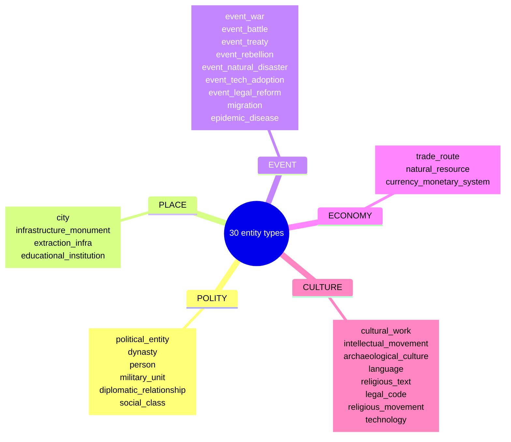

# Entity types

The reference for History Mapped's 30 entity types. It lists their five groups, the fields every
entity shares, the enumerations, and the attributes each type can carry. For the ideas behind the
model, read the [Data model overview](README.md) first.

> **Audience:** developers, data contributors, editors · **Use:** reference ·
> **Last reviewed:** 2026-11-14 · **Source of truth:** the PHP enums in `api/app/Enums/` and the
> attribute catalogue in `api/app/Support/EntityAttributeCatalog.php`



## Contents

1. [Entity groups and type hierarchy](#1-entity-groups-and-type-hierarchy)
2. [Application-wide enums](#2-application-wide-enums)
3. [Shared fields](#3-shared-fields)
4. [Type-specific attributes](#4-type-specific-attributes)
5. [Sources and citations](#5-sources-and-citations)
6. [Relationships](#6-relationships)
7. [Storage](#7-storage)

---

## 1. Entity groups and type hierarchy

Every entity belongs to one of **5 groups**. Groups exist for UI navigation (tab filtering, icon families, color palettes), API query scoping, and map lens organization. Each group contains 3–9 concrete `entity_type` values.

```
entity_group (enum)          entity_type (enum)                                     count
─────────────────────────────────────────────────────────────────────────────────────────
POLITY                       political_entity, dynasty, person, military_unit,
                             diplomatic_relationship, social_class                      6
PLACE                        city, infrastructure_monument, extraction_infra,
                             educational_institution                                    4
EVENT                        event_war, event_battle, event_treaty,
                             event_rebellion, event_natural_disaster,
                             event_tech_adoption, event_legal_reform,
                             migration, epidemic_disease                                9
ECONOMY                      trade_route, natural_resource,
                             currency_monetary_system                                   3
CULTURE                      cultural_work, intellectual_movement,
                             archaeological_culture, language,
                             religious_text, legal_code, religious_movement,
                             technology                                                 8
─────────────────────────────────────────────────────────────────────────────────────────
                                                                          TOTAL:       30
```

**Why five groups.** Groups drive navigation (tabs, icons, colours), API filters and map layers.
Version 2.1 folded ten groups into five: people and armies act for polities (POLITY); mines and
schools are places on the map (PLACE); migrations and epidemics happen in time (EVENT); belief and
knowledge sit with other culture (CULTURE). `event_battle` is separate from `event_war` because a
battle is a point in space and time, while a war spans a region and years.

---

## 2. Application-wide enums

The PHP enums in `api/app/Enums/` are the source of truth. Some are PostgreSQL enum types, others
are text columns that the models cast. The SQL below lists the values, grouped by domain.

### 2.1 Core System Enums

```sql
-- The two top-level classifiers (5 groups, 30 types)
CREATE TYPE entity_group AS ENUM (
  'POLITY', 'PLACE', 'EVENT', 'ECONOMY', 'CULTURE'
);

CREATE TYPE entity_type AS ENUM (
  -- POLITY (political actors, power structures, and their instruments)
  'political_entity', 'dynasty', 'person', 'military_unit',
  'diplomatic_relationship', 'social_class',
  -- PLACE (physical locations and structures on the map)
  'city', 'infrastructure_monument', 'extraction_infra',
  'educational_institution',
  -- EVENT (temporal occurrences: conflicts, disasters, movements)
  'event_war', 'event_battle', 'event_treaty', 'event_rebellion',
  'event_natural_disaster', 'event_tech_adoption', 'event_legal_reform',
  'migration', 'epidemic_disease',
  -- ECONOMY (trade networks, resources, and monetary systems)
  'trade_route', 'natural_resource', 'currency_monetary_system',
  -- CULTURE (ideas, beliefs, knowledge, and creative output)
  'cultural_work', 'intellectual_movement', 'archaeological_culture',
  'language', 'religious_text', 'legal_code', 'religious_movement',
  'technology'
);
```

### 2.2 Verification and Confidence Enums

```sql
CREATE TYPE verification_status AS ENUM (
  'pipeline_draft',        -- Created by pipeline, not yet validated
  'ohm_draft',             -- Created by the OHM border import, not yet validated
  'auto_validated',        -- Passed automated checks
  'needs_review',          -- In human review queue
  'in_review',             -- Currently assigned to a reviewer
  'human_verified',        -- Approved by reviewer
  'expert_verified',       -- Approved by domain expert
  'flagged',               -- Flagged for re-examination (hidden from the map)
  'rejected',              -- Rejected as invalid/duplicate (hidden from the map)
  'merged'                 -- Merged into another entity (hidden; merges currently delete the loser instead)
);

CREATE TYPE confidence_level AS ENUM (
  'high',                  -- Strong evidence, multiple corroborating sources
  'medium',                -- Reasonable evidence, some ambiguity
  'low',                   -- Weak evidence, significant uncertainty
  'unresolved'             -- Insufficient data to assess
);

CREATE TYPE reliability_tier AS ENUM (
  'authoritative',         -- Primary sources, peer-reviewed archaeology
  'scholarly',             -- Academic secondary sources, university press
  'reference',             -- Encyclopedias, well-curated databases (e.g., Pleiades)
  'user_contributed'       -- Community submissions, Wikipedia, blogs
);
```

### 2.3 Temporal Enums

```sql
CREATE TYPE date_resolution_method AS ENUM (
  'nlp_direct',            -- Tier 1: explicit date extracted by NLP
  'nlp_approximate',       -- Tier 2: partial/approximate date via NLP
  'llm_reign_resolution',  -- Tier 3: relative date resolved by LLM
  'era_table_lookup',      -- Tier 4: era-relative resolved via reference table
  'llm_contextual_inference', -- Tier 5: inferred from co-occurring entities
  'human_assigned',        -- Tier 6 or override: assigned by human reviewer
  'source_database'        -- Imported from structured database (Pleiades, Wikidata)
);

CREATE TYPE duration_type AS ENUM (
  'point',                 -- Instantaneous event (battle, treaty signing)
  'period',                -- Bounded time range (war, reign, construction)
  'ongoing',               -- No defined end (living language, active city)
  'uncertain'              -- Duration not determinable from sources
);
```

### 2.4 Spatial Enums

```sql
CREATE TYPE location_resolution_method AS ENUM (
  'ohm_nominatim',         -- OpenHistoricalMap (geocoder or a QID-tagged OHM feature)
  'wikidata',              -- Wikidata SPARQL coordinates
  'geonames',              -- GeoNames database
  'pleiades',              -- Pleiades ancient places gazetteer
  'llm_disambiguation',    -- LLM selected from candidate locations
  'human_assigned',        -- Reviewer placed manually
  'source_database'        -- Coordinates from structured import
);

CREATE TYPE geometry_type AS ENUM (
  'point',                 -- Single location (city, battle site, monument)
  'polygon',               -- Territory (empire borders, region extent)
  'linestring',            -- Route (trade route, migration path, river)
  'multipoint',            -- Multiple associated locations (archipelago, mine cluster)
  'multipolygon'           -- Discontinuous territory (island empire, split state)
);
```

### 2.5 Political and Governance Enums

```sql
CREATE TYPE political_entity_subtype AS ENUM (
  'empire', 'kingdom', 'republic', 'city_state', 'tribal_confederation',
  'theocracy', 'principality', 'duchy', 'khanate', 'sultanate',
  'caliphate', 'shogunate', 'confederation', 'league', 'colonial_territory',
  'protectorate', 'vassal_state', 'free_city', 'nomadic_polity', 'other'
);

CREATE TYPE government_type AS ENUM (
  'absolute_monarchy', 'constitutional_monarchy', 'elective_monarchy',
  'oligarchy', 'aristocratic_republic', 'democratic_republic',
  'theocracy', 'military_dictatorship', 'tribal_chieftainship',
  'feudal', 'bureaucratic_centralized', 'colonial_administration',
  'communist_state', 'fascist_state', 'anarchy', 'diarchy',
  'federal', 'confederal', 'other'
);

CREATE TYPE succession_type AS ENUM (
  'primogeniture', 'ultimogeniture', 'elective', 'tanistry',
  'agnatic', 'cognatic', 'appointed', 'meritocratic',
  'military_acclamation', 'divine_selection', 'rotation',
  'other', 'unknown'
);
```

### 2.6 Military Enums

```sql
CREATE TYPE military_unit_subtype AS ENUM (
  'infantry', 'cavalry', 'navy', 'archer_ranged', 'siege',
  'chariot', 'elephant_corps', 'garrison', 'mercenary_company',
  'legion', 'phalanx', 'warband', 'fleet', 'air_force',
  'special_forces', 'militia', 'guard', 'other'
);

CREATE TYPE military_composition AS ENUM (
  'professional', 'conscript', 'mercenary', 'tribal_warrior',
  'slave_soldier', 'feudal_levy', 'volunteer', 'mixed', 'unknown'
);
```

### 2.7 Place and Infrastructure Enums

```sql
CREATE TYPE settlement_subtype AS ENUM (
  'capital_city', 'major_city', 'minor_city', 'town', 'village',
  'fortress', 'port', 'religious_center', 'trade_hub',
  'administrative_center', 'mining_town', 'oasis', 'colony',
  'garrison_town', 'abandoned', 'other'
);

CREATE TYPE monument_subtype AS ENUM (
  -- Civic / Public
  'palace', 'forum', 'amphitheater', 'theater', 'bath_complex',
  'library', 'market_agora', 'government_building',
  -- Religious
  'temple', 'cathedral', 'mosque', 'monastery', 'shrine', 'pyramid',
  'megalithic_structure', 'sacred_grove',
  -- Military / Defensive
  'fortification', 'wall', 'castle', 'citadel', 'watchtower',
  -- Infrastructure
  'aqueduct', 'canal', 'bridge', 'road_section', 'harbor', 'lighthouse',
  'dam', 'granary', 'sewer_system',
  -- Monumental / Memorial
  'triumphal_arch', 'obelisk', 'mausoleum', 'tomb', 'statue',
  'memorial', 'stele',
  -- Other
  'other'
);
```

### 2.8 Economy and Resource Enums

```sql
CREATE TYPE resource_category AS ENUM (
  'grain', 'livestock', 'cash_crop', 'timber', 'metal_precious',
  'metal_strategic', 'metal_base', 'stone_building', 'gemstone',
  'salt', 'spice', 'textile_raw', 'dye', 'incense_perfume',
  'fuel', 'water', 'fish_seafood', 'animal_strategic',
  'animal_luxury', 'medicinal', 'other'
);

CREATE TYPE resource_renewability AS ENUM (
  'renewable', 'finite', 'cyclical', 'unknown'
);

CREATE TYPE resource_strategic_value AS ENUM (
  'critical', 'high', 'medium', 'low', 'negligible', 'unknown'
);

CREATE TYPE extraction_infra_subtype AS ENUM (
  'mine', 'quarry', 'farm', 'plantation', 'ranch', 'fishery',
  'forest_logging', 'hunting_ground', 'well_spring', 'salt_works',
  'workshop', 'shipyard', 'smithy_foundry', 'irrigation_system',
  'mill', 'vineyard', 'kiln', 'other'
);

CREATE TYPE trade_route_subtype AS ENUM (
  'overland', 'maritime', 'riverine', 'mixed',
  'pilgrimage', 'military_supply', 'other'
);

CREATE TYPE currency_type AS ENUM (
  'coin_metal', 'paper', 'commodity_money', 'shell_bead',
  'barter_system', 'credit_system', 'other'
);
```

### 2.9 Event Enums

```sql
CREATE TYPE war_subtype AS ENUM (
  'interstate_war', 'civil_war', 'colonial_war', 'religious_war',
  'succession_war', 'trade_war', 'border_conflict', 'raid_series',
  'invasion', 'siege_campaign', 'naval_war', 'tribal_war', 'other'
);

CREATE TYPE battle_subtype AS ENUM (
  'pitched_battle', 'siege', 'naval_battle', 'ambush',
  'skirmish', 'raid', 'last_stand', 'other'
);

CREATE TYPE battle_outcome AS ENUM (
  'decisive_victory', 'tactical_victory', 'pyrrhic_victory',
  'draw', 'tactical_defeat', 'decisive_defeat', 'inconclusive',
  'unknown'
);

CREATE TYPE treaty_subtype AS ENUM (
  'peace_treaty', 'alliance_treaty', 'trade_agreement',
  'marriage_alliance', 'tribute_agreement', 'border_demarcation',
  'non_aggression_pact', 'surrender', 'ceasefire',
  'mutual_defense', 'vassalage_agreement', 'other'
);

CREATE TYPE rebellion_subtype AS ENUM (
  'revolution', 'rebellion', 'coup', 'civil_war',
  'peasant_uprising', 'slave_revolt', 'military_mutiny',
  'separatist_movement', 'religious_uprising', 'other'
);

CREATE TYPE disaster_subtype AS ENUM (
  'earthquake', 'volcanic_eruption', 'flood', 'tsunami',
  'drought', 'famine', 'wildfire', 'hurricane_typhoon',
  'landslide', 'climate_shift', 'other'
);

CREATE TYPE reform_subtype AS ENUM (
  'legal_code', 'constitutional_change', 'administrative_reorganization',
  'land_reform', 'taxation_reform', 'military_reform',
  'religious_reform', 'educational_reform', 'economic_reform',
  'abolition', 'enfranchisement', 'other'
);
```

### 2.10 Society Enums

```sql
CREATE TYPE epidemic_subtype AS ENUM (
  'plague_bacterial', 'plague_viral', 'smallpox', 'cholera',
  'malaria', 'typhus', 'influenza', 'tuberculosis', 'leprosy',
  'dysentery', 'measles', 'unknown_pestilence', 'other'
);

CREATE TYPE epidemic_severity AS ENUM (
  'local',                 -- Confined to one city/region
  'regional',              -- Multiple provinces/regions
  'pandemic',              -- Continent-scale or beyond
  'unknown'
);

CREATE TYPE diplomatic_status AS ENUM (
  'alliance', 'defensive_pact', 'trade_agreement', 'vassalage',
  'tributary', 'protectorate', 'personal_union', 'federation_member',
  'non_aggression', 'neutrality', 'war', 'cold_war',
  'embargo', 'occupation', 'other'
);

CREATE TYPE migration_subtype AS ENUM (
  'invasion', 'colonization', 'forced_deportation', 'refugee_flight',
  'economic_migration', 'nomadic_movement', 'pilgrimage_settlement',
  'slave_trade', 'diaspora', 'other'
);

CREATE TYPE social_class_subtype AS ENUM (
  'royalty', 'nobility', 'clergy', 'warrior_class', 'merchant_class',
  'artisan_class', 'peasantry', 'serf', 'slave', 'freedman',
  'bureaucrat_literati', 'nomad_pastoral', 'outcast_untouchable',
  'intelligentsia', 'bourgeoisie', 'proletariat', 'other'
);
```

### 2.11 Culture and Knowledge Enums

```sql
CREATE TYPE cultural_work_subtype AS ENUM (
  'literary_text', 'philosophical_text', 'historical_text',
  'religious_text', 'scientific_text', 'legal_text',
  'building_architecture', 'sculpture', 'painting_mural',
  'mosaic', 'pottery_ceramics', 'textile', 'metalwork',
  'musical_composition', 'inscription', 'coin_design',
  'map_cartography', 'other'
);

CREATE TYPE language_status AS ENUM (
  'living', 'extinct', 'liturgical_only', 'reconstructed',
  'endangered', 'revived', 'unknown'
);

CREATE TYPE language_role AS ENUM (
  'vernacular', 'lingua_franca', 'administrative',
  'liturgical', 'literary', 'trade_language', 'court_language',
  'scholarly', 'other'
);

CREATE TYPE technology_domain AS ENUM (
  'military', 'agricultural', 'industrial', 'construction',
  'navigation', 'communication', 'medical', 'metallurgical',
  'textile', 'writing_printing', 'astronomical', 'hydraulic',
  'transportation', 'food_preservation', 'other'
);

CREATE TYPE intellectual_movement_subtype AS ENUM (
  'philosophical_school', 'artistic_style', 'literary_movement',
  'scientific_paradigm', 'legal_tradition', 'educational_tradition',
  'historiographical', 'other'
);

CREATE TYPE religious_movement_subtype AS ENUM (
  'monotheism', 'polytheism', 'animism', 'ancestor_worship',
  'philosophical_religion', 'mystery_cult', 'syncretic',
  'sect_denomination', 'heretical_movement', 'reform_movement',
  'missionary_movement', 'monastic_order', 'other'
);
```

### 2.12 Person Enums

```sql
CREATE TYPE person_role AS ENUM (
  'ruler', 'regent', 'heir', 'consort', 'general', 'admiral',
  'diplomat', 'governor', 'religious_leader', 'prophet',
  'philosopher', 'scientist', 'artist', 'architect', 'poet',
  'historian', 'lahistory-mappediver', 'rebel_leader', 'merchant',
  'explorer', 'spy', 'slave', 'other'
);

CREATE TYPE gender AS ENUM (
  'male', 'female', 'other', 'unknown'
);
```

### 2.13 Relationship Enums

```sql
CREATE TYPE relationship_type AS ENUM (
  -- Political
  'rules', 'governed_by', 'vassal_of', 'suzerain_of',
  'allied_with', 'at_war_with', 'succeeded_by', 'preceded_by',
  'part_of', 'contains', 'capital_of', 'split_from', 'merged_into',

  -- Person
  'born_in', 'died_in', 'resided_in', 'commanded', 'founded',
  'authored', 'commissioned', 'married_to', 'parent_of', 'child_of',
  'sibling_of', 'mentor_of', 'student_of', 'assassinated_by',
  'member_of_dynasty', 'patron_of',

  -- Military
  'participated_in', 'fought_at', 'defeated_at', 'victorious_at',
  'stationed_at', 'recruited_from', 'commanded_by',

  -- Economic
  'trades_with', 'connects', 'produces', 'extracts',
  'supplies', 'controlled_by', 'passes_through',
  'minted_by', 'used_currency',

  -- Religious/Cultural
  'adheres_to', 'official_religion_of', 'persecuted_by',
  'influenced_by', 'inspired', 'schism_from',
  'translated_into', 'located_at', 'built_by',
  'destroyed_by', 'restored_by',

  -- Causal
  'caused', 'resulted_from', 'contributed_to', 'enabled',
  'prevented', 'weakened', 'strengthened',

  -- Knowledge
  'invented', 'adopted', 'taught_at', 'spread_to',
  'required_by', 'replaced_by',

  -- Diplomatic
  'signed_by', 'violated_by', 'guaranteed_by',
  'mediated_by', 'enforced_by'
);
```

### 2.14 Display and Rendering Enums

```sql
CREATE TYPE icon_class AS ENUM (
  'crown', 'person', 'dynasty_tree', 'sword', 'city', 'monument',
  'trade_ship', 'gem', 'pickaxe', 'coin', 'people', 'migration_arrow',
  'plague', 'handshake', 'scroll', 'palette', 'ruins', 'language_glyph',
  'sacred_book', 'scales', 'crossed_swords', 'shield', 'treaty_seal',
  'fist', 'earthquake', 'gear', 'quill', 'temple', 'lightbulb',
  'university'
);

-- Group colours are CSS variables in web/src/styles.css (light / dark):
-- POLITY:  --g-polity   #b4543f / #d47a63  (terracotta)
-- PLACE:   --g-place    #6b7f4a / #9cae6f  (olive)
-- EVENT:   --g-event    #bd8a2c / #d9a94e  (ochre)
-- ECONOMY: --g-economy  #4d6a86 / #7d9db8  (slate blue)
-- CULTURE: --g-culture  #8a5673 / #bb87a3  (plum)
```

---

## 3. Shared fields

Every entity has the columns below. Its dates, locations, names and tags live in small satellite
tables, so an entity can have more than one of each. Type-specific fields are keys in `attributes`
(Section 4).

### 3.1 The `entities` table

| Column | Type | Notes |
|---|---|---|
| `entity_id` | uuid | Primary key |
| `name` | text | Display name. Full-text and trigram indexes (search is by name only) |
| `entity_type`, `entity_group` | PG enums | One of the 30 types, and its group, both stored |
| `wikidata_id` | text | Nullable and **not unique**. Import and write paths guard against reusing a QID |
| `summary` | text | One sentence |
| `significance` | text | Why it matters |
| `description` | text | Optional long text in paragraphs |
| `attributes` | jsonb | Type-specific keys (Section 4), plus shared keys: `date_raw`, `confidence_notes`, `validation_flags`, `media_refs`, `entity_color`, `temporal_display_range`, `era_label`. `_`-prefixed keys are pipeline and admin bookkeeping; the public API leaves them and `validation_flags` out |
| `source_citations` | jsonb | Free-form citations (Section 5) |
| `verification_status` | enum | Default `pipeline_draft` ([2.2](#22-verification-and-confidence-enums)) |
| `confidence`, `date_confidence`, `location_confidence` | `confidence_level` | Separate confidence for the record, its dates and its place |
| `date_method`, `duration_type`, `location_method`, `icon_class` | enums | Section 2 |
| `impact_score`, `display_priority` | int | Ranking on the map and in lists |
| `primary_geo_ref_id` | uuid | The active primary geography reference (3.2) |
| `embedding` | vector(1536) | HNSW index. Generated, not yet used by search |
| `reviewer_id`, `review_date` | bigint, timestamp | Who reviewed the entity, and when |
| `created_by` | text | Provenance: `pipeline:<batch>`, `borders:<batch>`, `agent:<user id>`, … |
| `created_at`, `updated_at` | timestamps | |

### 3.2 Satellite tables

| Table | Holds | How many per entity |
|---|---|---|
| `entity_aliases` | Other names, with language and source. A primary alias becomes the display name on the map | Many; at most one primary |
| `entity_temporal_ranges` | Dates: `start_date` and `end_date` as ISO-like text (month and day allowed), integer years derived by a trigger, a range type (`primary`, `secondary`, `disputed`), method and confidence | Many; one primary |
| `entity_locations` | The base location: place name, `geom` (point or line), `territory_geom` (polygon), method and confidence | Many; one primary |
| `geometry_periods` | Dated geometry. **The only geometry the map draws** | Many |
| `entity_geo_refs` | References to OHM features and gazetteer items: provider, type, bare id (`2744968`, `Q16553`), match role, retrieval method, years | Many; one active primary |
| `entity_tags` | Tags from the controlled vocabulary, each with its source (`manual`, `curated`, `derived`) | Many |
| `entity_timeline_entries` | A derived read model for the entity's timeline, rebuilt automatically | Many |

How these combine on the map, and the rules for choosing a point, are in
[For geographers](for-geodata-contributors.md). When a reader clicks an OHM feature, the app sends
its signed id and the year to `GET /api/v1/map/resolve-ohm-feature`, which picks the best active
reference valid in that year ([Maps, tiles and OHM](../architecture/ohm-integration.md#linking-our-entities-to-ohm)).

---

## 4. Type-specific attributes

> **Storage decision:** All type-specific fields are stored as keys in the JSONB `attributes` column on the `entities` table. They are **not** separate database columns or sub-tables. This section documents the expected JSONB schema per entity type for pipeline ingestion, validation, and admin panel form generation.
>
> **Rationale:** Type-specific attributes are never queried on the map hot path. They are loaded only when displaying entity detail views — a single-row JSON decode. JSONB avoids 30 sub-tables, 30 models, and 30 migrations while allowing schema evolution without DDL changes. For the few attribute keys used in filters, PostgreSQL expression indexes provide indexed equality lookups.
>
> **Cross-entity references in JSONB:** Fields like `"city_entity_id"` or `"person_id"` stored inside JSONB arrays are **soft references** (UUID strings), not foreign keys. Referential integrity for these is enforced by the application, in pipeline validation and admin saves. Links that need database-level integrity belong in the `relationships` table instead.
>
> **Time-varying geometries:** Entities whose PostGIS geometries change over time (empire borders, trade route shifts, migration paths) use `geometry_periods` — not JSONB — because PostGIS spatial queries require GIST-indexed `geometry` columns.

All entities carry every field from Section 3 in addition to the `attributes` keys listed below.

---

### 4.1 Political Entity

**entity_type:** `political_entity` | **entity_group:** `POLITY`

```jsonc
{
  "political_subtype": "empire",                              // enum: political_entity_subtype
  "government_type": "bureaucratic_centralized",              // enum: government_type
  "succession_type": "primogeniture",                         // enum: succession_type
  "government_history": [{"type": "str", "start": -753, "end": -509}],
  "capital_history": [{"city_entity_id": "uuid", "start": -753, "end": -509}],
  "population_estimates": [{"value": 55000000, "year": 117, "source": "str", "confidence": "str"}],
  "territory_area_estimates": [{"km2": 5000000, "year": 117, "source": "str"}],
  "official_languages": [{"language_entity_id": "uuid", "start": -200, "end": 476}],
  "official_religions": [{"religious_movement_id": "uuid", "start": 380, "end": 476, "status": "str"}],
  "administrative_divisions": [{"name": "Syria", "type": "province", "entity_id": "uuid"}]
}
```

**Key relationships:** `governed_by` → Person · `vassal_of`, `suzerain_of`, `allied_with`, `at_war_with` → Political Entity · City → `capital_of` · Trade Route, Natural Resource → `controlled_by`
**On the map:** borders come from the linked OpenHistoricalMap relation, dated to the year on screen. Our geometry periods hold dated points.

---

### 4.2 Person

**entity_type:** `person` | **entity_group:** `POLITY`

```jsonc
{
  "gender": "male",                                            // enum: gender
  "birth_date": "-356",                                        // EDTF text
  "death_date": "-323",                                        // EDTF text
  "birth_place_id": "uuid",                                    // → City entity
  "death_place_id": "uuid",                                    // → City entity
  "burial_place_id": "uuid",                                   // → City or Monument entity
  "dynasty_id": "uuid",                                        // → Dynasty entity
  "ethnicity": "Macedonian",
  "cause_of_death": "fever",
  "roles": [{"role": "ruler", "political_entity_id": "uuid", "start": -336, "end": -323, "title": "King"}]
}
```

**Key relationships:** `rules` (Political Entity), `commanded` (Military Unit), `authored` (Cultural Work), `founded` (Dynasty, City, Religious Movement), `parent_of/child_of/married_to` (Person)

---

### 4.3 Dynasty / Ruling House

**entity_type:** `dynasty` | **entity_group:** `POLITY`

```jsonc
{
  "founding_event": "str",
  "ethnic_origin": "str",
  "legitimacy_basis": "str",                                   // hereditary, divine right, etc.
  "succession_type": "primogeniture",                          // enum: succession_type
  "cadet_branches": [{"name": "str", "entity_id": "uuid", "split_date": 1200}],
  "political_entities_ruled": [{"entity_id": "uuid", "start": 1200, "end": 1400}]
}
```

**Key relationships:** `member_of_dynasty` (Person), `rules` (Political Entity), `preceded_by/succeeded_by` (Dynasty), `married_to` (Dynasty — alliance marriages)

---

### 4.4 Military Unit / Army

**entity_type:** `military_unit` | **entity_group:** `POLITY`

```jsonc
{
  "unit_subtype": "legion",                                    // enum: military_unit_subtype
  "composition": "professional",                               // enum: military_composition
  "size_estimates": [{"count": 5000, "year": 100, "source": "str"}],
  "commanders": [{"person_id": "uuid", "start": 100, "end": 110, "rank": "str"}],
  "equipment_technology": [{"technology_id": "uuid", "description": "str"}],
  "stationed_locations": [{"city_id": "uuid", "start": 100, "end": 110}],
  "notable_actions": [{"event_id": "uuid", "role": "str", "outcome": "str"}]
}
```

**Key relationships:** `part_of` (Political Entity), `commanded_by` (Person), `fought_at` (Event Battle), `stationed_at` (City)

---

### 4.5 City / Settlement

**entity_type:** `city` | **entity_group:** `PLACE`

```jsonc
{
  "settlement_subtype": "capital_city",                        // enum: settlement_subtype
  "elevation_m": 15,
  "founding_legend": "str",
  "population_estimates": [{"value": 1000000, "year": 100, "source": "str", "confidence": "str"}],
  "political_control": [{"political_entity_id": "uuid", "start": -753, "end": 476}],
  "economic_roles": [{"role": "trade_hub", "start": -200, "end": 476}],
  "infrastructure": [{"monument_id": "uuid", "built_date": -80}]
}
```

**Key relationships:** `capital_of`, `part_of` → Political Entity · Trade Route → `connects` · Person → `born_in`, `died_in`, `resided_in` · Event, Monument → `located_at`

---

### 4.6 Infrastructure / Monument

**entity_type:** `infrastructure_monument` | **entity_group:** `PLACE`

```jsonc
{
  "monument_subtype": "temple",                                // enum: monument_subtype
  "construction_start": "-447",                                // EDTF text
  "construction_end": "-432",                                  // EDTF text
  "commissioned_by": "uuid",                                   // → Person or Political Entity
  "architect_builder": "uuid",                                 // → Person
  "materials": ["marble", "limestone"],
  "dimensions": {"height_m": 13.7, "length_m": 69.5, "area_m2": null},
  "current_condition": "ruins",                                // extant, ruins, destroyed, rebuilt, submerged
  "destruction_date": null,                                    // EDTF text
  "destruction_cause": null,
  "unesco_status": "World Heritage Site",
  "city_id": "uuid"                                            // → City entity
}
```

**Key relationships:** `built_by`, `restored_by` → Person, Political Entity · `located_at` → City · `destroyed_by` → Event, Political Entity · Technology, Natural Resource → `required_by`

**Design rationale:** Separating monuments from cities allows Civ-style "Wonder" display. The Colosseum, Great Wall, Hagia Sophia are some of the most visually compelling map features.

---

### 4.7 Religious / Ideological Movement

**entity_type:** `religious_movement` | **entity_group:** `CULTURE`

```jsonc
{
  "movement_subtype": "monotheism",                            // enum: religious_movement_subtype
  "founder_id": "uuid",                                        // → Person
  "core_doctrines": "str",
  "institutional_structure": "str",                            // church, temple network, decentralized
  "sacred_texts": [{"religious_text_id": "uuid", "role": "str"}],
  "spread_timeline": [{"region": "str", "date": 50, "method": "str"}],
  "schisms": [{"child_movement_id": "uuid", "date": 1054, "cause": "str"}],
  "persecution_periods": [{"political_entity_id": "uuid", "start": 64, "end": 313, "severity": "str"}]
}
```

**Key relationships:** `founded` (Person), `official_religion_of` (Political Entity), `schism_from` (Religious Movement), `persecuted_by` (Political Entity), `inspired` (Intellectual Movement)
**Changing extent:** a series of `spread_zone` geometry periods.

---

### 4.8 Trade Route / Network

**entity_type:** `trade_route` | **entity_group:** `ECONOMY`

```jsonc
{
  "route_subtype": "overland",                                 // enum: trade_route_subtype
  "transport_mode": ["camel_caravan", "sailing_vessel"],
  "risk_factors": ["piracy", "banditry"],
  "waypoints": [{"city_id": "uuid", "order": 1, "role": "str"}],
  "commodities": [{"resource_id": "uuid", "direction": "eastbound", "volume_estimate": "str"}],
  "controlling_entities": [{"political_entity_id": "uuid", "segment": "str", "start": -200, "end": 200}],
  "infrastructure": [{"type": "caravanserai", "description": "str", "segment": "str"}],
  "customs_taxation": [{"location": "str", "rate": "str", "entity_id": "uuid"}]
}
```

**Key relationships:** `connects` → City · `passes_through`, `controlled_by` → Political Entity · `supplies` → Natural Resource · Event War, Epidemic → `weakened` · Technology → `enabled`
**Changing path:** a series of `route` geometry periods, or a trade-route [map story](../architecture/map-stories.md).

---

### 4.9 Natural Resource

**entity_type:** `natural_resource` | **entity_group:** `ECONOMY`

```jsonc
{
  "resource_category": "metal_precious",                       // enum: resource_category
  "renewability": "finite",                                    // enum: resource_renewability
  "is_tradeable": true,
  "substitutability": "str",
  "transport_difficulty": "str",
  "cultural_value": "str",
  "strategic_value_history": [{"value": "critical", "period": "str", "reason": "str"}],
  "extraction_tech_required": [{"technology_id": "uuid", "description": "str"}],
  "known_deposits": [{"location": "str", "quality": "str", "discovery_date": "str"}],
  "processed_forms": [{"raw": "tin ore", "processed": "bronze", "technology_required": "str"}],
  "price_history": [{"period": "str", "value": 100, "unit": "str", "source": "str"}]
}
```

**Key relationships:** Extraction Infrastructure → `extracts` · Political Entity, Trade Route → `produces`, `supplies` · `controlled_by` → Political Entity · `required_by` → Technology · `caused` → Event War (resource wars)

---

### 4.10 Extraction Infrastructure

**entity_type:** `extraction_infra` | **entity_group:** `PLACE`

```jsonc
{
  "infra_subtype": "mine",                                     // enum: extraction_infra_subtype
  "scale": "large",                                            // small, medium, large, industrial
  "resource_extracted": [{"resource_id": "uuid", "volume_estimate": "str", "unit": "str"}],
  "labor_force": {"size": 500, "type": "slave_soldier", "conditions": "str"},
  "technology_used": [{"technology_id": "uuid", "description": "str"}],
  "productivity_history": [{"period": "str", "output": 100, "unit": "str"}],
  "controlling_entity": [{"political_entity_id": "uuid", "start": -200, "end": 100}]
}
```

**Key relationships:** `extracts` → Natural Resource · `controlled_by` → Political Entity · `located_at` → City · Technology → `required_by`

---

### 4.11 Currency / Monetary System

**entity_type:** `currency_monetary_system` | **entity_group:** `ECONOMY`

```jsonc
{
  "currency_type": "coin_metal",                               // enum: currency_type
  "issuing_authority": "uuid",                                 // → Political Entity
  "denominations": [{"name": "denarius", "value": 1, "metal": "silver", "weight_g": 3.9}],
  "metal_composition_history": [{"period": "str", "metal": "silver", "purity_pct": 95}],
  "exchange_rates": [{"against_currency_id": "uuid", "rate": 1.5, "period": "str"}],
  "circulation_area": [{"region": "str", "period": "str"}]
}
```

**Key relationships:** `minted_by` → Political Entity · Political Entity → `used_currency` · Natural Resource (the metal) → `required_by`

---

### 4.12 Technology / Innovation

**entity_type:** `technology` | **entity_group:** `CULTURE`

```jsonc
{
  "tech_domain": "military",                                   // enum: technology_domain
  "inventor_id": "uuid",                                       // → Person
  "origin_location": "uuid",                                   // → City
  "replaced_by": "uuid",                                       // → Technology
  "impact_description": "str",
  "prerequisites": [{"technology_id": "uuid"}],
  "adoption_timeline": [{"political_entity_id": "uuid", "date": 200, "method": "trade"}]
}
```

**Key relationships:** `invented` (Person), `adopted` (Political Entity), `enabled` (Military Unit, Extraction Infrastructure), `replaced_by` (Technology), `required_by` (Infrastructure Monument)

---

### 4.13 Educational / Knowledge Institution

**entity_type:** `educational_institution` | **entity_group:** `PLACE`

```jsonc
{
  "institution_type": "library",                               // academy, university, library, madrasa, etc.
  "founded_by": "uuid",                                        // → Person or Political Entity
  "city_id": "uuid",                                           // → City
  "destruction_event": "uuid",                                 // → Event (if destroyed)
  "subjects_taught": ["philosophy", "mathematics"],
  "library_holdings": "str",
  "notable_scholars": [{"person_id": "uuid", "period": "str", "role": "str"}]
}
```

**Key relationships:** `located_at` → City · Person, Political Entity → `founded`, `patron_of` · Person → `taught_at` · Intellectual Movement → `influenced_by`

---

### 4.14 Event — War / Conflict

**entity_type:** `event_war` | **entity_group:** `EVENT`

```jsonc
{
  "war_subtype": "interstate_war",                             // enum: war_subtype
  "casus_belli": "str",
  "territorial_changes": "str",
  "ending_treaty": "uuid",                                     // → Event Treaty
  "belligerents": {"side_a": [{"entity_id": "uuid", "role": "str"}], "side_b": [{"entity_id": "uuid", "role": "str"}]},
  "key_commanders": [{"person_id": "uuid", "side": "side_a", "role": "str"}],
  "major_battles": [{"event_battle_id": "uuid"}],
  "casualties": {"side_a": {"killed": 10000}, "side_b": {"killed": 15000}, "civilian": 5000}
}
```

**Key relationships:** Political Entity, Military Unit → `participated_in` (the sides are also linked to each other by `at_war_with`) · `commanded_by` → Person · `contains` → Event Battle · `resulted_from` → Event · `caused` → Event, Political Entity · Event Treaty → `resulted_from`

---

### 4.15 Event — Battle / Siege

**entity_type:** `event_battle` | **entity_group:** `EVENT`

```jsonc
{
  "battle_subtype": "siege",                                   // enum: battle_subtype
  "parent_war_id": "uuid",                                     // → Event War
  "outcome": "decisive_victory",                               // enum: battle_outcome
  "victor_side": "side_a",
  "tactical_notes": "str",
  "belligerents": {"side_a": [{"entity_id": "uuid", "role": "str"}], "side_b": [{"entity_id": "uuid", "role": "str"}]},
  "commanders": [{"person_id": "uuid", "side": "side_a", "survived": true}],
  "forces": {"side_a": {"count": 80000, "composition": "str"}, "side_b": {"count": 7000, "composition": "str"}},
  "casualties": {"side_a": {"killed": 5000}, "side_b": {"killed": 7000}}
}
```

**Key relationships:** `part_of` (Event War), `fought_at` (City/location), `commanded_by` (Person), `participated_in` (Military Unit)

---

### 4.16 Event — Treaty / Agreement

**entity_type:** `event_treaty` | **entity_group:** `EVENT`

```jsonc
{
  "treaty_subtype": "peace_treaty",                            // enum: treaty_subtype
  "key_provisions": "str",
  "duration": "str",
  "termination_date": null,                                    // EDTF text
  "termination_reason": null,
  "signatories": [{"political_entity_id": "uuid", "role": "str"}],
  "negotiators": [{"person_id": "uuid", "representing": "uuid"}],
  "territorial_terms": [{"region": "str", "from_entity": "uuid", "to_entity": "uuid"}],
  "compliance_history": [{"date": 200, "event": "str", "description": "str"}]
}
```

**Key relationships:** `signed_by` → Political Entity, Person · `mediated_by`, `guaranteed_by` → Person, Political Entity · `violated_by` → Political Entity · `resulted_from` → Event War · `caused` → Diplomatic Relationship

---

### 4.17 Event — Revolution / Rebellion / Coup

**entity_type:** `event_rebellion` | **entity_group:** `EVENT`

```jsonc
{
  "rebellion_subtype": "revolution",                           // enum: rebellion_subtype
  "target_government": "uuid",                                 // → Political Entity
  "outcome": "success",                                        // success, failure, partial, ongoing
  "government_change": "str",
  "repression": "str",
  "causes": ["famine", "taxation"],
  "rebel_leaders": [{"person_id": "uuid", "role": "str"}],
  "factions": [{"name": "str", "composition": "str", "social_class_id": "uuid"}],
  "external_supporters": [{"political_entity_id": "uuid", "support_type": "str"}],
  "casualties": {"killed": 10000}
}
```

**Key relationships:** Person, Political Entity → `participated_in` · `commanded_by` → Person · `resulted_from` → Event · `caused` → Political Entity, Event · `weakened` → Political Entity

---

### 4.18 Event — Natural Disaster

**entity_type:** `event_natural_disaster` | **entity_group:** `EVENT`

```jsonc
{
  "disaster_subtype": "earthquake",                            // enum: disaster_subtype
  "economic_damage": "str",
  "societal_response": "str",
  "long_term_consequences": "str",
  "estimated_deaths": {"min": 10000, "max": 30000, "source": "str"},
  "affected_entities": [{"political_entity_id": "uuid", "severity": "str"}],
  "infrastructure_destroyed": [{"entity_id": "uuid", "damage_level": "str"}]
}
```

**Key relationships:** `weakened` → Political Entity, City · City, Monument → `destroyed_by` · `caused`, `contributed_to` → Migration, Rebellion, Epidemic

---

### 4.19 Event — Technology Adoption

**entity_type:** `event_tech_adoption` | **entity_group:** `EVENT`

```jsonc
{
  "technology_id": "uuid",                                     // → Technology
  "adopting_entity": "uuid",                                   // → Political Entity
  "acquisition_method": "trade",                               // independent invention, trade, conquest, espionage
  "adaptation_notes": "str",
  "impact": "str",
  "diffusion_speed": "gradual"                                 // rapid, gradual, incomplete
}
```

---

### 4.20 Event — Legal / Institutional Reform

**entity_type:** `event_legal_reform` | **entity_group:** `EVENT`

```jsonc
{
  "reform_subtype": "land_reform",                             // enum: reform_subtype
  "enacting_entity": "uuid",                                   // → Political Entity
  "provisions": "str",
  "motivation": "str",
  "longevity": "str",
  "effects_intended": "str",
  "effects_unintended": "str",
  "reversal_date": null,                                       // EDTF text
  "key_figures": [{"person_id": "uuid", "role": "str"}]
}
```

---

### 4.21 Epidemic / Disease

**entity_type:** `epidemic_disease` | **entity_group:** `EVENT`

```jsonc
{
  "epidemic_subtype": "plague_bacterial",                      // enum: epidemic_subtype
  "severity": "pandemic",                                      // enum: epidemic_severity
  "spread_vector": "fleas/rats",
  "origin_location": "uuid",                                   // → City
  "societal_responses": "str",
  "economic_consequences": "str",
  "estimated_deaths": {"min": 25000000, "max": 50000000, "percentage_of_population": 30, "source": "str"},
  "spread_timeline": [{"region": "str", "arrival_date": 1347, "peak_date": 1349, "end_date": 1353}],
  "affected_trade_routes": [{"route_id": "uuid", "disruption_level": "str"}],
  "demographic_impact": [{"region": "str", "population_loss_pct": 30, "recovery_years": 150}],
  "recurrence_pattern": [{"date": 1361, "severity": "regional"}]
}
```

**Key relationships:** `spread_to` → City, Political Entity · `weakened` → Political Entity, City · `caused`, `contributed_to` → Migration, Event Legal Reform · Trade Route → `enabled` · Event War → `contributed_to`
**Changing extent:** a series of `spread_zone` geometry periods, or an epidemic [map story](../architecture/map-stories.md).

**Design rationale:** Epidemics spread geographically over time following trade and military networks. On the map, a natural disaster is a single marker; an epidemic is an animated wavefront.

---

### 4.22 Diplomatic Relationship / Alliance

**entity_type:** `diplomatic_relationship` | **entity_group:** `POLITY`

```jsonc
{
  "diplomatic_status": "alliance",                             // enum: diplomatic_status
  "party_a": "uuid",                                          // → Political Entity
  "party_b": "uuid",                                          // → Political Entity
  "originating_treaty": "uuid",                                // → Event Treaty
  "terms": "str",
  "power_asymmetry": "str",
  "military_obligations": "str",
  "termination_cause": "str",
  "tribute_details": {"direction": "b_to_a", "amount": "str", "commodity": "str", "frequency": "annual"},
  "violations": [{"date": 200, "violator": "uuid", "description": "str", "consequence": "str"}]
}
```

**Key relationships:** `signed_by` → Political Entity · `resulted_from` → Event Treaty · `mediated_by`, `guaranteed_by` → Person, Political Entity · `violated_by` → Political Entity · Event War → `weakened`

**Design rationale:** Captures the ongoing *state* of a diplomatic relationship, while Event Treaty captures the *moment of creation*.

---

### 4.23 Migration / Population Movement

**entity_type:** `migration` | **entity_group:** `EVENT`

```jsonc
{
  "migration_subtype": "invasion",                             // enum: migration_subtype
  "migrating_group": "str",
  "voluntary": false,
  "casualties_during": "str",
  "impact_origin": "str",
  "impact_destination": "str",
  "push_factors": ["invasion", "famine"],
  "pull_factors": ["empty land"],
  "origin_regions": [{"location": "str", "entity_id": "uuid"}],
  "destination_regions": [{"location": "str", "entity_id": "uuid"}],
  "population_estimate": {"min": 50000, "max": 200000, "source": "str"},
  "route": [{"waypoint": "str", "date": 375}]
}
```

**Changing path:** a series of `movement_path` geometry periods, or a migration [map story](../architecture/map-stories.md).

---

### 4.24 Social Class / Group

**entity_type:** `social_class` | **entity_group:** `POLITY`

```jsonc
{
  "class_subtype": "nobility",                                 // enum: social_class_subtype
  "political_entity_id": "uuid",                               // → Political Entity
  "economic_role": "str",
  "legal_status": "str",
  "political_power": "str",
  "social_mobility": "str",
  "military_obligation": "str",
  "education_access": "str",
  "population_proportion": [{"percentage": 2, "year": 1400, "source": "str"}]
}
```

---

### 4.25 Cultural / Artistic Work

**entity_type:** `cultural_work` | **entity_group:** `CULTURE`

```jsonc
{
  "work_subtype": "literary_text",                             // enum: cultural_work_subtype
  "creator_id": "uuid",                                        // → Person
  "patron_id": "uuid",                                         // → Person or Political Entity
  "language_id": "uuid",                                       // → Language
  "style_genre": "str",
  "preservation_status": "extant",                             // extant, fragments, lost, reconstructed, copies_only
  "current_location": "str",
  "influence_description": "str",
  "medium_materials": ["papyrus", "ink"],
  "themes": ["war", "honor"]
}
```

---

### 4.26 Intellectual / Artistic Movement

**entity_type:** `intellectual_movement` | **entity_group:** `CULTURE`

```jsonc
{
  "movement_subtype": "philosophical_school",                  // enum: intellectual_movement_subtype
  "core_ideas": "str",
  "methodology": "str",
  "style_characteristics": "str",
  "founders": [{"person_id": "uuid"}],
  "geographic_centers": [{"city_id": "uuid", "period": "str"}],
  "major_works": [{"cultural_work_id": "uuid"}],
  "opposition": [{"movement_id": "uuid", "nature": "str"}]
}
```

---

### 4.27 Archaeological Culture

**entity_type:** `archaeological_culture` | **entity_group:** `CULTURE`

```jsonc
{
  "technology_level": "str",
  "economic_base": "str",
  "settlement_patterns": "str",
  "burial_practices": "str",
  "hypothesized_ethnicity": "str",
  "hypothesized_language": "uuid",                             // → Language (often uncertain)
  "evidence_quality": "str",
  "material_markers": ["pottery style X", "burial type Y"],
  "type_sites": [{"name": "str", "location": "str", "excavation_date": "str"}]
}
```

---

### 4.28 Language / Linguistic Group

**entity_type:** `language` | **entity_group:** `CULTURE`

```jsonc
{
  "language_family": "Indo-European",
  "language_status": "extinct",                                // enum: language_status
  "writing_system": "cuneiform",
  "descended_from": "uuid",                                    // → Language
  "iso_639_code": "lat",
  "speaker_estimates": [{"count": 10000000, "year": 100, "source": "str"}],
  "roles": [{"role": "administrative", "political_entity_id": "uuid", "period": "str"}]
}
```

---

### 4.29 Religious Text / Sacred Object

**entity_type:** `religious_text` | **entity_group:** `CULTURE`

```jsonc
{
  "text_type": "scripture",                                    // scripture, commentary, relic, artifact
  "composition_date": "-600",                                  // EDTF, often disputed
  "language_id": "uuid",                                       // → Language
  "genre": "law",                                              // mythology, law, prophecy, wisdom, history
  "material": "str",
  "authors": [{"person_id": "uuid", "role": "str"}],
  "canonical_status": [{"religious_movement_id": "uuid", "status": "canonical"}],
  "translation_history": [{"language_id": "uuid", "date": 250, "translator_id": "uuid"}],
  "veneration_sites": [{"city_id": "uuid", "description": "str"}]
}
```

---

### 4.30 Legal Code / Constitutional Document

**entity_type:** `legal_code` | **entity_group:** `CULTURE`

```jsonc
{
  "promulgation_date": "-450",                                 // EDTF text
  "promulgator_id": "uuid",                                    // → Person or Political Entity
  "governing_entity": "uuid",                                  // → Political Entity
  "language_id": "uuid",                                       // → Language
  "key_provisions": "str",
  "legal_philosophy": "str",
  "enforcement_duration": "str",
  "modern_significance": "str",
  "amendments": [{"date": -300, "description": "str"}],
  "influenced_by": [{"legal_code_id": "uuid", "description": "str"}],
  "influenced": [{"legal_code_id": "uuid", "description": "str"}]
}
```

---

## 5. Sources and citations

Citations are free-form JSON in three places: `entities.source_citations`,
`relationships.source_citations` and `chronicle_entries.source_evidence`. Typical shapes are a
Wikidata property reference (`{source_type: "reference", title: "Wikidata property: P…",
reliability: "reference"}`) or a link to an article.

A `sources` table also exists (title, `reliability_tier`, author, dates, language, location, URL,
content hash, and analysis notes), but nothing references it yet. Normalising citations into it is
on the [backlog](../TODO.md).

| `reliability_tier` | Meaning |
|---|---|
| `authoritative` | Primary sources, peer-reviewed archaeology |
| `scholarly` | Academic secondary sources |
| `reference` | Encyclopaedias and curated databases (Wikidata, Pleiades) |
| `user_contributed` | Community submissions, Wikipedia, blogs |

---

## 6. Relationships

Relationships are directed, typed edges between two entities, stored in `relationships`. There are
74 types in 8 families, listed with their intended source and target in
[Relationship types](relationships.md).

| Column | Notes |
|---|---|
| `source_entity_id`, `target_entity_id` | Both ends; deleting an entity deletes its relationships |
| `relationship_type` | PG enum, 74 values (2.13) |
| `temporal_start`, `temporal_end` | Optional text dates. A trigger derives `start_year` and `end_year` |
| `description`, `confidence`, `source_citations` | |
| `derive_geometry_period` | On by default (the admin's add form starts with it off). Saving a dated relationship with it on derives a presence period, whatever the type |
| `created_by`, `created_at` | No `updated_at` |

There is no unique constraint on (source, target, type): importers check for duplicates instead.
Direction matters: `(Rome, vassal_of, Parthia)` differs from `(Parthia, suzerain_of, Rome)`.

---

## 7. Storage

Everything lives in PostgreSQL 16 with PostGIS and pgvector. There is no object storage:

| Data | Where |
|---|---|
| Entities, satellites, relationships, chronicles, map stories, tags, collections | PostgreSQL tables |
| Geometry | PostGIS `geometry` columns in EPSG:4326, GiST-indexed |
| Embeddings | `entities.embedding`, pgvector HNSW |
| Images | Links to Wikimedia Commons with their credits, in `attributes.media_refs`. No copies are stored ([Entity images](../architecture/entity-images.md)) |
| Long descriptions for curated entities | Markdown files in `api/resources/entity-descriptions/`, synced into `entities.description` |
| Map stories | JSON files in `api/resources/map-stories/`, synced into `map_stories` |
| Pipeline artifacts | Files under `output/` and `api/storage/app/pipeline/` |
