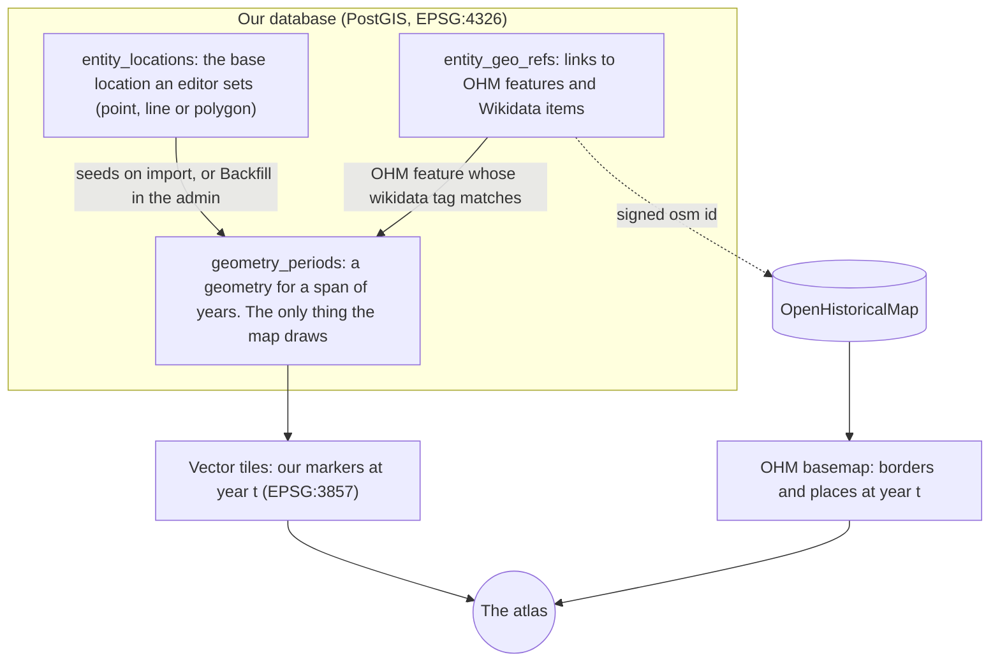
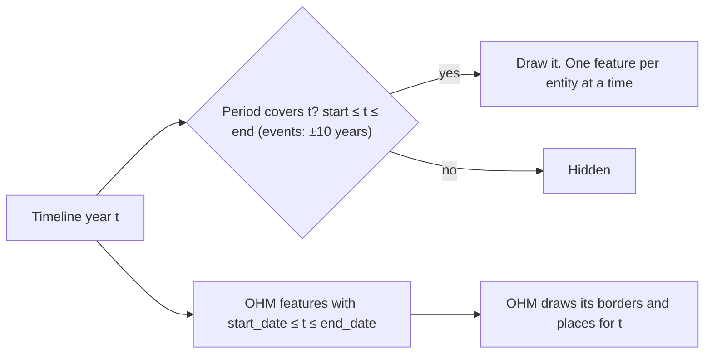
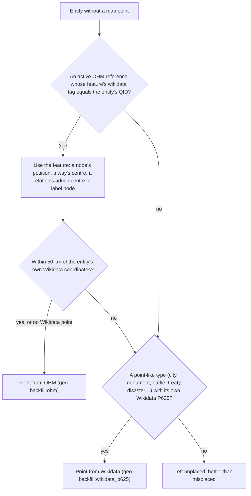

# For geographers

How History Mapped stores and draws places, borders and movement over time, written for people who
work with GIS, gazetteers or historical cartography. The short version: **we draw dated points,
and OpenHistoricalMap (OHM) draws the borders.** Every entity on the map is placed by a geometry
valid for a span of years. A polity's territory is the OHM feature it links to, filtered to the
year being viewed.

> **Audience:** geographers, GIS and geodata contributors, cartographers · **Read time:** 10 minutes ·
> **Last reviewed:** 2026-11-14 · **Related:** [Maps, tiles and OHM](../architecture/ohm-integration.md)

## At a glance

## Where geometry lives

| Store | Holds | Drawn on the public map? |
|---|---|---|
| `geometry_periods` | One geometry per entity per span of years (`start_year`, `end_year`; an empty end means ongoing), with a period type, provenance, confidence and an optional cause | **Yes.** It is the map's only source |
| `entity_locations` | The entity's base location: a place name, a point or line (`geom`) and a polygon (`territory_geom`), with confidence and method. Editors set it in the admin | No. It seeds a geometry period on import, or when an editor runs Backfill |
| `entity_geo_refs` | References to external features: OHM nodes, ways and relations, Wikidata items. Each has a match role (`primary`, `candidate`, `fallback`, `rejected`) and its own years | Indirectly: an OHM reference links our marker to OHM's drawing of the feature |

**Every geometry period on the map today is a point.** Borders are not copied into our database.
An empire's territory is the OHM boundary relation it references, drawn by OHM's tiles for the
year on screen. Our marker and OHM's polygon highlight together when you hover either.

## Coordinates and formats

| Topic | Rule |
|---|---|
| Storage | WGS 84, **EPSG:4326**, longitude then latitude, decimal degrees. PostGIS `geometry` columns |
| Input | GeoJSON geometry: `Point`, `LineString`, `Polygon`, `MultiPoint`, `MultiPolygon` (and multi-lines for routes) |
| Rendering | Vector tiles in Web Mercator (**EPSG:3857**), built from PostGIS at request time |
| Order | `[39.8262, 21.4225]` is Mecca (longitude first). The reverse is the most common mistake |
| Precision | As much as the evidence supports, no more: 4–5 decimals for a known site, 2 for "within a few km", none for "somewhere in the region" (leave it empty) |

## Time: geometry that changes

- Years are integers, negative before the common era, with no year 0. OHM uses decimal dates. We
  convert with one rule (a year runs from `year + 0.00137` to `year + 0.99863`), so both layers
  agree at the year boundary ([details](../architecture/ohm-integration.md#filtering-by-year)).
- OHM numbers BCE years astronomically: its year 0 is 1 BCE, so 44 BCE is `-0043` there and
  `-44` here. The map converts when it filters OHM layers, and imports convert OHM's dates into
  ours. About half of OHM's BCE dates use the historical number instead (the Roman Empire from
  `-0027`); those show a year early. Correct them in OHM.
- A territory that changed is a series of periods, each with its own geometry and years. Nothing
  stops periods from overlapping, so check before adding one.
- Events stay on the map for ten years either side of their dates, so they do not flicker past
  while the timeline moves.

| Period type | Use for |
|---|---|
| `territory` | The extent of a polity or region at a time |
| `route` | A trade route, road or campaign path |
| `spread_zone` | The extent of an epidemic, religion or culture |
| `movement_path` | A migration or a journey |
| `presence` | An entity at a place for a time. When a dated relationship is saved with "derive a presence period" on, of any type, the relationship's source gets a period at the target's base location (or its own, if the target has none) for the relationship's years. The flag is on by default for API writes and for the relationship hints `pipeline:import` resolves; the admin's add form starts with it off. It is removed with the relationship |

| Provenance | Meaning | Caveat |
|---|---|---|
| `manual` | Drawn or set by an editor | The Wikidata backfill also writes `manual` |
| `derived` | Computed from a relationship or a source event | |
| `ohm_import` | Imported from OHM or a border job | Imports also use it for any period seeded from a location |

`provenance_mode` is therefore approximate. The `created_by` marker is reliable, for example
`geo-backfill:ohm`, `geo-backfill:wikidata_p625`, `derive:located_at` or `borders:<batch>`.

## How a map point is chosen

- **Rejected:** name-only OHM matches, Nominatim guesses, and coordinates borrowed from a related
  place. Audit scripts remove existing points of those kinds.
- **Explicit derivation:** an event or place with no point can be placed at the point of the place
  it is `located_at` (`geometry:derive-located-at`, a dry run unless `--apply`). The result is a
  derived period tied to that relationship.
- **Known exception:** the extraction agent's place step and `pipeline.locate_events` can still
  place an event at an associated place. The point audits catch these afterwards.

## OHM references

| Field | Values |
|---|---|
| Provider | `ohm`, `wikidata`, `geonames`, `pleiades`, `custom` |
| External type | `node`, `way`, `relation` (OHM), `qid` (Wikidata), `feature` |
| External id | The bare id: `2744968`, `Q16553` |
| Match role | `primary` (one active per entity), `candidate`, `fallback`, `rejected` |
| Retrieval method | `overpass`, `nominatim`, `rest`, `manual` |
| Years | Optional start and end, filled from the OHM feature's dates |

In tiles and on the client the OHM id travels **signed**: a relation is negative (`relation/1880` →
`-1880`), and a node or way is positive, the same convention as `osm_id` in OHM's own tiles. A
positive id cannot tell a node from a way. Setting a new primary reference deactivates the previous
one.

## Confidence and method

| `location_confidence` | Meaning |
|---|---|
| `high` | Attested in primary sources or confirmed by archaeology; the point is on the site |
| `medium` | Established by scholarship, but the coordinates are estimated |
| `low` | Disputed, approximate or inferred from context |
| `unresolved` | Unknown, or no scholarly consensus |

| `location_method` | Meaning |
|---|---|
| `ohm_nominatim` | Geocoded through OpenHistoricalMap's Nominatim |
| `wikidata` | A Wikidata coordinate claim |
| `geonames`, `pleiades` | A gazetteer |
| `llm_disambiguation` | An automated tool chose between candidate places |
| `human_assigned` | Set by an editor |
| `source_database` | Taken from a trusted source dataset |

Notes on a debated location go in the entity's confidence notes. Never average competing sites: pick
the majority view and record the others. A map story can show alternative sites side by side.

## Common situations

| The entity is… | Do this |
|---|---|
| **A city or site** | A point on the ancient site, not the modern city. "Carthage (near modern Tunis)" as the place name |
| **A battle or treaty** | A point at the site. Set the confidence from the evidence |
| **A polity** | Link its OHM boundary relation as the primary reference. Its point marks the capital or heartland |
| **A person** | No point of their own. Use relationships: `born_in`, `died_in`, `resided_in`. A presence period can show them at a place for a time |
| **A war** | No single point. Link its battles with `contains` and its sides with `at_war_with` |
| **A trade route** | Connect it to its cities with `connects` and to the polities it crosses with `passes_through`. A `route` period can carry the line |
| **A migration or epidemic** | A `movement_path` or `spread_zone` period, or a [map story](../architecture/map-stories.md) that animates the spread |
| **Unknown** | Leave it empty and set the confidence to `unresolved` |

## Editing geometry

Geometry is edited on the admin entity page. Dated geometry and OHM references need
`geometry.write`, which the `geo_moderator` and `admin` roles have. The base location is part of
the entity form, so it needs `entities.write` (`moderator`, `history_moderator`, `admin`).

| Tool | Writes | Permission |
|---|---|---|
| Map editor: draw a point, line or polygon | `entity_locations` | `entities.write` |
| Geometry periods panel: add dated geometry, or **Backfill** from the base location | `geometry_periods` | `geometry.write` |
| Geography references: search OHM, attach or detach a feature, choose the primary | `entity_geo_refs` | `geometry.write` |
| Relationship panel: "derive a presence period" | a `presence` period | `relationships.write` |

After moving a base location, run Backfill so the map follows. See
[Admin and editing](../architecture/admin-map-editor.md#editing-an-entity).

**Before you save a location:** longitude first, WGS 84 decimals; the place name matches the point;
the confidence is honest; the OHM reference was tried before a point was drawn by hand; a debated or
time-bound extent is explained in the notes.

## Where next

- [Maps, tiles and OHM](../architecture/ohm-integration.md): basemaps, the date filter, tiles,
  troubleshooting
- [Atlas vector tiles](../schemas/atlas-tiles.md): the tile contract
- [Data model](README.md): how geometry fits the rest of the model
