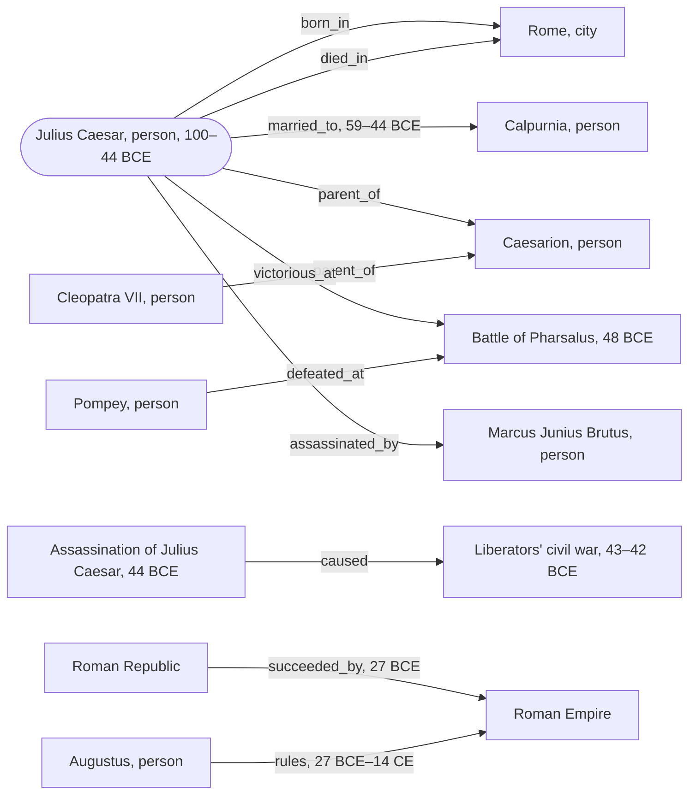
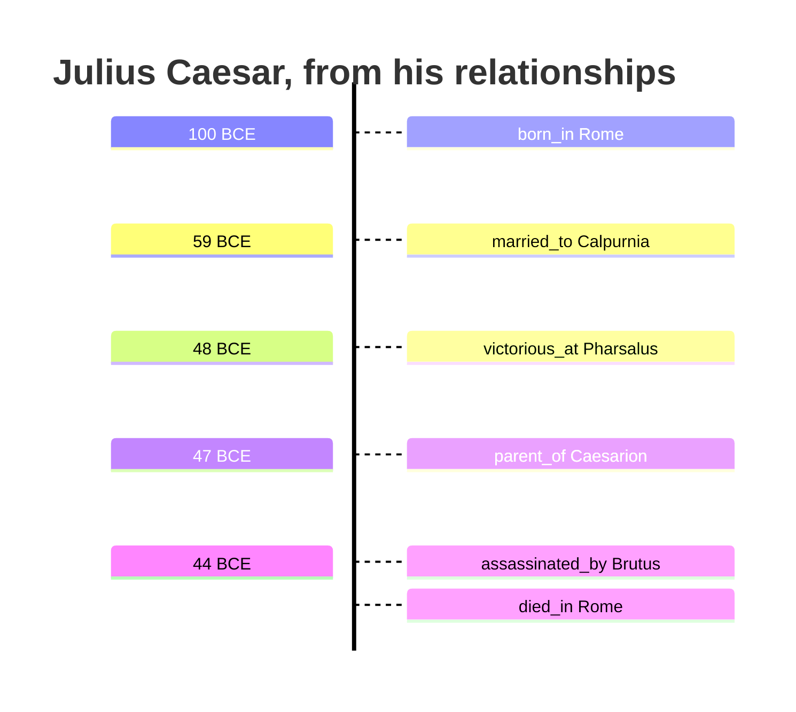
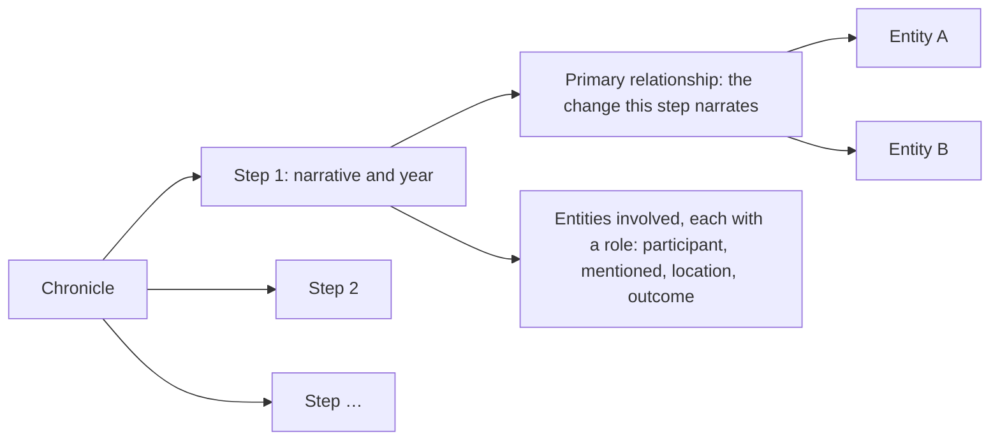

# For historians

How History Mapped records historical knowledge, in plain language. It covers what counts as an
entity, how dates and their uncertainty are kept, how links between things are typed, how chronicles
tell a story, and how the record shows where each fact came from and how sure we are. If you can
write a footnote or an encyclopaedia entry, you already think the right way.

> **Audience:** historians, editors, researchers, teachers · **Read time:** 12 minutes ·
> **Last reviewed:** 2026-11-14 · **No technical background needed**

## Everything is an entity

Anything that has a name, existed at some time (and usually in some place), and mattered to
something else is an **entity**: a state, a person, a city, a battle, a trade route, a religion, a
plague, a legal code, a technology. Each entity has exactly one **type**, and the 30 types fall into
five groups:

| Group | Covers | Examples |
|---|---|---|
| **Polity**: power and people | States, dynasties, people, armies, social classes, diplomatic relationships | The Achaemenid Empire, the Ming dynasty, Cleopatra VII, the Janissaries |
| **Place**: where history happened | Cities, monuments and infrastructure, mines, universities | Carthage, the Grand Canal, the Library of Alexandria, the mines of Potosí |
| **Event**: what happened | Wars, battles, treaties, rebellions, disasters, reforms, migrations, epidemics | The Battle of Gaugamela, the Peace of Westphalia, the Black Death |
| **Economy**: how wealth moved | Trade routes, natural resources, currencies | The Silk Road, the trans-Saharan salt trade, the Roman denarius |
| **Culture**: ideas, beliefs, works | Works, movements, languages, religious texts, legal codes, archaeological cultures, technologies | The *Shahnameh*, the Reformation, the Code of Hammurabi, the stirrup |

The full list, with the fields each type can carry (a battle's outcome, a person's roles, a
currency's metal), is in [Entity types](entity-specification.md).

## What an entity records

| Part | What it holds | Example: the Battle of Cannae |
|---|---|---|
| Identity | Name, other names, type, Wikidata identifier (QID) | "Battle of Cannae", `event_battle`, `Q179591` |
| Text | A one-sentence **summary**, a **significance** statement, an optional long **description** | "Hannibal's encirclement of a larger Roman army in 216 BCE." |
| Time | Start and end years, how the date was found, how confident it is | `-216`, high confidence |
| Place | A map point and its confidence, or a link to the feature on OpenHistoricalMap | near Canne della Battaglia, Apulia |
| Type details | Fields specific to the type | outcome, belligerents, casualties |
| Links | Typed relationships to other entities | Carthage `victorious_at` Cannae |
| Evidence | Sources, plus a confidence level and a review status | Wikidata, Polybius via Wikipedia |

## Time: dates and their uncertainty

Dates are stored as **years**: negative before the common era, with no year 0. A full date, when
known, is kept alongside the year. The system never invents precision: it records how sure the date
is, rather than making it look exact.

| What the sources give | How it is recorded |
|---|---|
| An exact day: 15 March 44 BCE | the date `-0044-03-15`, year −44, confidence `high` |
| A year: 1066 | year 1066, confidence `high` |
| "Circa 500 BCE" | year −500, confidence `medium`; the phrase can be kept as display text |
| A decade only ("the 1340s") | year 1340, confidence `low` |
| A century only ("3rd century BCE") | not turned into a year automatically: left for an editor |
| A span: a reign, a war | start and end years; an empty end means "ongoing" |
| Genuinely unknown | confidence `unresolved` |

Each date also records **how it was found**: from a source database such as Wikidata, read directly
from the text, inferred from a reign or an era, or set by an editor.

**On the map, events linger.** A battle or treaty stays visible for ten years either side of its
date, so it does not flash past while you scrub the timeline. Its stored date is unchanged.

## Relationships: how things connect

A relationship is a typed, **directed** statement between two entities: *A does something to or with
B*. It can be limited to a span of years, and it carries its own confidence and sources. There are
74 types in 8 families:

| Family | Example types | Example |
|---|---|---|
| Political | `rules`, `vassal_of`, `allied_with`, `at_war_with`, `succeeded_by`, `part_of` | *Augustus* `rules` *Roman Empire* |
| Person | `born_in`, `died_in`, `married_to`, `parent_of`, `commanded`, `assassinated_by` | *Julius Caesar* `assassinated_by` *Marcus Junius Brutus* |
| Military | `participated_in`, `fought_at`, `victorious_at`, `defeated_at`, `commanded_by` | *Darius III* `defeated_at` *Battle of Gaugamela* |
| Economic | `trades_with`, `connects`, `produces`, `extracts`, `used_currency` | *Silk Road* `connects` *Chang'an* |
| Religious and cultural | `adheres_to`, `influenced_by`, `inspired`, `translated_into`, `located_at` | *Library of Alexandria* `located_at` *Alexandria* |
| Causal | `caused`, `resulted_from`, `contributed_to`, `enabled`, `prevented`, `weakened` | *Assassination of Franz Ferdinand* `caused` *World War I* |
| Knowledge | `invented`, `adopted`, `taught_at`, `spread_to`, `replaced_by` | *Printing press* `spread_to` *Venice* |
| Diplomatic | `signed_by`, `violated_by`, `guaranteed_by`, `mediated_by`, `enforced_by` | *Peace of Westphalia* `signed_by` *Sweden* |

Every type, with its intended source and target, is in [Relationship types](relationships.md).

### A worked example: Julius Caesar

Each box below is its own entity, with its own dates, sources and page. Each arrow is one stored
relationship.

The same relationships serve every point of view. Caesar's page shows Pharsalus as a victory.
Pompey's page shows it as a defeat. Cleopatra's page shows Caesarion. Nothing is written twice.

**A life as a timeline.** A person's timeline is not typed in separately. It is built from their
dated relationships and places, and rebuilt whenever one of them changes:

## Chronicles: telling the story

A chronicle is a guided tour through a period or a theme: "Amarna Age great-power diplomacy",
"The Roman World". Each step is one dated change, told in a few sentences, and tied to the
relationship it narrates and to every entity it touches. On the map, each step moves the timeline to
its year and frames the places involved.

**How chronicles are written.** Most are produced by an AI-assisted pipeline under editorial rules:

1. An author writes a transcript of 60 to 120 numbered, dated, sourced facts for one era, region
   or topic.
2. Each fact must belong to the chronicle's era. **A fact is never re-dated to fit**: a fact from
   another period goes to a "spillover" list for the chronicle where it belongs.
3. The facts are extracted into entities and relationships, matched to Wikidata identifiers, and
   reviewed. A reviewer can pass, fix or send back each run before it is imported.

[Chronicles](../architecture/chronicles.md) describes the production line in detail.

## Map stories: history in motion

Some events are best seen moving: a battle's manoeuvres, an epidemic's spread, a trade network's
routes. A **map story** replays one step by step on the map. Each step carries the units and their
positions, arrows of movement, a dated narrative, and the sources and stated uncertainty of the
reconstruction. Alternative sites can be shown where the location is disputed. See
[Map stories](../architecture/map-stories.md).

## Evidence, confidence and review

| Signal | Where it shows | Values |
|---|---|---|
| **Sources** | On entities, relationships and chronicle entries | Free-form citations: a Wikidata property, an article, a book excerpt |
| **Confidence** | Separately for the record, its dates and its location | `high`, `medium`, `low`, `unresolved` |
| **Verification status** | On every entity | From `pipeline_draft` through `needs_review` and `in_review` to `human_verified` and `expert_verified`; `flagged` and `rejected` records are hidden from the map |

Editorial rules applied across the content:

- **One identity per thing.** Entities are matched to their Wikidata identifier. Two different
  people who share a name are not merged, and a QID is never reused for something else.
- **Dates are not moved to fit a story.** A fact outside a chronicle's era goes where it belongs.
- **Places are not borrowed.** Map points come from the entity's own OpenHistoricalMap feature or
  its own Wikidata coordinates, and audits remove points copied from related entities. Unplaced is
  better than misplaced.
- **AI proposes, people decide.** AI output goes through checks and review, and in the admin an
  editor confirms every AI-proposed change.

## How you can help

| You want to… | How |
|---|---|
| Fix a summary, description, name or alias | Sign in on the site and use **Suggest an edit** on the entity page. An editor reviews it |
| Fix a relationship's description or a chronicle's text | The same **Suggest an edit**, on the relationship or the chronicle step |
| Change dates, places, types or links | Ask for an editor role (`history_moderator` for historical content, `geo_moderator` for geometry) and edit in the admin |
| Propose a new chronicle or map story | Open an issue on GitHub with the scope and your sources |

## Where next

- [Core concepts](../overview/concepts.md): the ten terms in brief
- [Relationship types](relationships.md) and [Entity types](entity-specification.md): the full
  vocabularies
- [For geographers](for-geodata-contributors.md): how places and borders are handled
