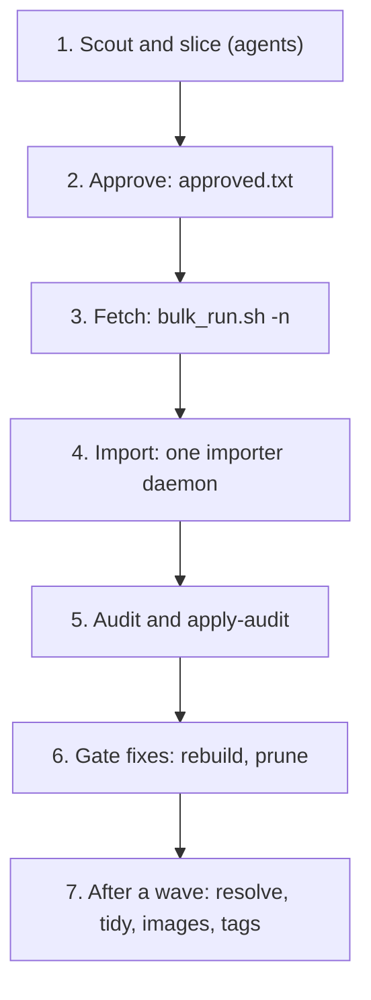

# Bulk Wikidata ingest — runbook

How to run `python -m pipeline.bulk`: design slices, fetch them, import them, audit them and roll
them back. The design is in [Data pipeline § Bulk Wikidata slices](../architecture/data-pipeline.md#5-bulk-wikidata-slices).



All commands run from the repository root, through the memory cap:

```bash
CLI="scripts/capped.sh pipeline/.venv/bin/python -m pipeline.bulk"
export LANGCHAIN_TRACING_V2=false LANGSMITH_TRACING=false
```

## Files

| Path | What it holds |
|---|---|
| `pipeline/bulk/slices/<id>.json` | The slice spec (checked in). `$CLI check` validates all of them |
| `output/bulk/<id>/` | `listed.tsv`, `queue.tsv`, `state.json`, `raw/` (gzipped WDQS and Wikipedia data), `parts/` (built JSONL, meta, import markers) |
| `output/bulk/claims.tsv` | Which slice owns each QID (the first one that listed it) |
| `output/bulk/approved.txt` | Slice ids the importer may import, one per line, `#` comments allowed |
| `output/bulk/logs/` | `<id>.log` per slice, `importer.log`, `run.log` |
| `output/bulk/audit/` | Auditor reports (`<id>.md`), proposed fixes (`<id>.csv`), applied fixes (`applied-<stamp>.csv`) |
| `output/bulk/tidy/` | Relations deleted by `tidy`, as CSV |

## 1. Scout and slice

Slices are designed by Claude agents, not by hand:

| Agent | Input | Output |
|---|---|---|
| Scout (a workflow prompt) | A domain (people, places, conflicts…) | Proposals with an estimated size and precision |
| `bulk-slicer` | One or a few proposals | The spec, its listing, one sample part, and APPROVED or REJECTED at 90% precision on 40 judged rows |

Launch the slicer with "Read `.claude/agents/bulk-slicer.md` and follow it" plus `proposals:`,
`domain:` and `notes:`, on Sonnet. WDQS limits concurrency: run at most three slicers at once. The
slicer never imports anything.

## 2. Approve

Append each APPROVED id to `output/bulk/approved.txt`. Read the slicer's note first: a partial
listing (shards that failed while WDQS was saturated) needs another `$CLI qids <id>` before the
fetch, and a listing is frozen once a part exists. To relist, delete `parts/`, `raw/` and
`queue.tsv` but keep `state.json`: its `todo` list resumes where the listing stopped.

## 3. Fetch

```bash
scripts/bulk_run.sh -n -p 3 <id> <id> …     # qids, then fetch, three slices at a time
$CLI status <id> …                          # listed, queued, built, imported per slice
```

`-n` skips the importer, so several runs can overlap with one daemon. A batch that times out is
retried after 30 seconds and then halved; a single item that still fails is logged and skipped.
Throughput is roughly 5–6 rows a second per process.

## 4. Import

Run exactly one importer daemon. It imports built parts of approved slices only, one part at a time:

```bash
MEM_MAX=2G $CLI importer --poll 20 >> output/bulk/logs/importer.log 2>&1 &
touch output/bulk/STOP                      # stops it after the current part
```

Each part runs `pipeline:import --sync --skip-images` with batch id `bulk-<id>-NNNN`, at 60–90 rows
a second.

## 5. Audit

Launch `bulk-auditor` ("Read `.claude/agents/bulk-auditor.md` and follow it", `slice:` and
`focus:`) on each imported slice. It samples 60 rows, checks duplicates against older rows and the
relations the import created, and writes `output/bulk/audit/<id>.csv`. It never changes data.

Curate the CSV before applying it. Auditors guess dates for century-rounded records, and some merges
are namesakes; downgrade those rows to `needs_review`. Then:

```bash
$CLI apply-audit output/bulk/audit/<id>.csv          # dry run
$CLI apply-audit output/bulk/audit/<id>.csv --yes
```

| Action | Effect |
|---|---|
| `needs_review` | Sets the row's review flag |
| `delete` | Deletes a bulk row (older rows are only flagged) |
| `merge_into:<id>` | Folds the row into an older one with `pipeline.merge_entities`; the survivor takes the QID if it has none |
| `fix_dates:a..b` | Sets the start and end years |

## 6. Gate fixes and rollback

When an audit shows a whole class is wrong, fix the spec rather than the rows:

```bash
# edit pipeline/bulk/slices/<id>.json (exclude_p31, min_sitelinks, year_max, require_dates_p31…)
$CLI rebuild <id> --imported          # re-run the gates on every fetched part
$CLI prune <id>                       # dry run: rows the rebuilt parts no longer keep
$CLI prune <id> --yes
$CLI prune <id> --all --yes           # roll back the whole slice and forget its import markers
```

`prune` deletes only rows tagged with the slice, refuses while a chronicle links one of them, and
reopens other rows' relationship hints that pointed at a deleted row.

## 7. After a wave

| Step | Command |
|---|---|
| Link relations across slices | `php artisan pipeline:resolve-relationships` (in `app`) |
| Remove anachronistic state links | `$CLI tidy` (dry run), then `$CLI tidy --yes` |
| Images | `php artisan entity:fetch-images` (bulk imports skip them) |
| Derived tags | `php artisan tags:sync` |
| Embeddings | `php artisan pipeline:embeddings --pending` (paid API calls: decide first) |

Bulk rows reach production only through a full content load
([content data transfer](content-data-transfer.md)); check the droplet's disk and memory first.

## Troubleshooting

| Symptom | Cause and fix |
|---|---|
| A slicer or fetch logs 429 or 504 for minutes | WDQS is saturated. Run fewer slicers and fetchers at once |
| `Failed to find executable` from `bulk_run.sh` | An old copy of the script; `PY` must be exported to the `xargs` workers |
| Rows imported before approval | The importer predates `approved.txt`; `prune <id> --all --yes` and re-approve |
| Deletes take minutes | Missing indexes on the columns that reference entities; run the migrations |
| "person rules X" relations to offices | Old builds kept P39 hints; rebuilt parts drop them |
