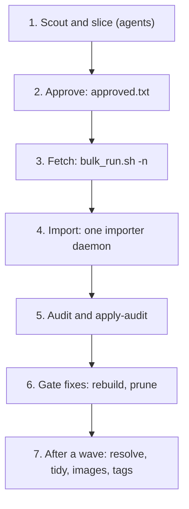

# Bulk Wikidata ingest — runbook

How to run `python -m pipeline.bulk`: design slices, fetch them, import them, audit them and roll
them back. The design is in [Data pipeline § Bulk Wikidata slices](../architecture/data-pipeline.md#5-bulk-wikidata-slices).



All commands run from the repository root, through the memory cap:

```bash
CLI="scripts/capped.sh pipeline/.venv/bin/python -m pipeline.bulk"
export LANGCHAIN_TRACING_V2=false LANGSMITH_TRACING=false
```

## Files

| Path | What it holds |
|---|---|
| `pipeline/bulk/slices/<id>.json` | The slice spec (checked in). `$CLI check` validates all of them |
| `output/bulk/<id>/` | `listed.tsv`, `queue.tsv`, `state.json`, `raw/` (gzipped WDQS and Wikipedia data), `parts/` (built JSONL, meta, import markers) |
| `output/bulk/claims.tsv` | Which slice owns each QID (the first one that listed it) |
| `output/bulk/approved.txt` | Slice ids the importer may import, one per line, `#` comments allowed |
| `output/bulk/logs/` | `<id>.log` per slice, `importer.log`, `run.log` |
| `output/bulk/audit/` | Auditor reports (`<id>.md`), proposed fixes (`<id>.csv`), applied fixes (`applied-<stamp>.csv`) |
| `output/bulk/tidy/` | Relations deleted by `tidy`, as CSV |
| `output/bulk/redate/` | Dates before each `redate`, as CSV |

## 1. Scout and slice

Slices are designed by Claude agents, not by hand:

| Agent | Input | Output |
|---|---|---|
| Scout (a workflow prompt) | A domain (people, places, conflicts…) | Proposals with an estimated size and precision |
| `bulk-slicer` | One or a few proposals | The spec, its listing, one sample part, and APPROVED or REJECTED at 90% precision on 40 judged rows |

Launch the slicer with "Read `.claude/agents/bulk-slicer.md` and follow it" plus `proposals:`,
`domain:` and `notes:`, on Sonnet. WDQS limits concurrency: run at most three slicers at once. The
slicer never imports anything.

## 2. Approve

Append each APPROVED id to `output/bulk/approved.txt`. Read the slicer's note first: a partial
listing (shards that failed while WDQS was saturated) needs another `$CLI qids <id>` before the
fetch, and a listing is frozen once a part exists. To relist, delete `parts/`, `raw/` and
`queue.tsv` but keep `state.json`: its `todo` list resumes where the listing stopped.

## 3. Fetch

```bash
scripts/bulk_run.sh -n -p 3 <id> <id> …     # qids, then fetch, three slices at a time
$CLI status <id> …                          # listed, queued, built, imported per slice
```

`-n` skips the importer, so several runs can overlap with one daemon. A batch that times out is
retried after 30 seconds and then halved; a single item that still fails is logged and skipped.
Throughput is roughly 5–6 rows a second per process.

## 4. Import

An importer daemon imports built parts of approved slices only, one part at a time:

```bash
MEM_MAX=2G $CLI importer --poll 20 >> output/bulk/logs/importer.log 2>&1 &
touch output/bulk/STOP                      # stops every daemon after its current part
```

Each part runs `pipeline:import --sync --skip-images` with batch id `bulk-<id>-NNNN`; one daemon
imports 10–15 person rows a second. When fetchers outrun it, start more daemons: each part has its
own lock (`parts/part-NNNN.import.lock`), so a daemon skips a part another one holds and takes the
next. Claims keep a QID in one slice and part, so parallel parts never import the same item.

```bash
for k in 0 1 2 3 4; do MEM_MAX=2G $CLI importer --poll 20 >> output/bulk/logs/importer-$k.log 2>&1 & done
```

`prune` and `redate` do not wait for running imports; stop the daemons first when they touch a slice
that is still importing.

## 5. Audit

Launch `bulk-auditor` ("Read `.claude/agents/bulk-auditor.md` and follow it", `slice:` and
`focus:`) on each imported slice. It samples 60 rows, checks duplicates against older rows and the
relations the import created, and writes `output/bulk/audit/<id>.csv`. It never changes data.

Curate the CSV before applying it. Auditors guess dates for century-rounded records, and some merges
are namesakes; downgrade those rows to `needs_review` (a `fix_dates` needs a year-precision source;
a merge needs the same dates and place, not only the same name). Then:

```bash
$CLI apply-audit output/bulk/audit/<id>.csv          # dry run
$CLI apply-audit output/bulk/audit/<id>.csv --yes
```

| Action | Effect |
|---|---|
| `needs_review` | Sets the row's review flag |
| `delete` | Deletes a bulk row (older rows are only flagged) |
| `merge_into:<id>` | Folds the row into an older one with `pipeline.merge_entities`; the survivor takes the QID if it has none |
| `fix_dates:a..b` | Sets the start and end years |
| `requid:<bulk id or QID or none>` | An older row that holds another item's QID takes the right one. It folds in the bulk row about the same subject, swaps its point and images for the right item's, and deletes relations made through the wrong QID (their hints reopen) |
| `requid:<…>:same` | As `requid`, when the old QID was a duplicate item of the same subject (a "city seat" item): its links stay and its hints move to the new QID |

Older curated rows sometimes hold a namesake's QID (the president James Monroe held a Michigan
politician's), and a bulk slice then adds the real subject as a second row. To find them, join
curated and bulk rows on name and type, or compare each curated row's years with its own QID's
Wikidata dates; a span that does not overlap marks a wrong QID. Fix them with `requid`.

## 6. Gate fixes and rollback

When an audit shows a whole class is wrong, fix the spec rather than the rows:

```bash
# edit pipeline/bulk/slices/<id>.json (exclude_p31, min_sitelinks, year_max, require_dates_p31…)
$CLI rebuild <id> --imported          # re-run the gates on every fetched part
$CLI prune <id>                       # dry run: rows the rebuilt parts no longer keep
$CLI prune <id> --yes
$CLI prune <id> --all --yes           # roll back the whole slice and forget its import markers
```

`prune` deletes only rows tagged with the slice, refuses while a chronicle links one of them, and
reopens other rows' relationship hints that pointed at a deleted row.

A change to a date rule reaches rows already imported through `redate`: it compares each row's
primary date range, confidence and birth and death attributes with its rebuilt record and rewrites
the ones that differ. It skips rows whose dates an applied audit fixed, and saves the old values:

```bash
$CLI rebuild <id> --imported && $CLI prune <id> --yes
$CLI redate <id> …                    # dry run: lists the changes
$CLI redate <id> … --yes              # before-values go to output/bulk/redate/
```

A rebuilt part that keeps more rows than before does not import the new ones: the part is already
marked imported.

A slice claims every QID it lists, including the ones its gates later drop. When a later slice is
meant for those items (a 1950–1999 battles slice after a battles slice bounded at 1950), give the
dropped claims back first:

```bash
$CLI release <id> …                   # dry run: claims dropped for after-year-max or before-year-min
$CLI release <id> … --reason no-dates --yes
```

Only fetched parts are examined; claims on unfetched queue entries and `qid-audit-blocked` stay.

## 7. After a wave

| Step | Command |
|---|---|
| Link relations across slices | `php artisan pipeline:resolve-relationships` (in `app`) |
| Remove anachronistic links | `$CLI tidy` (dry run), then `$CLI tidy --yes`. State links outside the state's lifetime (25 years of slack; capitals, succession and currency are kept) and person-event links outside the person's life (5 years) |
| Images | `php artisan entity:fetch-images` (bulk imports skip them) |
| Derived tags | `php artisan tags:sync` |
| Embeddings | `php artisan pipeline:embeddings --pending` (paid API calls: decide first) |

Bulk rows reach production only through a full content load
([content data transfer](content-data-transfer.md)); check the droplet's disk and memory first.

## Troubleshooting

| Symptom | Cause and fix |
|---|---|
| A slicer or fetch logs 429 or 504 for minutes | WDQS is saturated. Run fewer slicers and fetchers at once, and list through QLever: `BULK_LIST_ENDPOINT=https://qlever.dev/api/wikidata $CLI qids <id>` (30k people in 45 s). Only the listing moves; fetches stay on WDQS and the Wikidata API |
| `Failed to find executable` from `bulk_run.sh` | An old copy of the script; `PY` must be exported to the `xargs` workers |
| Athletes in a people slice (racing drivers tagged engineer, Olympic riders tagged officer) | Set `exclude_desc` (sport words) and `keep_desc` (the slice's own occupations) in the spec; both match the Wikidata description. Then `rebuild --imported` and `prune` |
| A person's summary describes an award, a list or a family ("The Knight's Cross of the Iron Cross…") | Their Wikipedia link redirects into a group article. Fetches since 2026-11-15 skip such leads (a redirect to a section, or to a title sharing no word with the person's) and translation notices; 132 older rows got their Wikidata description instead (`output/bulk/audit/summary-fix-20261115.csv`) |
| A naval officer's summary describes a destroyer ("USS Inch (DE-146) was…", "Z9 Wolfgang Zenker was…"), or a person's describes their family or baronetcy | Their Wikipedia link lands on the namesake ship's or the family's article. Builds since 2026-11-15 drop such person leads (`PERSON_OFF_SUBJECT` in `build.py`) and use the Wikidata description |
| Olympic sailors and shooters in a people slice although the sport gate is set | Their description says only "Danish sailor"; the lead says "who competed in the 1924 Summer Olympics". `exclude_lead` matches the first 300 characters of the lead (keep_desc still overrides). Then `rebuild --imported` and `prune` |
| A slice drops many rows as `unmappable` (up to 15% of a part) | The items carry only Wikidata's language-neutral `mul` label, so no English one came back. Fetches since 2026-11-15 read `mul`; builds name such rows by their English article. For already imported slices: `rebuild --imported`, then `fill <id> --yes` imports just those rows |
| A class slice drags in neighbours (modern highways in a Roman-roads slice) | `require_p31` keeps only rows with one of the listed classes; `exclude_p31` drops listed ones. Then `rebuild --imported` and `prune` |
| Approved slices sit unimported | The importer daemon is older than a spec key; its log says `skipping unreadable spec`. Restart it |
| A slicer finds its whole pool "claimed by other slices" | An earlier slice listed and then dropped them (year bounds); `release` that slice's claims, then re-run `qids` |
| Rows imported before approval | The importer predates `approved.txt`; `prune <id> --all --yes` and re-approve |
| Deletes take minutes | Missing indexes on the columns that reference entities; run the migrations |
| "person rules X" relations to offices | Old builds kept P39 hints; rebuilt parts drop them |
| A medieval person born in 901 or 1001 exactly | A century date read as a year; parts built before 06870bd keep them. `rebuild --imported`, `prune`, `redate` |
