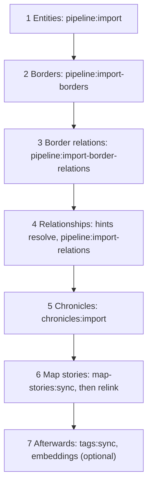

# Importing data

How to load pipeline output into the database, check it, and fix what did not resolve. To produce
the files in the first place, see [Data pipeline](../architecture/data-pipeline.md).

> **Audience:** data operators, developers · **Read time:** 8 minutes · **Last reviewed:** 2026-11-14 ·
> **Formats:** [Pipeline entity record](../schemas/pipeline-entity-record.md)

## Before you start

- **The stack is running** (`pnpm dev`). Every `artisan` command runs inside the `app` container.
  This guide uses a shell helper:

  ```bash
  art() { docker compose -f docker/docker-compose.yml exec app php artisan "$@"; }
  ```

- **The app container sees only `api/`.** Copy files from `output/` to
  `api/storage/app/pipeline/<run>/` first. Inside the container that folder is
  `storage/app/pipeline/<run>/`.
- **Take a dump before a big import.** There is no undo command:

  ```bash
  docker compose -f docker/docker-compose.yml exec -T db pg_dump -U history-mapped -Fc history-mapped > before-import.dump
  # to roll back:
  docker compose -f docker/docker-compose.yml exec -T db pg_restore -U history-mapped -d history-mapped --clean --if-exists < before-import.dump
  ```

## The order matters

Relationships only form when both ends exist, so import in this order:



Entity imports also stage relationship hints. A hint whose target is not in the database yet stays
unresolved until you import that target and resolve again.

## Recipes

### A Wikidata scrape or topic walk

```bash
python -m pipeline topic "Roman Empire"                       # writes output/topic_roman_empire.jsonl
mkdir -p api/storage/app/pipeline/rome && cp output/topic_roman_empire.jsonl api/storage/app/pipeline/rome/
art pipeline:import storage/app/pipeline/rome/topic_roman_empire.jsonl --sync --batch-id=rome
art pipeline:report-relationship-hints rome                    # what resolved, what did not
```

| Option | Effect |
|---|---|
| `--sync` | Run in the command instead of the queue worker. Without it, jobs go to `queue` (3 tries) |
| `--force` | Update entities that already exist instead of skipping them |
| `--batch-id=` | Name the batch. Entities get `created_by = pipeline:<batch>` |
| `--all` | Import every `.jsonl` in a directory |
| `--skip-relationships`, `--skip-images`, `--skip-dedup` | Skip a step. Resolve or fetch later |

`topic_*_ref.jsonl` and `topic_*_untyped.jsonl` are working files: they are not imported.

### OpenHistoricalMap borders

```bash
python -m pipeline borders run --run-id world-2026-11
python -m pipeline borders relations-run --run-id world-2026-11
cp -r output/ohm_borders/world-2026-11 api/storage/app/pipeline/
art pipeline:import-borders storage/app/pipeline/world-2026-11/final/ohm_borders.jsonl --sync --batch-id=world-2026-11
art pipeline:import-border-relations storage/app/pipeline/world-2026-11/relations_final --sync
```

For a smaller region, build an index of a downloaded dump and extract a subgraph first:
`borders build-index --input overpass.json`, then
`borders extract-subgraph --input overpass.json --seed-qid Q12560 --max-depth 2 --max-nodes 500 --run-id ottoman`
(`--max-depth` and `--max-nodes` are required).

### Refreshing OHM links

```bash
art pipeline:export-ohm-ref-ids storage/app/pipeline/ohm_ids.txt
python -m pipeline ohm-links fetch --ids-file api/storage/app/pipeline/ohm_ids.txt
cp output/ohm_links/<run>/ohm_links.jsonl api/storage/app/pipeline/
art pipeline:import-ohm-links storage/app/pipeline/ohm_links.jsonl --dry-run   # then without --dry-run
```

This fills in years on existing OHM references, and links an OHM feature to an entity when the
feature's `wikidata` tag matches the entity's QID.

### An extraction-agent run

The agent imports its own output and records the result in its run's `manifest.json`:

```bash
python -m pipeline agent --input notes/punic-wars.txt --run-id punic-wars
```

To re-import a run by hand, use the files in `api/storage/app/pipeline/agent_runs/<run>/`:

```bash
art pipeline:import storage/app/pipeline/agent_runs/punic-wars/entities_to_create.jsonl --sync --batch-id=punic-wars
art pipeline:import-relations storage/app/pipeline/agent_runs/punic-wars/relations.jsonl --batch-id=punic-wars
art chronicles:import storage/app/pipeline/agent_runs/punic-wars/chronicle.json --force
```

`pipeline:import-relations` skips relationships that already exist (same ends and type), so a
re-run only adds what is missing. `chronicles:import --link-missing` attaches entities that an
earlier chronicle import could not match.

### Map stories and long descriptions

```bash
art map-stories:sync                # api/resources/map-stories/*.json; keeps admin edits unless --force
art map-stories:relink              # after importing entities a story names
art entities:sync-descriptions      # api/resources/entity-descriptions/*.md
```

### After a large import

```bash
art tags:sync                       # derived era, region, theme and type tags
art pipeline:embeddings --pending   # optional: entity embeddings (not used by search yet)
art entity:fetch-images --limit=500 # optional: runs nightly anyway
```

Timeline entries rebuild on their own through the queue. To force one: `art timeline:rebuild <entity id>`.

## Record formats in brief

A minimal entity record (one JSON object per line):

```json
{"name": "Battle of Cannae", "entity_type": "event_battle", "entity_group": "EVENT", "wikidata_id": "Q179591", "temporal_start": "-0216", "summary": "Hannibal's army encircled and destroyed a larger Roman army near Cannae in Apulia."}
```

| Key | Notes |
|---|---|
| `name`, `entity_type`, `entity_group` | Required. Records without them are skipped |
| `wikidata_id` | Strongly recommended. Matching is by QID first, then OHM id, then name, type and era |
| `temporal_start`, `temporal_end` | Signed years or ISO-like dates (`-0216`, `1453-05-29`) |
| `geojson`, `territory_geojson` | Base location (lon, lat). It seeds the map's geometry period |
| `_relationship_hints` | `[{relationship_type, target_wikidata_id, target_label, temporal_start, temporal_end, confidence}]` |
| `_geo_resolution` | Only used when `status` is `"matched"` and `geo_ref.external_id` is set: `{status, geo_ref: {provider, external_type, external_id, match_role, retrieval_method, match_score}, geometry}` |

The importer sets `verification_status` to `pipeline_draft`. It uses `needs_review` instead for a
likely namesake, for a person whose life spans more than 110 years, or when the file asks for it.
Agent relationship files (`relations.jsonl`) name both ends (`source_name`, `target_name`) and,
where known, their ids and QIDs.

## Checking an import

```bash
docker compose -f docker/docker-compose.yml exec db psql -U history-mapped history-mapped
```

```sql
-- Entities in a batch, by review status
SELECT verification_status, count(*) FROM entities
WHERE created_by = 'pipeline:rome' GROUP BY 1;

-- Unresolved relationship hints in a batch, by reason
SELECT resolution_note, count(*) FROM pipeline_relationship_hints
WHERE batch_id = 'rome' AND NOT resolved GROUP BY 1 ORDER BY 2 DESC;

-- Entities in a batch that have no map point
SELECT e.name, e.entity_type FROM entities e
WHERE e.created_by = 'pipeline:rome'
  AND NOT EXISTS (SELECT 1 FROM geometry_periods g WHERE g.entity_id = e.entity_id)
LIMIT 50;
```

Border imports use `created_by = 'borders:<batch>'`.

## Troubleshooting

| Symptom | Cause and fix |
|---|---|
| "No such file" from `artisan` | The file is outside `api/`. Copy it under `api/storage/app/pipeline/` |
| The import finished but nothing changed | Without `--sync` the work is queued. Check that the `queue` container is running, or re-run with `--sync` |
| Entities were skipped as duplicates | They already exist (same QID, OHM id, or name, type and era). Use `--force` to update them |
| Relationships are missing | One end is not imported yet. Import it, then `art pipeline:resolve-relationships <batch> --sync` |
| An entity is not on the map | It has no geometry period. Add a location and run `art entity:backfill --entity-id=<id>`, or Backfill in the admin |
| Rows came in as `needs_review` | A namesake or an implausible date was suspected. Review them in the admin |
| The map does not show new rows | Tiles are cached: 5 minutes behind Caddy in production, plus the browser's service worker. Hard-reload. After a `tiles` migration, restart `martin` |

## Related

- [Data pipeline](../architecture/data-pipeline.md): what each track produces
- [Pipeline entity record](../schemas/pipeline-entity-record.md): the full entity format
- [Content bundle](../schemas/content-bundle.md): moving reviewed content between environments
- Internal runbooks: [Agentic pipeline](agentic-pipeline-runbook.md),
  [OHM border extraction](ohm-border-extraction.md), [Data quality](data-quality-runbook.md)
