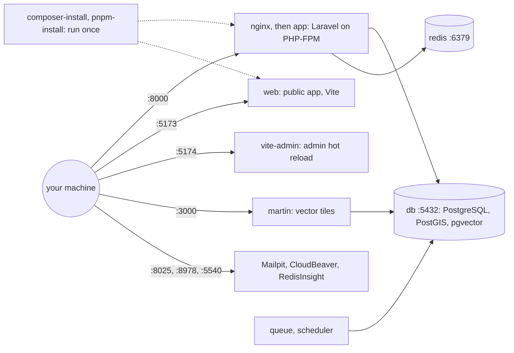

# Local setup

Run the whole stack on your machine with Docker Compose: the API and admin, the public web app,
PostgreSQL, Redis, the tile server and the inspection tools. Allow about 15 minutes for the first
start. After that, it starts in seconds.

> **Audience:** developers · **Last reviewed:** 2026-11-14 · **You need:** Docker Engine with
> Compose v2, pnpm 10, Git; Python 3.10 or newer only for the pipeline

## What you get



| URL | What |
|---|---|
| http://localhost:5173 | Public web app (landing, browse, docs; the atlas at `/app`) |
| http://localhost:8000 | Admin (sign in), the API at `/api/v1`, tiles at `/tiles`, API docs at `/docs/api` |
| http://localhost:3000/tiles/catalog | Martin's tile sources |
| http://localhost:8025 | Mailpit: every e-mail the app sends |
| http://localhost:8978 / :5540 | CloudBeaver (database) / RedisInsight |
| `localhost:5432` | PostgreSQL: database, user `history-mapped`, password `secret` |

## First start

```bash
# 1. Get the code and the env files
git clone https://github.com/PickleSoda/history-mapped.git && cd history-mapped
cp api/.env.example api/.env
cp web/.env.example web/.env
cp pipeline/.env.example pipeline/.env      # only if you will run the pipeline

# 2. Start everything (installs PHP and JS dependencies on the first run)
pnpm dev                                     # = docker compose -f docker/docker-compose.yml up

# 3. In a second terminal: app key, schema, roles, demo users, reference tables
alias dc='docker compose -f docker/docker-compose.yml'
dc exec app php artisan key:generate
dc exec app php artisan migrate --seed

# 4. Content that lives in files
dc exec app php artisan tags:sync
dc exec app php artisan collections:sync
dc exec app php artisan map-stories:sync
dc exec app php artisan entities:sync-descriptions
```

The base seed creates one user per role, all with the password `password`: `admin@example.com`,
`moderator@example.com`, `history@example.com`, `geo@example.com` and `user@example.com`. It
deliberately leaves the knowledge graph empty. For a small sample graph, run
`dc exec app php artisan db:seed --class=DemoSeeder`. For real data, import pipeline output
([Importing data](data-contributor-guide.md)) or restore a dump from a teammate.

Map stories and collections refer to entities by Wikidata id, so they only show their full content
once those entities exist in your database.

## Ports and configuration

| File | Read by | Holds |
|---|---|---|
| `api/.env` | Laravel (app, queue, scheduler, vite-admin) | App key, database, Redis, mail, AI keys |
| `web/.env` | The web app | `VITE_API_URL` (default `http://localhost:8000`); `VITE_MAP_TILES_URL` to use vector tiles (unset means REST mode) |
| `docker/.env` | Docker Compose | Host ports: `FORWARD_NGINX_PORT`, `FORWARD_WEB_PORT`, `FORWARD_MARTIN_PORT`… |
| `pipeline/.env` | The Python pipeline | Wikidata, Wikipedia and LLM settings, `OUTPUT_DIR` |

> **Port clash?** Put the override in **`docker/.env`**. Compose reads that file because it sits
> next to the first `-f` file. A `.env` at the repository root is ignored by `pnpm dev`. The Vite
> ports are also fixed in each `vite.config.ts` for hot reload, so change those together.

## Everyday commands

```bash
dc exec app php artisan test                      # PHPUnit
dc exec app php artisan test --filter=EntityTest  # one class or method
dc exec app composer test                          # Pint check + tests
dc exec app composer ci:check                      # what CI runs for the API and admin
dc exec app php artisan route:list                 # or: pnpm api:routes
dc exec app php artisan wayfinder:generate --with-form   # regenerate admin route helpers

dc exec web pnpm --filter @history-mapped/web lint
dc exec web pnpm --filter @history-mapped/web types:check
dc exec web pnpm --filter @history-mapped/web test       # Vitest; CI does not run it
dc exec web pnpm --filter @history-mapped/web build

dc exec app php artisan migrate:fresh --seed      # reset the database
dc restart martin                                 # after any migration that touches the tiles schema
```

Run PHP, Composer and Node through the containers, not on your host, so versions match CI.

## The pipeline (optional)

```bash
python -m venv pipeline/.venv && source pipeline/.venv/bin/activate
pip install -r pipeline/requirements.txt
python -m pipeline --help                 # run from the repository root
python -m pytest pipeline/tests/          # tests
```

The app container sees only `api/`, so files you want to import must be under `api/` (for example
`api/storage/app/…`), or be copied in with `docker compose cp`. The extraction agent already writes
its runs to `api/storage/app/pipeline/agent_runs/`. [Importing data](data-contributor-guide.md) has
the full workflow.

## Troubleshooting

| Symptom | Fix |
|---|---|
| "No application encryption key has been specified" | `dc exec app php artisan key:generate` |
| The atlas map is empty | Import data, or set `VITE_MAP_TILES_URL=http://localhost:8000/tiles` in `web/.env`, then restart `web` |
| Tiles return 500 "Cannot find SRID" | `dc exec app php artisan migrate` (restores EPSG:3857 and 4326) |
| A new tile function is missing from Martin | `dc restart martin` |
| `wayfinder:generate` fails with "Permission denied" | An earlier run left `api/resources/js/{actions,routes}` owned by root: `chown` them back to your user |
| Port already in use | Set the `FORWARD_*_PORT` in `docker/.env` |
| Admin pages show no styles | Make sure `vite-admin` is running (`dc ps`) |

## Where next

- [System overview](../architecture/system-overview.md): how the pieces fit together
- [Importing data](data-contributor-guide.md): fill the database
- [Deployment and operations](../architecture/deployment.md): how the hosted site differs
