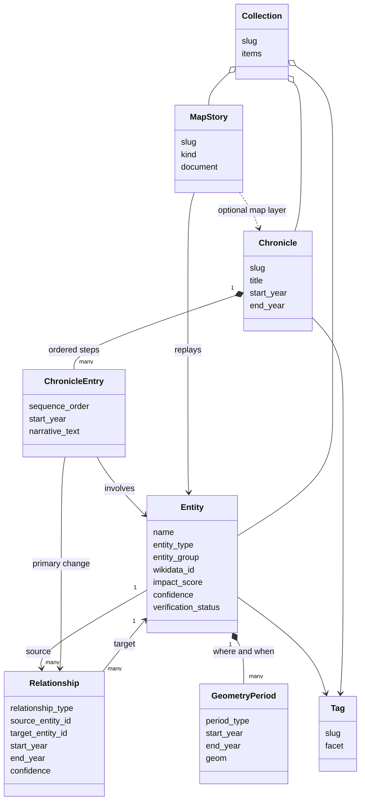

# Core concepts

The handful of ideas everything else in History Mapped is built from. Read this once and the
rest of the docs, the atlas and the admin will make sense. No technical background is needed.

> **Audience:** everyone · **Read time:** 6 minutes · **Last reviewed:** 2026-11-14

## The model on one page

Read the arrows as sentences: *an entity has many relationships*, *a chronicle is an ordered list of
entries*, *each entry points at the relationship that changed*, *a collection groups entities,
chronicles and map stories*.

## The ten terms

| Term | What it means | Example |
|---|---|---|
| **Entity** | Any named historical thing that existed in time and, usually, in space. Every entity has exactly one **type**. | The Battle of Cannae, Julius Caesar, Samarkand, the Silk Road |
| **Group** and **type** | 5 groups (Polity, Place, Event, Economy, Culture) split into 30 types such as `political_entity`, `person`, `city`, `event_battle`, `trade_route`. | Cannae is an `event_battle` in the Event group |
| **Relationship** | A typed, directed link between two entities, with an optional time window and a confidence level. There are 74 relationship types. | Alexander the Great `victorious_at` the Battle of Gaugamela |
| **Chronicle** | A guided tour: an ordered list of entries, each a dated change told in a few sentences and tied to the entities it touches. | "Amarna Age great-power diplomacy, c. 1500–1200 BCE" |
| **Map story** | A step-by-step replay drawn on the map: armies and arrows for a battle, spreading regions for an epidemic, routes for a trade network. | The Battle of Gaugamela; the Black Death |
| **Geometry period** | Where an entity was during a span of years: a point, or a territory taken from OpenHistoricalMap. An entity can have many periods, which is how borders move. | The Roman Republic's extent in 100 BCE |
| **Tag** | A label from a controlled vocabulary in five facets: era, region, theme, type, topic. Tags power browsing. | `classical` + `mediterranean` + `war` |
| **Collection** | A curated set of entities, chronicles and map stories, shown under Browse. | "Great Battles", "The Silk Roads" |
| **Source** | Where a fact came from. Citations are stored with each entity, relationship and chronicle entry. | A Wikidata property, a Wikipedia article, a book excerpt |
| **Wikidata QID** | The entity's identifier on Wikidata (`Q` plus a number). It is how History Mapped matches records from different sources and avoids duplicates. | `Q179591` is the Battle of Cannae |

## How time works

- Dates are stored as **years**. Years before the common era are **negative**: 216 BCE is `-216`.
  There is no year 0.
- An entity has a start and an end year. It also records whether that is a single moment, a
  period, something still ongoing, or uncertain, and how confident the dating is.
- When a source gives a phrase such as "c. 500 BCE", it can be kept as the entity's `date_raw` and
  shown beside the year. The uncertainty itself is recorded as the date confidence.
- The map works in **decimal years**: 1066 becomes about 1066.001 at the start and 1066.999 at the
  end. This is OpenHistoricalMap's convention, and it lets the map show a feature only during the
  years it existed. [Maps, tiles and OHM](../architecture/ohm-integration.md) has the exact rule.

## How place works

- Most entities have a **point**: a city's location, a battle site, a capital.
- Borders come from **OpenHistoricalMap (OHM)**, a time-aware sibling of OpenStreetMap. Its basemap
  redraws the world for the year you pick. An entity that OHM draws is linked to that OHM feature,
  so hovering or selecting the entity highlights the area.
- What the map draws for an entity is its **geometry periods**: dated points (and occasionally
  shapes). An entity without one stays off the map.
- Placement is cautious. The placement backfill uses the entity's own OHM feature first, then its
  own Wikidata coordinates, and audits remove points copied from related entities. An unplaced
  entity stays off the map rather than appearing in the wrong place.
- [For geographers](../entity-model/for-geodata-contributors.md) covers the details.

## How trust is shown

Every entity carries two quality signals, and the atlas shows both:

- **Confidence**, kept separately for the record, its dates and its location: `high`, `medium`,
  `low` or `unresolved`.
- **Verification status**: how far the record has been checked.

| Status | Meaning | On the map |
|---|---|---|
| `pipeline_draft` | Imported by the pipeline, not yet checked | yes |
| `ohm_draft` | Imported from OpenHistoricalMap borders | yes |
| `auto_validated` | Passed automatic checks | yes |
| `needs_review` | Something looks off, such as an ambiguous name; an editor should look | yes |
| `in_review` | An editor is working on it | yes |
| `human_verified` | Confirmed by an editor | yes |
| `expert_verified` | Confirmed by a specialist | yes |
| `flagged` | A known problem | hidden |
| `rejected` | Wrong; kept for the record | hidden |
| `merged` | A duplicate folded into another entity (reserved: merges currently delete the duplicate) | hidden |

The statuses are a ladder, not an enforced workflow. Imports start at `pipeline_draft`,
`ohm_draft` or `needs_review`; editors move records up (changing it needs the `entities.verify`
permission).

## Identifiers you will see

| Identifier | Looks like | Used for |
|---|---|---|
| Entity id | `9b2c…` (UUID) | Links and API calls: `/entities/<id>` |
| Chronicle, map story, collection slug | `battle-of-cannae` | Readable URLs: `/chronicles/<slug>` |
| Wikidata QID | `Q179591` | Matching sources, de-duplicating, curated collections |
| OHM id | `relation/123` (signed `-123` in tiles) | Linking an entity to its border on OpenHistoricalMap |

## Where next

- **The product:** [What is History Mapped?](product-overview.md)
- **The full model:** [Data model overview](../entity-model/README.md) ·
  [Entity types](../entity-model/entity-specification.md) ·
  [Relationship types](../entity-model/relationships.md)
- **Domain guides:** [For historians](../entity-model/for-historians.md) ·
  [For geographers](../entity-model/for-geodata-contributors.md)
