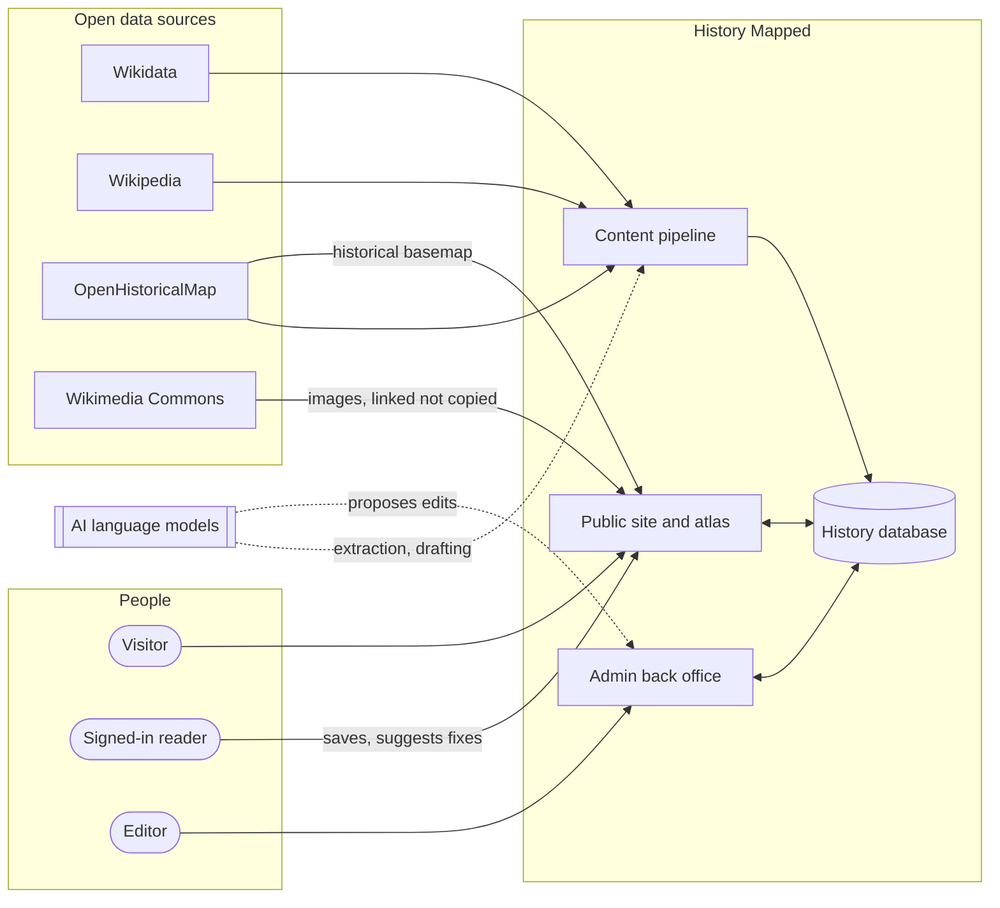
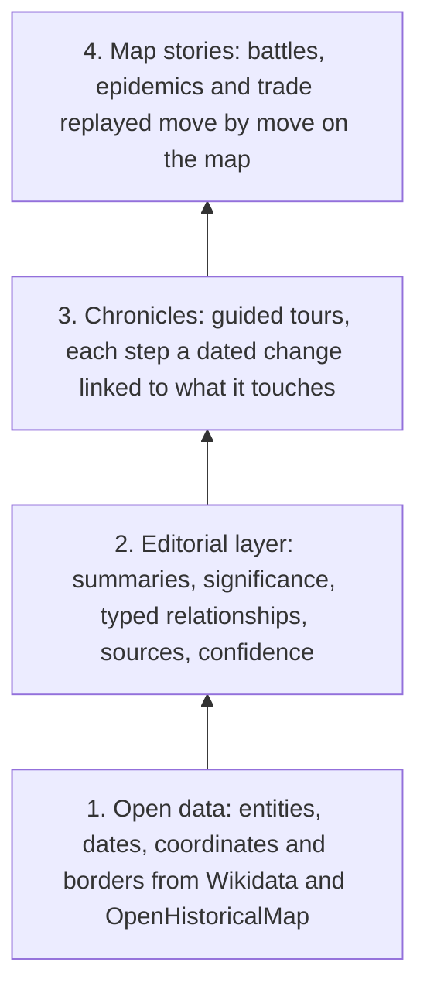
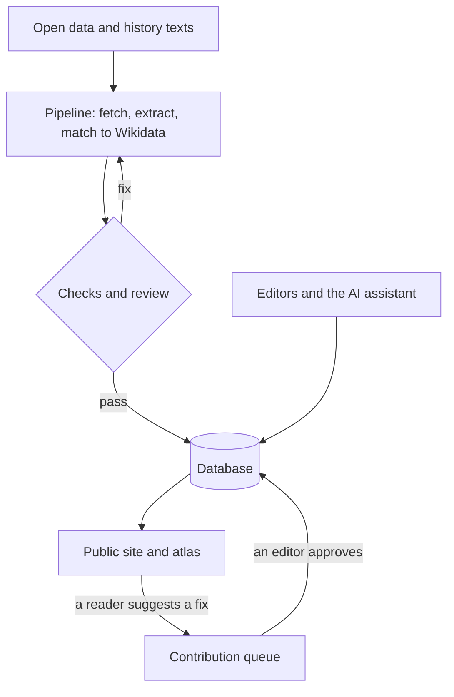
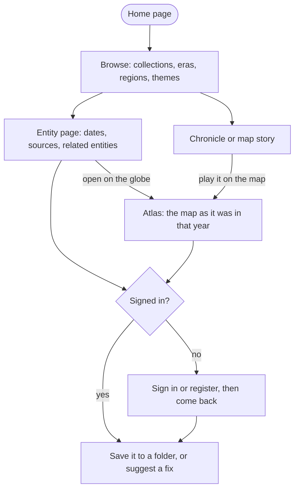
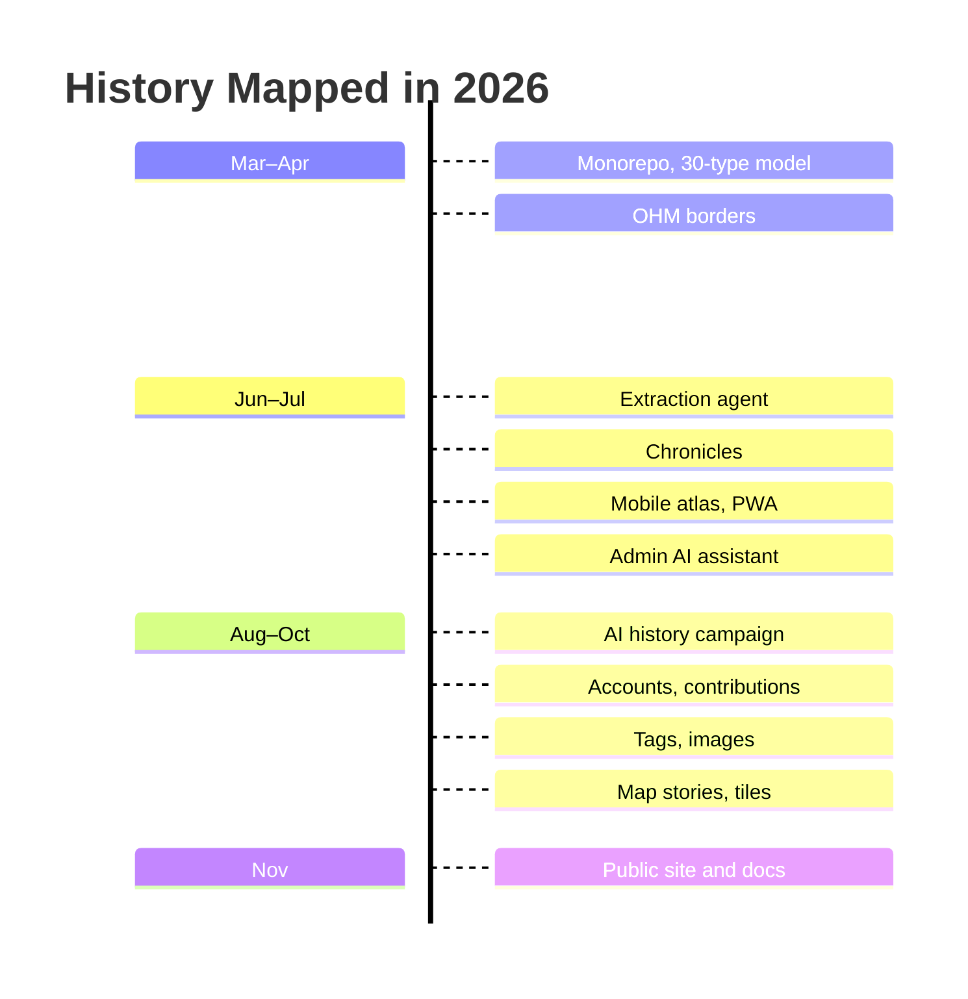

# What is History Mapped?

History Mapped is an open atlas of world history. It puts the states, people, battles, places and
ideas of the past on one map and one timeline, and links each of them to the others. This page
explains what the product does, who it serves, how its content is made and where it is going. It is
written for business and product readers, and is a good first page for everyone else.

> **Audience:** business, product, partners, newcomers · **Read time:** 8 minutes ·
> **Last reviewed:** 2026-11-14 · **Live at:** [historymapped.org](https://historymapped.org)

## In one minute

- **The problem.** History is usually told one story at a time: a book on Rome, a documentary on
  the Mongols, an article on one battle. The connections between those stories are left for the
  reader to assemble: who traded with whom, which war ended which empire, what else was happening
  in the same decade.
- **The product.** A time-aware map of the world that you can scrub through the centuries.
  Encyclopedia pages for every entity. Guided tours called chronicles. Battle maps and other map
  stories, replayed step by step.
- **The content.** It is built from open data (Wikidata, Wikipedia, OpenHistoricalMap, Wikimedia
  Commons). An editorial layer goes on top: summaries, typed relationships, sources and a confidence
  level on every entity. It is produced by an AI-assisted pipeline with review steps, and corrected
  by editors and readers.
- **The status.** Live at historymapped.org; the public site (landing, browse, docs) launched in
  November 2026. The hosted content holds about 37,000 entities and 77,000 relationships, around 300
  chronicles and 12 map stories.

## What people can do

| Surface | Where | What it offers | Mainly for |
|---|---|---|---|
| **Landing** | `/` | What the project is, featured collections and stories | First-time visitors |
| **Browse** | `/browse` | Encyclopedia-style browsing by era, region, theme and type; curated collections; the list of map stories | Readers, students, teachers |
| **Atlas** | `/app` | A globe with a timeline: borders redraw for any year, entities appear while they existed, and you click through to details, a relation graph, chronicles and map stories | Explorers, enthusiasts |
| **Entity and chronicle pages** | `/entities/…`, `/chronicles/…` | Standalone, shareable pages with dates, place, sources, relationships and narrative | Everyone, and search engines |
| **Map stories** | in the atlas | Battles, epidemics and trade networks replayed step by step on the map | Readers, educators |
| **Accounts** | `/saved`, `/contributions` | Save entities and chronicles, and suggest corrections that editors review | Engaged readers |
| **Admin** | the API domain | The editorial back office: edit entities, borders, relationships, chronicles and map stories, with an AI assistant that proposes changes for an editor to confirm | Editors |
| **Docs** | `/docs` | These pages | Everyone |

## How it fits together

## Four layers of content

Each layer builds on the one below it, and every layer is visible in the product.

## How the content is made

The content pipeline turns open data and long-form history into checked records. Imports are
validated before they are written. Chronicles and map stories also go through an AI reviewer, and
editors can correct anything afterwards.

- **Scale comes from the pipeline.** Wikidata and OpenHistoricalMap supply the skeleton of
  entities, dates and borders. AI agents write chronicle transcripts of dated facts, extract
  entities and relationships from them, and review each other's output before anything is
  ingested ([Data pipeline](../architecture/data-pipeline.md)).
- **Quality comes from rules and review.** Entities are matched to their Wikidata identifier where
  one exists, so duplicates can be found and merged. Dates are never shifted to fit a story. Map points come from
  the entity's own sources, not from related entities. Each record carries its sources, a confidence level and a
  verification status ([Core concepts](concepts.md#how-trust-is-shown)).
- **People stay in charge.** The admin's AI assistant only *proposes* changes. An editor previews
  each one and confirms it. Readers' suggested fixes go through the same review.

## A visitor's journey

## What makes it different

| Capability | Why it matters |
|---|---|
| **Borders that change with the year** | The basemap is OpenHistoricalMap, so the map shows the world as it was in the year you pick |
| **One connected graph** | 30 entity types and 74 relationship types turn separate stories into one network you can walk through |
| **Narrative on top of data** | Chronicles and map stories tell the story, and every step stays linked to the underlying records |
| **Visible provenance** | Sources, confidence and verification status are shown on every entity, not hidden |
| **Open by design** | Built on open data, images linked from Wikimedia with their credits, readers can suggest fixes |
| **Works everywhere** | One web app for desktop and phone, installable, with offline caching of what you have viewed |

## By the numbers

| Measure | Value | Source |
|---|---|---|
| Entity types | 30, in 5 groups | `api/app/Enums/EntityType.php` |
| Relationship types | 74 | `api/app/Enums/RelationshipType.php` |
| Tag vocabulary | 81 tags in 4 facets (era 10, region 46, theme 19, type 6), plus free topics | `api/database/data/tags/vocabulary.json` |
| Chronicles with curated tags | 302 | `api/database/data/tags/chronicles.json` |
| Curated collections | 7 | `api/resources/collections/` |
| Map stories | 12: 8 battles, 2 epidemics, 2 trade networks | `api/resources/map-stories/` |
| Content on the hosted site | about 37,000 entities, 77,000 relationships, 20,700 geometry periods | last full content load, 2026-10-18 |

## Technology at a glance

| Layer | Choice |
|---|---|
| Public web app | React 19 and Vite, MapLibre GL for the map, installable as a PWA |
| API and admin | Laravel 13 (PHP 8.4); the admin is Inertia.js with React |
| Data | PostgreSQL 16 with PostGIS (geography) and pgvector (entity embeddings, not yet used by search) |
| Map tiles | Our own vector tiles served by Martin, over OpenHistoricalMap's historical basemap |
| Content pipeline | Python: Wikidata and OHM ingestion, a LangGraph extraction agent, AI-agent campaigns |
| Hosting | Docker Compose on a DigitalOcean droplet behind Caddy, deployed by GitHub Actions |

The [System overview](../architecture/system-overview.md) explains how these parts work together.

## Milestones and what is next

**Next on the roadmap** (status in [`docs/plans/STATUS.md`](../plans/STATUS.md)):

- **More map stories.** Agents now author a battle in a few minutes; the first bulk batch is
  queued.
- **Better data quality.** Weighted confidence scoring in place of a flat score; maps for about
  3,300 OHM-linked entities that have no geometry yet.
- **Reach.** Prerendered pages for search engines, landing copy, and an admin UI for curated
  collections.
- **Contribution loop.** Importing content bundles, and later sending border corrections back to
  OpenHistoricalMap.

## Dependencies and licensing

| Dependency | Used for | Terms |
|---|---|---|
| Wikidata | Entity identity, dates, coordinates | CC0 (public domain) |
| OpenHistoricalMap | Historical borders, places, the basemap | CC0 |
| Wikipedia | Background text for extraction and summaries | CC BY-SA 4.0 |
| Wikimedia Commons | Images, linked and credited, never copied | Per file (shown with each image) |
| AI language models | Extraction, drafting, review, the admin assistant | Commercial APIs, paid per use |

## Where next

- [Core concepts](concepts.md): the vocabulary used everywhere else
- [Map stories](../architecture/map-stories.md): the flagship storytelling feature
- [Data pipeline](../architecture/data-pipeline.md): how content is produced at scale
- [System overview](../architecture/system-overview.md): the technical architecture
