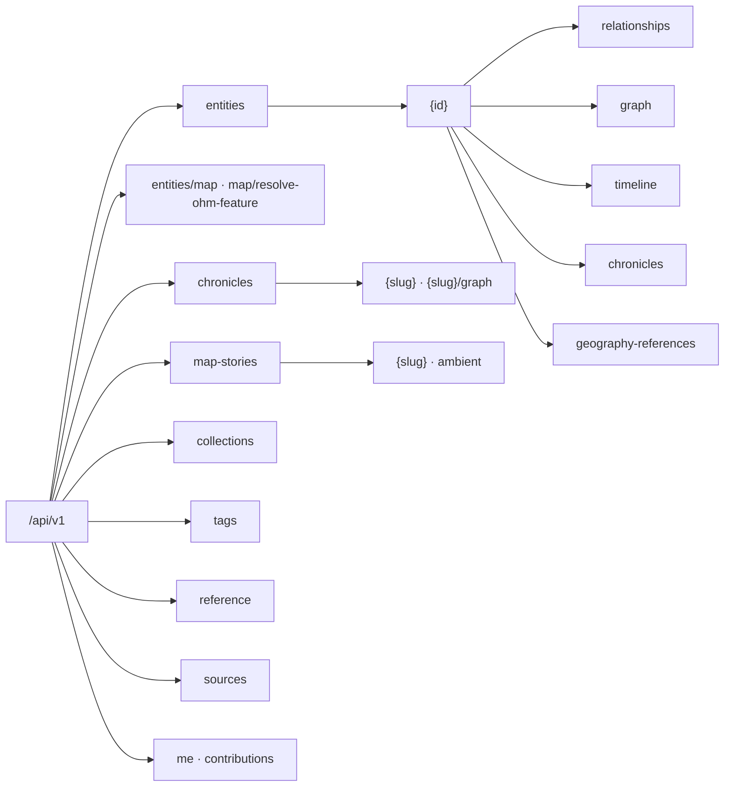

# REST API

The JSON API under `/api/v1` serves the public web app, the admin and anyone else who wants the
data. Reads are public. Writes need a signed-in session and a permission. This page lists every
endpoint group, its parameters and the conventions they share. Request validation rules live in
`api/app/Http/Api/V1/Requests/`.

> **Audience:** developers and data consumers · **Last reviewed:** 2026-11-14 ·
> **Base URL:** `https://api.historymapped.org/api/v1` (locally `http://localhost:8000/api/v1`)

## Conventions

| Topic | Rule |
|---|---|
| Format | JSON. Send `Accept: application/json` so validation errors come back as 422 with field messages |
| Envelope | Single resources and lists are wrapped in `data`. Paginated lists add `links` and `meta` (Laravel pagination) |
| Ids | Entities and relationships use UUIDs; an id that is not a UUID is a 404 at the router. Chronicles, map stories and collections use slugs |
| Years | Integers. BCE years are negative (`-216` is 216 BCE). Time filters take years, not dates |
| Lists | `per_page` (1–100, default per endpoint) and `page` |
| Array parameters | `types[]=a&types[]=b`. `tags` also accepts a comma-separated string |
| Caching | Map endpoints send an `ETag` and `max-age=60`. Tags and collections send `max-age=300`. Reference tables are cached for 24 hours on the server |
| Rate limits | Every `/api` route: 600 requests a minute per signed-in user, else per client IP (`API_RATE_LIMIT`); past it, 429 with `Retry-After`. Contributions: 10 per minute. Sign-in: 5 per minute per e-mail and IP. Vector tiles are not limited |
| Generated docs | Scramble serves an OpenAPI UI at `/docs/api` (JSON at `/docs/api.json`) on the API host. It is open to admins, or to everyone when `SCRAMBLE_DOCS_PUBLIC=true` |

## Endpoint map



## Entities

| Endpoint | Purpose |
|---|---|
| `GET /entities` | Search and browse entities (paginated) |
| `GET /entities/{id}` | One entity with dates, location, tags, aliases, images (`media_refs`) and map-story summaries. `?include_relationships=1`, `?include_territory=1`. `attributes` omits `_`-prefixed bookkeeping and `validation_flags` |
| `GET /entities/{id}/relationships` | Incoming and outgoing relationships, with summaries of both ends |
| `GET /entities/{id}/graph` | A node and edge graph, 1 or 2 hops ([contract](relation-graph-api.md)) |
| `GET /entities/{id}/timeline` and `…/timeline/{entry}` | The entity's derived timeline |
| `GET /entities/{id}/chronicles` | Chronicles that include the entity |
| `GET /entities/{id}/geography-references` | Links to external geography (OHM features) |

`GET /entities` parameters:

| Parameter | Meaning |
|---|---|
| `search` | Name search: `ILIKE` substring and English full text, plus trigram similarity from 6 characters (typos). A 1-2 character term matches name prefixes only, most important first |
| `type`, `types[]`, `group`, `groups[]` | Entity type (one of 30) or group (`POLITY`, `PLACE`, `EVENT`, `ECONOMY`, `CULTURE`) |
| `status`, `min_confidence` | Verification status; minimum confidence (`high`, `medium`, `low`) |
| `tag`, `tags[]` | Tag slugs. AND across facets, OR within a facet |
| `bbox_min_lng`, `bbox_min_lat`, `bbox_max_lng`, `bbox_max_lat` | Primary location inside a box |
| `near_lng`, `near_lat`, `near_radius` | Within a radius in metres (up to 1,000 km) |
| `exists_at`, `temporal_start`, `temporal_end` | Existed in a year, or overlaps a span |
| `sort` | `relevance`, `impact`, `recent`, `chronological`, `distance`, `name` |
| `per_page` (≤ 100), `page`, `include_relationships` | Paging and includes |

The total is counted only up to 1,000: past that, `meta.total` is 1000 and `meta.total_capped` is true (otherwise false). An exact count of a broad filter walked tens of thousands of rows per request.

## Map

| Endpoint | Purpose |
|---|---|
| `GET /entities/map` | GeoJSON for a box and a year (or span), ranked by impact. Required: the four `bbox_*` values, and `year` or `temporal_start` + `temporal_end`. Optional: `zoom_level`, `min_impact`, `min_results`, `types[]`, `groups[]`, `min_confidence`, `include_territories`, `all_periods`, `limit` (≤ 5000) |
| `GET /entities/map/year` | Everything visible in a year, for bulk use (`limit` up to 100,000) |
| `GET /map/resolve-ohm-feature` | Which entity an OpenHistoricalMap feature belongs to. `provider=ohm`, `osm_id` (signed: negative for relations), `target_year` |

The public web app uses vector tiles instead of `entities/map` on the hosted site; see
[Atlas vector tiles](atlas-tiles.md).

## Chronicles

| Endpoint | Purpose |
|---|---|
| `GET /chronicles` | Paginated list. `search` (titles, slugs, tag names), `status`, `tags[]`, `sort` = `recent`, `chronological`, `title` or `impact` |
| `GET /chronicles/{slug}` | The chronicle with its ordered entries, each entry's primary relationship and entities, and its map story if it has one |
| `GET /chronicles/{slug}/graph` | The chronicle as a graph, with per-step membership. `external`, `external_limit` (≤ 100), `relationship_types` |
| `GET /chronicles/{slug}/places` | Where the chronicle's entities sit on the map, for the player's step layer: each entity's `group`, its point `at` ([lng, lat]) and its OpenHistoricalMap `borders` (signed `osm_id`, the years each stands for, `primary`). Entities with neither are left out |

Archived chronicles are hidden everywhere in the public API: the list (even with `status=archived`),
an entity's chronicles, tag counts, collections, stars and map-story links. Their slugs answer 404.
Drafts are listed like published chronicles.

## Map stories, collections, tags, reference data

| Endpoint | Purpose |
|---|---|
| `GET /map-stories` | Story summaries. `kind[]` (battle, siege, epidemic, trade_route…), `sort` = `year` or `title`, paginated |
| `GET /map-stories/{slug}` | One story with its full document |
| `GET /map-stories/ambient` | Faint background stories active in a year. `year` (required), `bbox=w,s,e,n` |
| `GET /collections`, `GET /collections/{slug}` | Published curated sets, with their items resolved to current records |
| `GET /tags` | The tag vocabulary in display order, with chronicle and entity counts |
| `GET /reference`, `GET /reference/{table}` | Reference tables: historical periods, regions, calendar systems and so on |
| `GET /sources`, `GET /sources/{id}` | Source records; `search` matches titles |

## Your account (signed in)

All under `auth:sanctum`. The public web app signs in with Fortify (`POST /login` after
`GET /sanctum/csrf-cookie`), so the session cookie authenticates these calls. No API tokens are
issued.

| Endpoint | Purpose |
|---|---|
| `GET /me` | The signed-in user, roles, abilities and the admin URL; 401 for guests |
| `GET /me/stars/keys`, `GET /me/stars`, `POST /me/stars`, `DELETE /me/stars/{type}/{id}` | Starred entities and chronicles |
| `GET`, `POST /me/folders`; `PATCH`, `DELETE /me/folders/{id}`; `PUT`, `DELETE /me/folders/{id}/items/{type}/{id}` | Folders of saved items |
| `GET /me/contributions`, `POST /me/contributions/{id}/withdraw` | Your suggested edits |
| `POST /contributions` | Suggest an edit to an entity, relationship, chronicle or chronicle entry. Needs `contributions.create` (every account has it) |

## Writes (editors)

| Endpoint | Permission |
|---|---|
| `POST /entities`, `PUT /entities/{id}`, `DELETE /entities/{id}` | `entities.write` |
| `POST /entities/{id}/relationships`, `DELETE …/relationships/{relationship}` | `relationships.write` |
| `POST /entities/{id}/geography-references`, `DELETE …/{ref}`, `GET …/search`, `POST /map/resolve-ohm-feature` | `geometry.write` (the search is public) |
| `POST /sources` | `sources.write` |
| `POST /reference/cache/clear` | `reference.manage` |

Chronicles, map stories and collections have no write endpoints here: chronicles and map stories
are edited in the admin, and collections come from files. Roles and permissions are listed in
[Backend and API](../architecture/backend.md#auth-and-roles).

## Example

```bash
# Battles fought in Italy between 300 and 200 BCE, most important first
curl -s 'https://api.historymapped.org/api/v1/entities?type=event_battle&tags[]=italy&temporal_start=-300&temporal_end=-200&sort=impact&per_page=5' \
  -H 'Accept: application/json'
```

## Related

- [Relation graph API](relation-graph-api.md): graph response shapes
- [Atlas vector tiles](atlas-tiles.md): the tile endpoints under `/tiles`
- [Collections](collections.md): the collection file format and API
