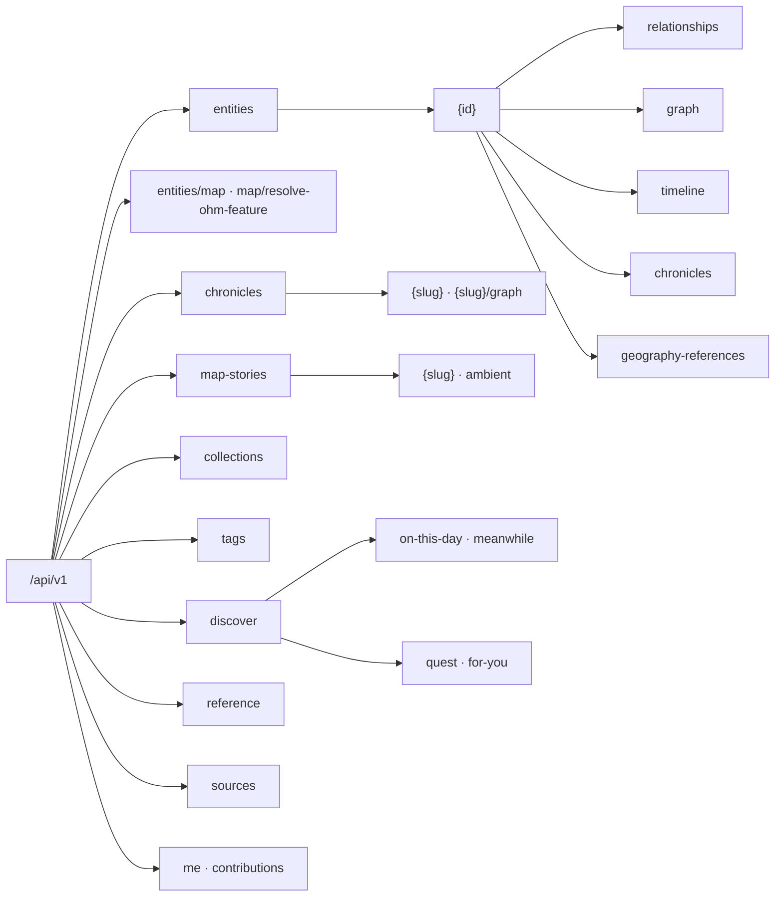

# REST API

The JSON API under `/api/v1` serves the public web app, the admin and anyone else who wants the
data. Reads are public. Writes need a signed-in session and a permission. This page lists every
endpoint group, its parameters and the conventions they share. Request validation rules live in
`api/app/Http/Api/V1/Requests/`.

> **Audience:** developers and data consumers · **Last reviewed:** 2026-11-14 ·
> **Base URL:** `https://api.historymapped.org/api/v1` (locally `http://localhost:8000/api/v1`)

## Conventions

| Topic | Rule |
|---|---|
| Format | JSON. Send `Accept: application/json` so validation errors come back as 422 with field messages |
| Envelope | Single resources and lists are wrapped in `data`. Paginated lists add `links` and `meta` (Laravel pagination) |
| Ids | Entities and relationships use UUIDs; an id that is not a UUID is a 404 at the router. Chronicles, map stories and collections use slugs |
| Years | Integers. BCE years are negative (`-216` is 216 BCE). Time filters take years, not dates |
| Lists | `per_page` (1–100, default per endpoint) and `page` |
| Array parameters | `types[]=a&types[]=b`. `tags` also accepts a comma-separated string |
| Caching | Map endpoints send an `ETag` and `max-age=60`. Tags, collections and the shared Discover feeds send `max-age=300`. Reference tables are cached for 24 hours on the server |
| Rate limits | Every `/api` route: 600 requests a minute per signed-in user, else per client IP (`API_RATE_LIMIT`); past it, 429 with `Retry-After`. Contributions: 10 per minute. Sign-in: 5 per minute per e-mail and IP. Vector tiles are not limited |
| Generated docs | Scramble serves an OpenAPI UI at `/docs/api` (JSON at `/docs/api.json`) on the API host. It is open to admins, or to everyone when `SCRAMBLE_DOCS_PUBLIC=true` |

## Endpoint map



## Entities

| Endpoint | Purpose |
|---|---|
| `GET /entities` | Search and browse entities (paginated) |
| `GET /entities/{id}` | One entity with dates, location, tags, aliases, images (`media_refs`) and map-story summaries. `?include_relationships=1`, `?include_territory=1`. `attributes` omits `_`-prefixed bookkeeping and `validation_flags` |
| `GET /entities/{id}/relationships` | Incoming and outgoing relationships, with summaries of both ends |
| `GET /entities/{id}/graph` | A node and edge graph, 1 or 2 hops ([contract](relation-graph-api.md)) |
| `GET /entities/{id}/timeline` and `…/timeline/{entry}` | The entity's derived timeline |
| `GET /entities/{id}/chronicles` | Chronicles that include the entity |
| `GET /entities/{id}/geography-references` | Links to external geography (OHM features) |

`GET /entities` parameters:

| Parameter | Meaning |
|---|---|
| `search` | Name search: `ILIKE` substring and English full text, plus trigram similarity from 6 characters (typos). A 1-2 character term matches name prefixes only, most important first |
| `type`, `types[]`, `group`, `groups[]` | Entity type (one of 30) or group (`POLITY`, `PLACE`, `EVENT`, `ECONOMY`, `CULTURE`) |
| `status`, `min_confidence` | Verification status; minimum confidence (`high`, `medium`, `low`) |
| `tag`, `tags[]` | Tag slugs. AND across facets, OR within a facet |
| `bbox_min_lng`, `bbox_min_lat`, `bbox_max_lng`, `bbox_max_lat` | Primary location inside a box |
| `near_lng`, `near_lat`, `near_radius` | Within a radius in metres (up to 1,000 km) |
| `exists_at`, `temporal_start`, `temporal_end` | Existed in a year, or overlaps a span |
| `sort` | `relevance`, `impact`, `recent`, `chronological`, `distance`, `name` |
| `per_page` (≤ 100), `page`, `include_relationships` | Paging and includes |

The total is counted only up to 1,000: past that, `meta.total` is 1000 and `meta.total_capped` is true (otherwise false). An exact count of a broad filter walked tens of thousands of rows per request.

## Map

| Endpoint | Purpose |
|---|---|
| `GET /entities/map` | GeoJSON for a box and a year (or span), ranked by impact. Required: the four `bbox_*` values, and `year` or `temporal_start` + `temporal_end`. Optional: `zoom_level`, `min_impact`, `min_results`, `types[]`, `groups[]`, `min_confidence`, `include_territories`, `all_periods`, `limit` (≤ 5000) |
| `GET /entities/map/year` | Everything visible in a year, for bulk use (`limit` up to 100,000) |
| `GET /map/resolve-ohm-feature` | Which entity an OpenHistoricalMap feature belongs to. `provider=ohm`, `osm_id` (signed: negative for relations), `target_year` |

The public web app uses vector tiles instead of `entities/map` on the hosted site; see
[Atlas vector tiles](atlas-tiles.md).

## Chronicles

| Endpoint | Purpose |
|---|---|
| `GET /chronicles` | Paginated list. `search` (titles, slugs, tag names), `status`, `tags[]`, `sort` = `recent`, `chronological`, `title` or `impact` |
| `GET /chronicles/{slug}` | The chronicle with its ordered entries, each entry's primary relationship and entities, and its map story if it has one |
| `GET /chronicles/{slug}/graph` | The chronicle as a graph, with per-step membership. `external`, `external_limit` (≤ 100), `relationship_types` |
| `GET /chronicles/{slug}/places` | Where the chronicle's entities sit on the map, for the player's step layer: each entity's `group`, its point `at` ([lng, lat]) and its OpenHistoricalMap `borders` (signed `osm_id`, the years each stands for, `primary`). A thing that spreads (a disease, a religion, a crop) also lists `reaches`: the chronicle's entities it is recorded as reaching (`spread_to` targets, the sources of `adopted` links to it, the places it is `located_at`), each with the `year` the link starts. Entities with none of the three are left out |

Archived chronicles are hidden everywhere in the public API: the list (even with `status=archived`),
an entity's chronicles, tag counts, collections, stars and map-story links. Their slugs answer 404.
Drafts are listed like published chronicles.

## Map stories, collections, tags, reference data

| Endpoint | Purpose |
|---|---|
| `GET /map-stories` | Story summaries. `kind[]` (battle, siege, epidemic, trade_route…), `sort` = `year` or `title`, paginated |
| `GET /map-stories/{slug}` | One story with its full document |
| `GET /map-stories/ambient` | Faint background stories active in a year. `year` (required), `bbox=w,s,e,n` |
| `GET /collections`, `GET /collections/{slug}` | Published curated sets, with their items resolved to current records |
| `GET /tags` | The tag vocabulary in display order, with chronicle and entity counts |
| `GET /reference`, `GET /reference/{table}` | Reference tables: historical periods, regions, calendar systems and so on |
| `GET /sources`, `GET /sources/{id}` | Source records; `search` matches titles |

## Discover

Four small feeds behind "Today" on `/browse` and in the atlas, built from what the atlas already
holds. All are public and answer `{ "data": … }`.

| Endpoint | Purpose |
|---|---|
| `GET /discover/on-this-day` | Up to 8 things that happened on a month and day: `month`, `day`, `widened`, `items`. `date` (`YYYY-MM-DD`, the reader's local day; default: the server's UTC day). Only its month and day are used |
| `GET /discover/meanwhile` | One year across the world: `year`, `window`, `totals`, `regions`. `year` (required, -4000 to the current year) |
| `GET /discover/quest` | The day's expedition, three battles to find on the map and the timeline: `date`, `number`, `targets`. `date` (default: the server's UTC day; at most 2 days from it) |
| `GET /discover/for-you` | Suggestions from the entities a browser opened lately: `because`, `entities`, `chronicles`, `stories`. `ids` (1 to 12 UUIDs, comma-separated, most recent first; ids the atlas does not know are ignored) |

Every entity in these answers has the same shape:

| Field | Meaning |
|---|---|
| `id`, `name`, `entity_type`, `entity_group` | As elsewhere; the group is UPPERCASE |
| `summary` | The entity's summary, or null |
| `start_year`, `end_year` | Its primary date range in years, else its earliest map period's. Either may be null |
| `at` | Its map point `[lng, lat]` to 5 decimals: the primary location's point, else the earliest map period's. Null when it has neither |
| `has_map_story` | It has a step-by-step battle map |

What each endpoint adds to that shape, and how it chooses:

| Endpoint | Adds | Rules |
|---|---|---|
| `on-this-day` | Per item: `kind` (`happened`, `began`, `ended`, `born`, `died`, `founded`, `dissolved`), `year`, and `date` as text (`1815-11-20`, `-0753-04-21`) | Entities on the map first, then by impact. At most 4 people, with room for 2 of the other kinds when the day has them. A day with fewer than 4 items borrows from the days before and after, up to 3 days away and only until it has 4; `widened` is how far it went. Only dates with a real day count: 1 January never does, and the 1st of another month only when the entity's summary states that day. A person's birthday counts only when the atlas knows they have died |
| `meanwhile` | Per region: `key`, `name`, `event`, `polity` (either may be null) and `counts`. `totals` counts the whole map, including what lies in no region | Events within `window` (10) years of the year, the span the tiles keep an event on the map; states (the `POLITY` group, people excluded) standing in the year. The event is the most important, then the nearest in time. The state is the one the chronicles mention most for the time it stood (mentions divided by one plus its centuries), then the most important, then the longest standing. Regions run west to east; one with neither is left out |
| `quest` | Per target: `difficulty` (`easy`, `medium`, `hard`, in that order), `year` (the year to be in), `region`, and `place` (a nearer place name, or null). `number` counts the days from the first expedition | One battle per difficulty, from the battles the tiles show from zoom 3 that have a summary and a point in a region. Easy: a battle map or at least 2 chronicle mentions. Hard: never mentioned. Medium: the rest. The same three for everyone on a date |
| `for-you` | Per row: `via`, the id of the opened entity it comes from. Entities also carry `relation` (the relationship type), `outgoing` (a relationship reads "source, type, target"; true when the opened entity is the source) and `year` (the year to open the entity at: the year the relationship starts, else the first year both existed, else the entity's first year). `because` lists the opened entities that produced a row | `entities`: the other end of each opened entity's relationships, the 3 of highest impact for each, 8 in all. `chronicles`: up to 4 that name one, by impact, as rows of `GET /chronicles`. `stories`: up to 3 battle maps of an opened or suggested entity, as rows of `GET /map-stories`. At most 400 relationships are read per opened entity |

| Topic | Detail |
|---|---|
| World regions | Decided by the entity's map point, not by tags: `north-america`, `mesoamerica-caribbean`, `south-america`, `europe`, `middle-east-north-africa`, `sub-saharan-africa`, `central-north-asia`, `south-asia`, `east-asia`, `southeast-asia`, `oceania`. The boxes are in `App\Support\Discover\WorldRegion`. A point in no box (mid-ocean, south of 60° S, north of 85° N) has no region |
| Caching | `on-this-day`, `meanwhile` and `quest` send `Cache-Control: public, max-age=300` and are kept on the server for 12 hours per day of the year, 6 hours per year and 36 hours per date. `for-you` sends `private, max-age=60` and is not kept |
| Upkeep | `on-this-day` reads the table `discover_anniversaries`, which `php artisan discover:build-anniversaries` rebuilds. The scheduler runs it weekly, and hourly with `--if-empty`, so a first deploy or a content load (which empties the table) is followed by a build within the hour. An empty table gives an empty list. The feature page is [Discover](../architecture/discover.md) |
| Settings | `api/config/discover.php`: sizes, the expedition's first day and difficulty threshold, cache times |

## Your account (signed in)

All under `auth:sanctum`. The public web app signs in with Fortify (`POST /login` after
`GET /sanctum/csrf-cookie`), so the session cookie authenticates these calls. No API tokens are
issued.

| Endpoint | Purpose |
|---|---|
| `GET /me` | The signed-in user, roles, abilities and the admin URL; 401 for guests |
| `GET /me/stars/keys`, `GET /me/stars`, `POST /me/stars`, `DELETE /me/stars/{type}/{id}` | Starred entities and chronicles |
| `GET`, `POST /me/folders`; `PATCH`, `DELETE /me/folders/{id}`; `PUT`, `DELETE /me/folders/{id}/items/{type}/{id}` | Folders of saved items |
| `GET /me/contributions`, `POST /me/contributions/{id}/withdraw` | Your suggested edits |
| `POST /contributions` | Suggest an edit to an entity, relationship, chronicle or chronicle entry. Needs `contributions.create` (every account has it) |

## Writes (editors)

| Endpoint | Permission |
|---|---|
| `POST /entities`, `PUT /entities/{id}`, `DELETE /entities/{id}` | `entities.write` |
| `POST /entities/{id}/relationships`, `DELETE …/relationships/{relationship}` | `relationships.write` |
| `POST /entities/{id}/geography-references`, `DELETE …/{ref}`, `GET …/search`, `POST /map/resolve-ohm-feature` | `geometry.write` (the search is public) |
| `POST /sources` | `sources.write` |
| `POST /reference/cache/clear` | `reference.manage` |

Chronicles, map stories and collections have no write endpoints here: chronicles and map stories
are edited in the admin, and collections come from files. Roles and permissions are listed in
[Backend and API](../architecture/backend.md#auth-and-roles).

## Example

```bash
# Battles fought in Italy between 300 and 200 BCE, most important first
curl -s 'https://api.historymapped.org/api/v1/entities?type=event_battle&tags[]=italy&temporal_start=-300&temporal_end=-200&sort=impact&per_page=5' \
  -H 'Accept: application/json'
```

## Related

- [Relation graph API](relation-graph-api.md): graph response shapes
- [Atlas vector tiles](atlas-tiles.md): the tile endpoints under `/tiles`
- [Collections](collections.md): the collection file format and API
