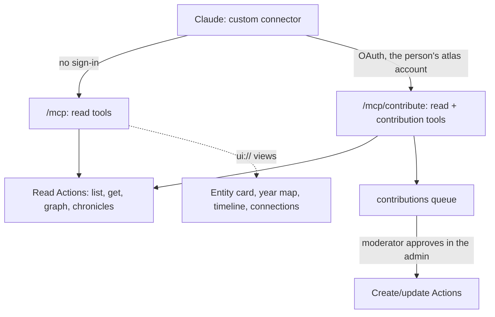

# MCP connector — design

**Status:** approved 2026-11-19 (decisions below). **Why:** let Claude (and any other MCP host) answer
history questions from the atlas's own data, show the answer as cards and maps inside the chat, and let
signed-in people send corrections and propose new entities and relationships for review.

## Decisions

| Question | Decision |
|---|---|
| Feedback | Only through **contributions**, the queue the atlas already uses. No separate issue reports. |
| Records Claude creates | **Reviewed first.** A Claude-proposed entity or relationship is a contribution; nothing reaches the public tables until a moderator approves it. A hidden verification status would not work: the public site already shows `pipeline_draft` (631k) and `needs_review` (10k). |
| Sign-in | A Claude connector is either sign-in-free or OAuth, so there are two URLs: `/mcp` (public, read-only) and `/mcp/contribute` (OAuth with the person's atlas account). |
| Package | `laravel/mcp` (already installed through Boost; moves to `require`, since the prod image installs without dev packages). It covers Streamable HTTP, structured output, tool annotations, MCP Apps (`AppResource`, `#[RendersApp]`), Passport OAuth and per-user tool registration. |

## Phase 1: public read server (`/mcp`)

Every tool is `#[IsReadOnly]` and `#[IsIdempotent]`, returns structured content (`outputSchema`) plus a
one-paragraph text summary, caps its rows, and gives each record its atlas link
(`{web}/entities/{id}`, `{web}/chronicles/{slug}`) so Claude can cite it.

| Tool | Input | Built on | View |
|---|---|---|---|
| `search_atlas` | `query`, optional `types[]`, `year`, `limit` ≤ 20 | `ListEntitiesAction` (capped, similarity-ranked) and the chronicle search | none |
| `get_entity` | `id`, or `qid`, or `name` (best match) | `GetEntityAction` with locations, tags, image, top relationships | Entity card |
| `what_was_happening` | `year`, optional `bbox` or a region tag, `types[]`, `limit` ≤ 50 | `ListEntitiesAction` with `exists_at` + bbox, ordered by impact | Year map |
| `get_connections` | `id`, optional `types[]`, `limit` ≤ 40 | `GetEntityGraphAction` | Connections graph |
| `find_chronicles` | `query` and/or `tags[]` | the chronicle index query | none |
| `get_chronicle` | `slug` | `ChronicleController::show` data, entries capped | Timeline |

Server `#[Instructions]` tell the model what the atlas covers (dates as signed years, BCE negative; what
an entity type is; that results are capped) and to link to the atlas when citing.

### Views (MCP Apps)

`AppResource` classes with Blade views under `resources/views/mcp/`, plain JS, no build step. Each view
reads the tool result the host passes it and may call read tools again (`app.callServerTool`), for example
to move the map's year.

| View | Shows | Outside origins (CSP) |
|---|---|---|
| Entity card | image with its Commons credit, name, type, dates, place, summary, top relationships, "Open in the atlas" | `upload.wikimedia.org` images |
| Year map | MapLibre: OpenFreeMap basemap, OHM borders filtered to the year (as the SPA does), the entities as points; clicking a point opens its card | maplibre CDN; `tiles.openfreemap.org`, `vtiles.openhistoricalmap.org` |
| Timeline | a chronicle's steps, or a set of entities, on a horizontal time axis (SVG) | none |
| Connections | the entity and its neighbours as a radial graph (SVG), relationship type on hover | none |

Claude needs `_meta.ui.domain` = the first 32 hex characters of `sha256(server URL)` + `.claudemcpcontent.com`,
computed from `APP_URL` at runtime.

## Phase 2: contributor server (`/mcp/contribute`)

Passport + `Mcp::oauthRoutes()` (discovery and dynamic client registration). Connecting in Claude opens
the atlas's sign-in and a consent page; tools then run as that user. The read tools are registered here
too. Contribution tools appear only to users with `contributions.create` (`shouldRegister`).

| Tool | Does | Rules |
|---|---|---|
| `suggest_correction` | `SubmitContributionAction` on one prose field of an entity, relationship, chronicle or chronicle entry | the existing ones: editable fields only, 50 pending per account |
| `propose_entity` | a **create** contribution holding the entity payload (type, name, dates, place, summary, QID, sources) | validated like `EntityData`; a QID that already exists is refused with that entity's id; same-name, same-type rows within ±50 years come back as possible duplicates so Claude can ask |
| `propose_relationship` | a **create** contribution for a relationship | each end is an entity id or a pending `propose_entity` contribution id; type and direction validated like `RelationshipData` |
| `my_contributions` | the account's contributions and their review status | own rows only |

None is read-only, so Claude asks before each call. There is no delete or direct-write tool.

### Data and review

- `contributions` gains `kind` (`edit` default, `create`), `payload jsonb null`, `source` (`atlas`, `mcp`)
  and `client` (the MCP client's name). `field`, `base_text`, `proposed_text` and `diff` become nullable
  for `create` rows. `target_id` is null until approval, then holds the created record's id.
- The admin contributions pages list create proposals with the payload, the possible duplicates and the
  source. Approving one runs `CreateEntityAction` / `CreateRelationshipAction` (`created_by` = the
  contributor, status `human_verified`). A relationship whose end is a pending entity proposal can't be
  approved before that proposal. Rejecting uses the existing close action.

## Load and safety

- Rate limits: per IP on `/mcp`, per user on `/mcp/contribute`. MCP traffic shares the droplet's four
  Octane workers, so rows are capped and summaries trimmed.
- Read tools expose public data only. No tool returns account data except `my_contributions`.
- Writes are proposals; approval stays in the admin.

## Rollout

1. Phase 1: no schema change. Deploy, add `https://api.historymapped.org/mcp` as a custom connector, try it.
2. Phase 2: Passport keys on the droplet (`docker/.env.prod`), migrations, admin review UI.
3. Later: submit to Anthropic's connector directory (needed for embedded websites and the Artifacts entry point).

## Testing

- `laravel/mcp` test helpers for each tool: inputs, caps, structured output, `shouldRegister` per role.
- Contribution create/approve/reject feature tests, including the pending-entity dependency.
- MCP Inspector against the local stack; Claude through a tunnel before the first deploy.

## As built (Phase 2)

- Tool names are kebab-case like the read tools (`suggest-correction`, `propose-entity`, ...), not snake_case.
- `propose-entity` with possible duplicates records **nothing** and returns them; the caller confirms and
  resubmits with `acknowledge_duplicates: true`. The stored payload keeps the duplicates for the moderator.
  A QID already pending as another proposal is refused too.
- `create` rows use `target_type` (`entity` / `relationship`) for what is proposed. Entity payloads are
  `{entity: {...}, possible_duplicates: [...]}`, relationship ends are `{entity_id}` or `{contribution_id}`.
- Rejecting or withdrawing an entity proposal closes the contributor's pending relationship proposals that
  depend on it, rather than blocking the rejection.
- `User::$guard_name = 'web'` so spatie permissions resolve under the Passport `api` guard. `User` had no
  Sanctum `HasApiTokens` (Sanctum is used for cookie sessions only), so Passport's trait does not clash.
- The Fortify login responses return to `/oauth/authorize` when the sign-in began there, for any role
  (non-staff are otherwise sent to the public site).
- Registration has its own per-IP limit (10 a minute) instead of wrapping all discovery routes.
- The client name comes from the OAuth client registration (`Claude`), not MCP `clientInfo` (not available
  per request on the stateless transport).

