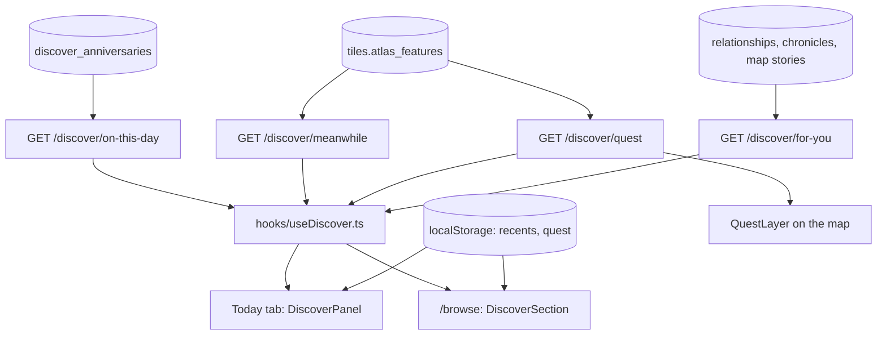

# Discover: "Today" on the browse page and in the atlas

**Status:** built and verified locally 2026-11-20; not yet committed or deployed · **As built:**
[`docs/architecture/discover.md`](../../architecture/discover.md) · §10 lists where the build differs from this spec.

The browse page is lists, and the atlas sidebar only lists what is in view. This adds four small,
data-driven modules that show what a map with a timeline can do, in two places: a **Today in the
atlas** section at the top of `/browse`, and a **Today** tab in the atlas sidebar (and the phone's
sheet). Nothing is authored by hand and nothing is invented: every line comes from entities the
atlas already holds.



## 1. The four modules

| Module | What the reader gets | Why it shows off the atlas |
|---|---|---|
| **On this day** | Up to 6 things that happened on today's month and day: an event, a founding, a birth, a death. Each opens on the map in its own year | The date is today; the place and the year are one click away |
| **Meanwhile** | For one year, a line per world region: the most notable event around then and the most notable state standing. In the sidebar it follows the timeline's year; on `/browse` it uses the year of today's first "on this day" item | "While X in Europe, Y in East Asia": the same year seen across the whole map |
| **Daily expedition** | Three places-and-times to find each day (easy, medium, hard). The reader moves the timeline and the map; a strip over the map says how warm they are in time and in place. On arrival the target pulses; clicking it completes it. Stars for few hints, a streak for consecutive days | The reader has to use both axes, time and space, to get there |
| **For you** | Entities, chronicles and battle maps related to what this browser opened lately | The atlas answers back to what the reader explored |

**Honesty rules.** Only show what the data says. "Meanwhile" juxtaposes; it never says one place was
"ahead" of another. A person's birthday is shown only when the stored date has a real day. Recents
never leave the browser except as a list of entity ids sent to `for-you`.

## 2. What the data supports (local DB, 2026-11-20)

| Fact | Number |
|---|---|
| Primary date ranges whose text has a real day (`entity_temporal_ranges.start_date` / `end_date` as `Y-M-D`, not 1 Jan / 31 Dec placeholders) | 2,699 starts, 2,450 ends; every calendar day has at least 5 (median 14) |
| People with a real-day `attributes.birth_date` (not 1 Jan) | about 310,000; 3,795 with impact ≥ 70, 35,572 with impact ≥ 60 |
| Map features (`tiles.atlas_features`, 57,355 rows, all points) | EVENT 9,629 · POLITY 2,974 · PLACE 43,602 |
| Events on the map within ±10 years of a year | 3 in 1200 BCE, 42 in 1066, 55 in 1492, 629 in 1914 |
| States standing in a year (POLITY features, people excluded) | 37 in 1200 BCE, 233 in 1066, 925 in 1914 |
| Battles visible from zoom 3 with a summary (the expedition pool) | about 1,970 |
| Region tags on map entities | only 10,946 of 57,351, and skewed: **do not use them**; classify by the map point instead (§4) |

## 3. API (all `GET`, public, under `/api/v1/discover`)

Every response is `{ "data": … }`. The web contract is `web/src/lib/schemas/discover.ts` (zod); keep
the two in step. `entity_group` is the enum value as other endpoints send it (UPPERCASE). Years are
integers, BCE negative. Only entities whose `verification_status` the tiles show count (the list in
`tiles.atlas_entity_features`).

**The entity shape** used everywhere below:

```json
{ "id": "uuid", "name": "Battle of Hastings", "entity_type": "event_battle", "entity_group": "EVENT",
  "summary": "…", "start_year": 1066, "end_year": 1066, "at": [0.49, 50.91], "has_map_story": true }
```

`at` is the entity's map point `[lng, lat]`, 5 decimals: its primary `entity_locations` point, else
its earliest geometry period's (the rule in `app/Actions/Chronicle/GetChroniclePlacesAction.php`);
`null` when it has neither.

### 3.1 `GET /discover/on-this-day?date=YYYY-MM-DD`

`date` is the reader's local day (default: the server's UTC day). Only its month and day matter.

```json
{ "data": { "month": 11, "day": 20, "widened": 0,
    "items": [ { …entity, "kind": "happened", "year": 1845, "date": "1845-11-20" } ] } }
```

| Rule | Detail |
|---|---|
| Source | The table `discover_anniversaries` (§3.5), by `(month, day)` |
| `kind` | `happened` (an event that starts and ends that day, or has no end), `began` / `ended` (an event's first / last day when they differ), `born` / `died` (a person), `founded` / `dissolved` (anything else: a state, a city, a unit) |
| Order and size | Placed first, then by impact, at most 8. At most 4 people; when the day has other kinds, at least 2 of them |
| Thin days | Fewer than 4 items: add the neighbouring days (±1, then ±2, ±3) until there are 4; `widened` is how far it went |
| Cache | Redis 12 h per `MM-DD`; `Cache-Control: public, max-age=300` |

### 3.2 `GET /discover/meanwhile?year=1066`

`year` is required, an integer from -4000 to the current year (else 422).

```json
{ "data": { "year": 1066, "window": 10, "totals": { "events": 42, "polities": 233 },
    "regions": [ { "key": "europe", "name": "Europe",
        "event": { …entity } , "polity": { …entity },
        "counts": { "events": 31, "polities": 120 } } ] } }
```

| Rule | Detail |
|---|---|
| Source | `tiles.atlas_features` only (16 MB; a full scan is about 13 ms locally). Never join the `entities` heap to choose; hydrate the chosen few by id afterwards |
| Events | `entity_group = 'EVENT'` with `start_year <= year + 10` and `COALESCE(end_year, start_year) >= year - 10`: the same ±10 years the tiles keep an event visible, so every result is on the map at that year |
| Polities | `entity_group = 'POLITY'`, `entity_type <> 'person'`, `start_year <= year` and `COALESCE(end_year, 9999) >= year` |
| Region | From the feature's point, by the box table in §4. Points in no box are left out |
| Choice per region | `event`: highest `GREATEST(display_priority, impact_score)`, then the start year nearest to `year`, then id. `polity`: highest importance, then the longest-standing, then id. Either may be null; a region with neither is left out |
| Order | West to east, as listed in §4 |
| Cache | Redis 6 h per year; `Cache-Control: public, max-age=300` |

### 3.3 `GET /discover/quest?date=YYYY-MM-DD`

`date` defaults to the server's UTC day and must be within 2 days of it (else 422), so cache keys stay bounded.

```json
{ "data": { "date": "2026-11-20", "number": 1,
    "targets": [ { …entity, "difficulty": "easy", "year": 1868, "region": "Sub-Saharan Africa", "place": "Amhara, Ethiopia" } ] } }
```

| Rule | Detail |
|---|---|
| Pool | Features with `entity_group = 'EVENT'`, `entity_type = 'event_battle'`, `min_zoom <= 3`, a summary of at least 40 characters, and a point inside a §4 region. One row per entity |
| Difficulty | By how often chronicles mention it (rows in `chronicle_entry_entities`) and whether it has a battle map: `easy` = a battle map or the most-mentioned third, `hard` = never mentioned, `medium` = the rest. Measure the tiers and set thresholds so each holds at least 150; say what you chose in the docblock |
| The day's three | One per tier, in the order easy, medium, hard: within a tier `ORDER BY md5(id \|\| date) LIMIT 1`. The same for everyone on a date |
| `year` | Its `start_year`. `at` is never null |
| `region`, `place` | The §4 region name; the primary location's `location_name` when it has one, else null |
| `number` | Days since `config('discover.quest_epoch')` (`2026-11-20`), plus 1 |
| Cache | Redis 36 h per date; `Cache-Control: public, max-age=300` |

### 3.4 `GET /discover/for-you?ids=uuid,uuid,…`

1 to 12 entity ids, most recently opened first (not UUIDs, or more than 12: 422; unknown ids are ignored).

```json
{ "data": { "because": [ { "id": "uuid", "name": "Hannibal" } ],
    "entities":   [ { …entity, "via": "uuid", "relation": "victorious_at" } ],
    "chronicles": [ { …a GET /chronicles row, "via": "uuid" } ],
    "stories":    [ { …a GET /map-stories row, "via": "uuid" } ] } }
```

| Rule | Detail |
|---|---|
| `entities` | The other end of each seed's relationships, never a seed itself. Per seed keep the 3 with the highest impact (walk at most ~400 relationships per seed, strongest first, as `GetEntityGraphAction` does, so a hub seed stays cheap); 8 in all, earlier seeds first. `relation` is the relationship type |
| `chronicles` | Chronicles (not archived) with an entry that names a seed, as an entry entity or an end of its primary relationship; 4 by impact. Use the existing list resource so rows match `GET /chronicles` |
| `stories` | Map stories whose entity is a seed or one of the chosen `entities`; 3. Rows match `GET /map-stories` |
| `via` | The seed (first by recency) the row comes from |
| `because` | The seeds that produced at least one row, in the order given |
| Cache | None on the server (index lookups only); `Cache-Control: private, max-age=60` |

### 3.5 The anniversaries table

`on-this-day` must not scan `entity_temporal_ranges` (594k rows, regex on text) or the 1 GB
`entities` heap per request. A small table holds the answer:

| Column | Notes |
|---|---|
| `entity_id uuid` | FK to `entities`, cascade on delete |
| `kind varchar(12)` | as in §3.1 |
| `month smallint`, `day smallint`, `year integer`, `date text` | `date` as stored (`1815-11-20`, `-0753-04-21`) |
| `impact smallint`, `placed boolean` | copied at build time, for ordering without a join |
| Keys | primary key `(entity_id, kind)`; index `(month, day, placed DESC, impact DESC)` |

`php artisan discover:build-anniversaries` rebuilds it in one transaction (delete, insert), then
forgets the cached days. Sources:

| Source | Rows | Rule |
|---|---|---|
| `entity_temporal_ranges` (primary) | all with a real day | `start_date` / `end_date` matching `^-?\d{1,6}-\d{2}-\d{2}$`, a valid month and day, start not `01-01`, end not `01-01` or `12-31` (placeholders). Kind by entity type as in §3.1 |
| People's `attributes->>'birth_date'` / `'death_date'` | impact ≥ 60, and only people who have died | Wikidata timestamps (`1925-11-20T00:00:00Z`); skip `01-01` (year-only placeholders). Kinds `born` / `died`. A row from the first source wins |

Schedule it weekly in `routes/console.php` (it scans the people once: seconds locally, tens of
seconds on the droplet) and run it once after a deploy or a content load. An empty table gives an
empty list, never an error.

## 4. World regions (by map point)

Checked in this order; the first match wins. `key` is stable, `name` is shown. The response lists
regions in the order of this table (west to east).

| # | key | name | Box (lng, lat) |
|---|---|---|---|
| 1 | `north-america` | North America | lng -170…-50, lat ≥ 24 |
| 2 | `mesoamerica-caribbean` | Mesoamerica & the Caribbean | lng -120…-58, lat 7…24 |
| 3 | `south-america` | South America | lng -93…-30, lat < 13 |
| 4 | `europe` | Europe | lat ≥ 36 and lng -25…26, or lat ≥ 42 and lng 26…60 |
| 5 | `middle-east-north-africa` | Middle East & North Africa | lat 12…42, lng -18…63 |
| 6 | `sub-saharan-africa` | Sub-Saharan Africa | lat < 12, lng -20…52 |
| 7 | `central-north-asia` | Central & North Asia | lat ≥ 37, lng 45…180 (after East Asia) |
| 8 | `south-asia` | South Asia | lat 5…37, lng 60…93 |
| 9 | `east-asia` | East Asia | lat 20…55, lng 93…150 |
| 10 | `southeast-asia` | Southeast Asia | lat -11…20, lng 92…141 |
| 11 | `oceania` | Oceania | lat < -8 and (lng ≥ 110 or lng ≤ -130) |

Evaluation order for overlaps: Europe, Middle East & North Africa, Sub-Saharan Africa, South Asia,
East Asia, Southeast Asia, Central & North Asia, Oceania, North America, Mesoamerica & the
Caribbean, South America. One PHP class (`App\Support\Discover\WorldRegion`) holds the table; unit
test it with a dozen known places (London, Istanbul, Cairo, Lagos, Delhi, Beijing, Samarkand,
Jakarta, Sydney, New York, Mexico City, Lima).

## 5. Web: what is already in place

Written and wired before the build (typecheck and lint pass). **Do not restructure these; fill in
your own files.**

| File | State |
|---|---|
| `web/src/lib/schemas/discover.ts`, `lib/api/discover.ts`, `hooks/useDiscover.ts` (`useOnThisDay`, `useMeanwhile`, `useDailyQuest`, `useForYou`), `qk` keys, barrel exports | Done: the contract |
| `web/src/lib/discover/date.ts` | Done: `dayKey()` (the reader's local day), `previousDayKey`, `dayMonthLabel` |
| `web/src/hooks/useAtlasGo.ts` | Done: inside the atlas, set the year and open an entity in one URL write, or fly to a point |
| `web/src/components/discover/kit.tsx` | Done: `DiscoverCard` (titled card) and `GoTo` (a button in the atlas, a link on a site page). Both take `variant: 'panel' \| 'page'` |
| URL `tab` (`lib/url/params.ts`), `useBrowseTab` / `useOpenBrowseTab` (`hooks/useChronicleTags.ts`), `todayAtlasHref()` (`lib/site-links.ts`) | Done: the Today tab is in `LeftSidebar` and the sheet's list, and `/app?tab=today` opens it |
| Mounts: `DiscoverPanel` (Today tab), `DiscoverSection` (`/browse`, section `#today`), `DiscoverRuntime` (`AtlasLayout`), `QuestLayer` (`MapCanvas`) | Mounted; each file is a placeholder to fill in |

**Variants.** `panel` is inside the atlas: dense (13 px text), actions use `GoTo` / `useAtlasGo` and
never navigate away. `page` is on `/browse`: roomier, and every action is a link (`GoTo`,
`atlasHref`, `todayAtlasHref`). On a site page never call a setter from `useSelection`,
`useTimeState` or `useAtlasGo`: it would rewrite that page's URL.

## 6. Web: the feed (workstream "feed")

Owns: `components/discover/{OnThisDayCard,MeanwhileCard,ForYouCard,DiscoverPanel,DiscoverSection,DiscoverRuntime}.tsx`,
`lib/discover/recents.ts` (+ test), any `lib/discover/*.ts` helper it adds except `quest*`, and a
render test `components/discover/discover.test.ts`.

| Piece | Behaviour |
|---|---|
| **OnThisDayCard** | Title "On this day", the date beside it (`dayMonthLabel`). Rows: the year (mono, `formatYear`), then the name with what happened in plain words ("born", "died", "founded", "begins", "ends"; nothing for `happened`). A battle-map mark when `has_map_story`. Each row is a `GoTo` with the entity and its year. `panel` shows 5 rows, `page` 6. When `widened > 0` each row also shows its own day |
| **MeanwhileCard** | Takes `year`. Title "Meanwhile in 1066" (`formatYear`), with the totals beside or under it ("233 states and 42 events on the map"). One row per region: the region name small, then the event (with its year when it is not `year`) and the state. Lead with a "While … in A, … in B" sentence built from the two regions with events that are farthest apart; leave it out when fewer than two regions have events. Rows are `GoTo`: in `panel` the entity only (the timeline stays where the reader put it), in `page` the entity and the card's year |
| **Panel year** | `DiscoverPanel` gives MeanwhileCard the timeline's year (`instantYear(useTimeState().time)`), debounced about 400 ms so dragging the timeline does not fire a request per tick. The last answer stays on screen while the next loads |
| **Page year** | `DiscoverSection` gives it the year of the first "on this day" item (prefer an event); the card says so ("the year of the Battle of …"). Until that loads, show a skeleton |
| **Recents** | `lib/discover/recents.ts`: a store over `localStorage` key `hm-recents`, `{ v: 1, entities: [{ id, at }], searches: [{ q, at }] }`, newest first, at most 12 entities and 8 searches, deduplicated. Every read and write in try/catch (private windows throw); it must work with storage unavailable. A `useRecents()` hook (`useSyncExternalStore`, also listening to the `storage` event) so every card on the page agrees |
| **DiscoverRuntime** | Records the open entity (`useSelection().sel`) and the search word (`useSearchFilter`) into recents. Renders nothing |
| **ForYouCard** | Hidden with no recent entities. Otherwise: "Because you opened A, B" (the `because` names), then entities (name, relation in plain words, `GoTo`), chronicles and battle maps (links: in `panel` use `useChronicleNav().enter` / `useStoryNav().enter`, in `page` `chronicleAtlasHref` / `storyAtlasHref`). Recent searches as chips that run the search again. A line saying where this comes from ("From what you opened in this browser") with a "Clear" button that empties recents |
| **DiscoverPanel** | Order: QuestCard, OnThisDayCard, MeanwhileCard, ForYouCard, all `variant="panel"`, in the scrolling column (`space-y-3 p-3`) |
| **DiscoverSection** | A grid (`grid gap-3 lg:grid-cols-3`): OnThisDayCard, MeanwhileCard, QuestCard, all `variant="page"`; ForYouCard under it at full width when there are recents |
| **States** | Loading: a quiet skeleton of the card's size. An error or an empty answer: the card is not rendered (the API may not be deployed yet; `retryUnlessClientError` already avoids retrying a 404) |

## 7. Web: the expedition (workstream "quest")

Owns: `components/discover/QuestCard.tsx`, `components/map/QuestLayer.tsx`,
`lib/discover/quest.ts` (pure rules, + test), `lib/discover/quest-store.ts` (state, + test), and a
small block appended to `web/src/styles.css` for the marker's pulse.

| Piece | Behaviour |
|---|---|
| **State** | One zustand store, saved to `localStorage` key `hm-quest` on every change (try/catch; works without storage): `{ v: 1, date, active: id \| null, targets: { [id]: { when, where, taken, found } }, streak: { count, last } }`. A new day (`dayKey()` differs from `date`) clears `targets` and `active`, keeps the streak |
| **Warmth in time** | Years between the timeline's year and the target's span `[start_year, end_year ?? start_year]` (0 inside it): `here` ≤ 10, `hot` ≤ 50, `warm` ≤ 200, `cool` ≤ 800, else `cold`. Plus which way: the target is `earlier` or `later` |
| **Warmth in place** | Great-circle km from the map's centre to the target: `hot` ≤ 800, `warm` ≤ 2,500, `cool` ≤ 6,000, else `cold`; `here` when the target is inside the viewport and the viewport's diagonal is at most 3,000 km (a regional view, not the whole world) |
| **Arrived** | Time `here` and place `here`. Then, and only then, the target's marker is on the map |
| **Hints** | "When": shows the year. "Where": shows the region, the place name when there is one, and a live compass direction (8 points) and distance. "Take me there": sets the timeline and flies there (`useAtlasGo({ year, at })`) |
| **Stars** | 3 with no hint, 2 with one of When / Where, 1 with both, 0 when taken there (it still counts as found) |
| **Finding** | Clicking the marker marks it found, opens the entity (`useAtlasGo({ id })`) and clears `active`. The card then shows the stars and the summary |
| **Streak** | When the day's third target is found: `count + 1` if `streak.last` is the previous day (`previousDayKey`), else 1; `last` = today |
| **QuestCard, `panel`** | Title "Expedition 12", the streak beside it. The three targets with their difficulty; found ones show stars. The active one shows the clue (its summary), the two warmth meters with a word each, the hint buttons, and "Stop". Others show "Start". All found: a short done state with the stars and a "Copy result" button (plain text: the expedition number, the three star rows, the site's `/browse` URL) |
| **QuestCard, `page`** | A teaser: the number, the three target names with their difficulty, today's progress from the store (found count, stars), and a link "Start in the atlas" (`todayAtlasHref()`) |
| **QuestLayer: strip** | While a target is active and not found: a small strip at the top centre of the map, clear of the panels (`useEphemeralStore((s) => s.mapInsets)`, as `StoryOverlay` positions its caption): the target's name, "When" and "Where" with their warmth, and a button that opens the Today tab (`useOpenBrowseTab()('today')`). Hidden while a chronicle or a battle map plays. `pointer-events: none` except its button |
| **QuestLayer: marker** | A `maplibregl.Marker` with a DOM element (a ring that pulses; no pulse under reduced motion), added on arrival and removed otherwise or on unmount. Its click must not reach the map (`stopPropagation`) |
| **Reading the map** | The centre and bounds from the map instance (`useMapInstance`) on `move`, at most once per animation frame; the year from `useTimeState` |

## 8. Rules for every workstream

- **Shared checkout.** Other sessions have uncommitted work here, and so does this one. Never run
  `git add`, `commit`, `stash`, `checkout`, `restore`, `reset` or `clean`. Touch only the files your
  workstream owns (plus the few named shared files). If a file changed under you, re-read it and
  re-apply your edit; never revert someone else's change.
- **Docker only** (no host PHP / node):
  - web: `docker compose -f docker/docker-compose.yml exec -T web sh -c 'cd /workspace/web && npx tsc -b && npx eslint src && npx vitest run <paths>'`
  - api: `docker compose -f docker/docker-compose.yml exec -T app php artisan test --filter <Name>` and `./vendor/bin/pint <files>`
- **Web tests** run only for `src/**/*.test.ts` (never `.test.tsx`); render with `createElement`, as
  `web/src/app/routes/browse/pages.test.ts` does.
- **Web lint**: `import/order` (alphabetical, `@/` internal), separate `import type` lines, React
  compiler hook rules. There is no prettier in `web/`.
- **Maps are light in both themes**: anything drawn on the map uses fixed colours, not theme tokens.
  Cards use tokens (`bg-card`, `text-muted-foreground`, `border`).
- **Plain words** in the UI: short labels, no exclamation marks, no emoji.
- **GitNexus** (CLAUDE.md): before editing an existing function or component, run
  `node .gitnexus/run.cjs impact <name> --direction upstream` and stop to report if it says HIGH or
  CRITICAL. Never edit `atlasHref` (CRITICAL, 31 dependents); add a new helper beside it instead.
- **Report back**: what you built (files), what you ran and its result, anything you could not
  verify, and every deviation from this spec with the reason.

## 9. Not in this pass

- A geography-guess round (click where it happened) and a "when" round on the timeline.
- Curated, written "did you know" comparisons.
- Signed-in recents and streaks (kept on the server).
- Day precision for the bulk-imported events (the pipeline knows it but does not store it).

## 10. As built: where the build differs

| Area | This spec | As built, and why |
|---|---|---|
| Meanwhile, the state | Highest importance, then the longest standing | Mentions in chronicles per century it stood, then importance. Importance is 98 or 96 by whether a state has an end year, so it chose Tamna for East Asia in 1066 and a chip maker for North America in 1979 |
| World regions | Boxes open to the poles | They stop at 60° S and 85° N: a South Pole expedition was Sub-Saharan Africa's event of 1911 |
| Expedition tiers | The most-mentioned third is easy | Easy: a battle map or 2 or more mentions (309). Medium: exactly 1 (1,271). Hard: none (379). 65% of the pool has exactly one mention, so no cut gives thirds |
| Expedition `place` | The location's name | A name only when it says more than the battle's own; null for most targets |
| Expedition clue | The summary as it is | Years are hidden until the "when" hint: 1,955 of 1,974 summaries print the year |
| Expedition, "here" in place | Inside the viewport | Inside the part of the map the panels leave visible, measured on screen |
| Expedition, "Take me there" | `useAtlasGo({ year, at })` | Its own flight, zoomed until the view is under 3,000 km on any window size |
| For you, the walk | Strongest relationships first | At most 400 relationships per opened entity, read in index order: ranking a hub's 17,000 took 60 ms |
| For you, a row | `via` and `relation` | Also `outgoing` (which way the relationship reads) and `year` (the year to open the row at) |
| Anniversaries, births | Unconditional for date ranges | Only for people known to have died, in both sources |
| Anniversaries, the 1st of a month | Kept | Kept only when the summary states that day: a date known to the month is stored as its 1st |
| Anniversaries, upkeep | Weekly, and by hand after a deploy | Also hourly with `--if-empty`, so a deploy or a content load needs no manual step |
| Browse page, Meanwhile | All eleven regions | Four, spread west to east, with "Show all" |
| Browse page, For you | Browse cards | Dense rows in columns, with the relation line |
| Sidebar tab | Follows URL `tab` | Also follows a request store, so asking for the tab already open still expands a collapsed sidebar |
| Timeline | Not in scope | A single click on the timeline now sets the year. Before, only a drag did, which the expedition made easy to trip over |

